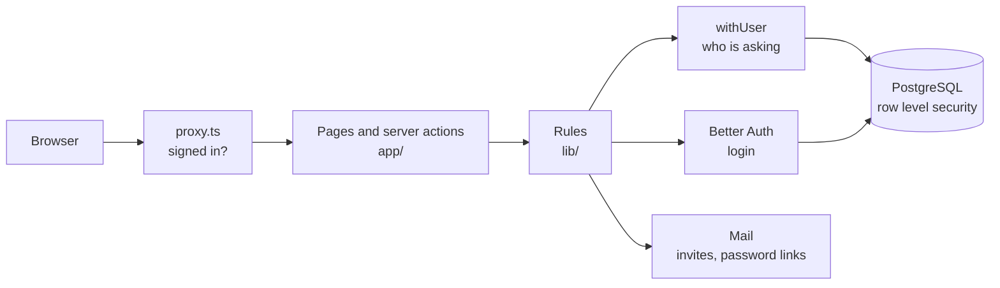

# Architecture

How the ERP is put together, as built so far (Foundation slices 1 to 5). Part of [[Holding ERP]]. The words follow the [[Glossary]]. What each slice adds is in [[Foundation Module]], the order of work in [[Pandu Roadmap]], and how we work in [[Workflow]].

Code: GitHub `jingaega/PT-SERIO-ERP`. File paths below are in that repo.

## The big picture

One Next.js app and one PostgreSQL database serve all 6 companies. Every company record carries its company, and the database itself keeps companies apart (see [[#Company isolation]]). Each company only looks different through its [[#Companies and themes|theme]].

A request goes like this:
1. The [[#Login|proxy]] sends anyone without a login cookie to the sign in page
2. The page or server action finds the person's [[#Access and permissions|access]] in the company from the address (`/pandu/...`)
3. The rules in `lib/` check the [[#Access and permissions|permission]], then read or write through [[#Company isolation|withUser]]
4. PostgreSQL returns or changes only rows of companies that person may see

## Stack

| Part | Tool | Why |
|---|---|---|
| App | Next.js 16, TypeScript | Screens and server code in one project. Server actions handle saves |
| Database | PostgreSQL 16 | Local in Docker now, AWS (RDS, Jakarta) later. Decided in [[Holding ERP#Decisions]] |
| Database code | Drizzle ORM | Tables in `db/schema`, migrations in `db/migrations` |
| Login | Better Auth | Email or Employee ID, forgot password, two-step login. See [[#Login]] |
| Screens | Tailwind CSS 4, shadcn/ui | Colors come from the [[#Companies and themes|company theme]] |
| Tests | Vitest | See [[#Tests and CI]] |
| Mail | nodemailer, Mailpit locally | See [[#Mail]] |

## Main components

### Companies and themes
- The 6 companies live in the `companies` table, seeded from `db/group-companies.ts`. Serio is the holding, Pandu the baseline
- Each company has a [[Glossary#Group and access|theme]]: colors in `app/themes.css`, logo in `public/logos`. The page sets `data-company` on the whole screen, so every component picks up that company's colors
- The company picker (`/`) lists only the companies you have [[#Access and permissions|access]] to. With exactly one, login takes you straight in
- Pages for one company live under `app/[company]/`. The company layout turns away anyone without access ("You don't have access to this company")

### Login
- Better Auth (`lib/auth.ts`) handles passwords, sessions, forgot password and two-step login. Sign up is off: accounts are only made by the seed or by an admin ([[#Users and roles screens]])
- Sign in with email or Employee ID (`lib/auth-flow.ts` turns either into the account)
- Super Admin and Super User must set up two-step login with an authenticator app before they can open anything (`lib/session.ts`)
- A deactivated account gets no new session (hook in `lib/auth.ts`), see [[#Users and roles screens]]
- `proxy.ts` only checks that a login cookie exists. The real check is on every page (`requireSession`)
- Login tables (users, sessions, accounts) are not under [[#Company isolation]], because login has to work before anyone is known

### Access and permissions
- An [[Glossary#Group and access|access]] row gives a user a role in one company. One user can have access to several companies. Several roles in one company are allowed by the database, the screens give one (open question in [[Foundation Module]])
- A [[Glossary#Group and access|role]] belongs to one company and has a list of permissions. The 6 role templates and the permission list are in `lib/permissions.ts`
- What someone may do in a company is their abilities: their holding role (if any) plus the permissions of their roles there
- `can()` decides what a screen shows. `requirePermission()` stops a change. Super Admin passes every check, Super User only view checks
- Every function that changes company data takes an Actor: the person, the company and their abilities. It checks its own permission, so the check sits with the rule and is tested with it
- Permissions are the app's check. [[#Company isolation]] is the database's check underneath. Both must agree

### Company isolation
The most important part: even a bug in the app can't show one company's data to another.
- The app connects as a limited database user (`serio_app`). The owner user is only for migrations, the seed and test setup, because it skips the rules
- Each request runs inside `withUser` (`lib/db-context.ts`), which tells PostgreSQL who is asking for that one transaction only, so shared connections never mix people up
- Row level security rules on every company table (`db/migrations/0005_company-isolation.sql`):
  - Read: Super Admin and Super User see every company, others only companies they have [[#Access and permissions|access]] to
  - Change: Super Admin everywhere, Super User never, others only their own companies
- Every new company table copies this pair of rules and gets a test like `tests/company-isolation.test.ts`

### Users and roles screens
Settings in each company, built in slice 5. Account and access admin, not HR (see [[Glossary#Group and access|User and Employee]]).
- **Users**: everyone with access, search, Add User, and Manage per person (change role, remove access, give access back)
- **Add User**: a new email gets an account and an email with a link to choose a password (3 days). An email that already has an account in another group company just gets access here. All saved in one transaction (`lib/users.ts`, `lib/accounts.ts`)
- **Deactivate**: Super Admin only. The account can't sign in anywhere and is signed out at once. Reactivate undoes it
- **Roles**: a tick grid of permissions per role, saved per company (`lib/roles.ts`)
- Every change goes through [[#Access and permissions|requirePermission]] and [[#Company isolation|withUser]]

### Mail
- `lib/mail.ts` sends through SMTP. Locally Mailpit catches every email (open it from `docker compose`)
- Used for forgot password ([[#Login]]) and invites ([[#Users and roles screens]]). An invite that fails to send never loses the new account: the admin is told to use "Forgot password?"

### Database, migrations and seed
- Tables are defined in `db/schema`, changes become migrations with `pnpm db:generate`, applied with `pnpm db:migrate`
- `pnpm db:setup` migrates, creates the app's limited database user and seeds
- The seed (`db/seed.ts`) makes the companies, permissions, the 6 roles per company and the holding accounts. Running it again never undoes changes made on the Roles screen
- Demo users exist only outside production: PDT-00001 Pandu viewer, PDT-00002 staff in Pandu and Anggoan, PDT-00003 Pandu company admin
- Data types follow the house rules: money and quantities as exact numbers, timestamps with time zone

### Tests and CI
- Vitest tests in `tests/`, run against a real seeded database. They cover the rules: [[#Company isolation]] (one company can't read or change another's rows), [[#Access and permissions]] (viewer and Super User refused), [[#Login]] and the [[#Users and roles screens]]
- Tests only change people and companies they make themselves, because test files run at the same time
- GitHub Actions runs lint, typecheck, database setup, tests and build on every push
- Every slice is also clicked through in a real browser, and then gets the strict code review ([[Workflow]])

## Not built yet
- Master data: items and UoM, customers, vendors (slices 6 to 8 in [[Foundation Module]])
- Real-time lists (slice 9)
- Business modules, starting with [[Sales and Marketing Module]] and [[Procurement Module]]
- Intercompany documents (see [[Holding ERP#Intercompany rules]]), not before it is discussed
- Hosting on AWS. Known limits to fix before more than one server runs are in [[Foundation Module#Known issues]]
