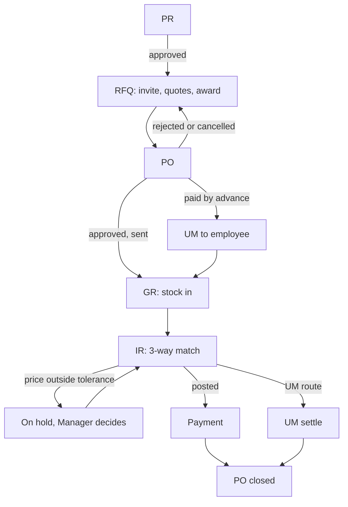
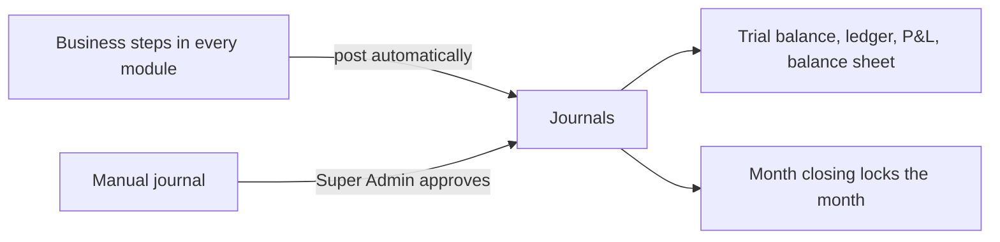
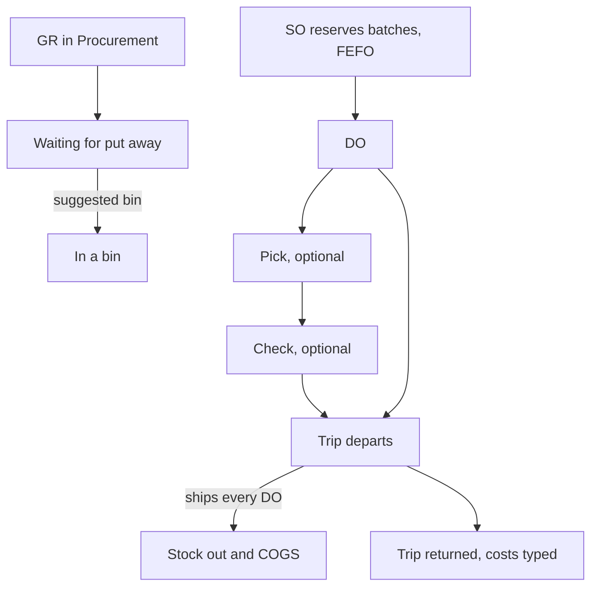
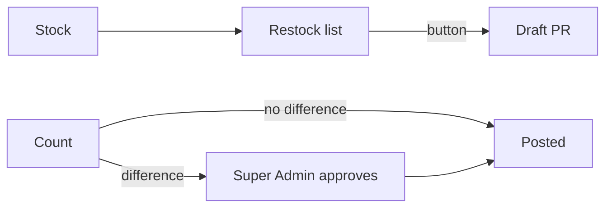
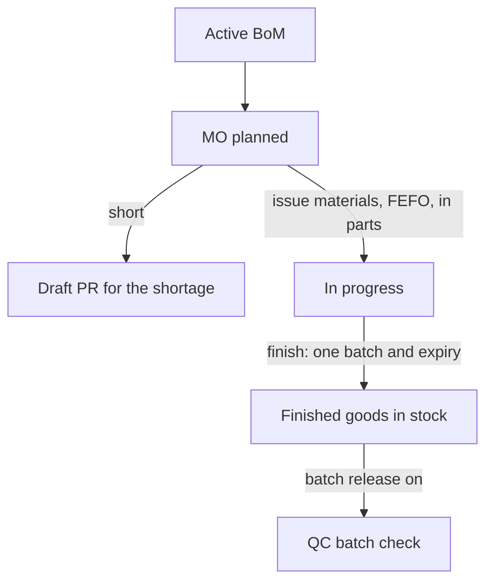
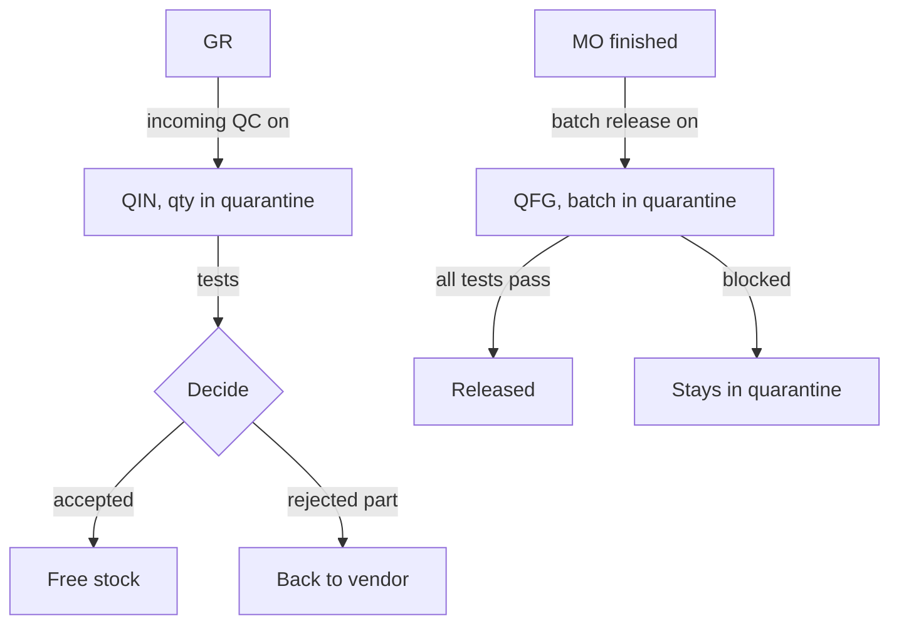
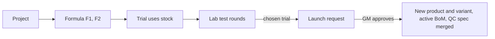
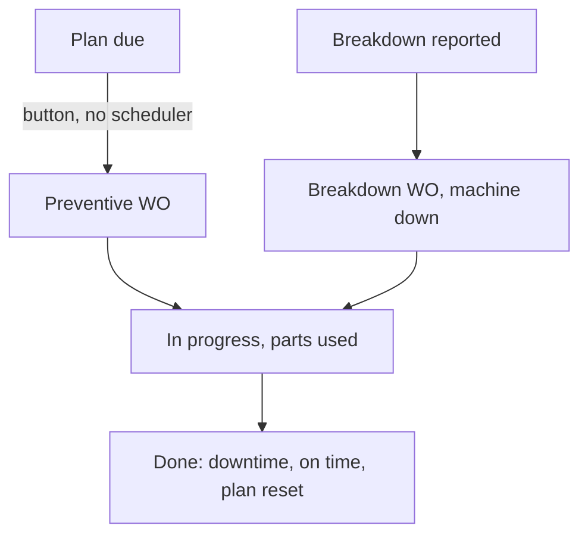

# Colleague Architecture

How the colleague's repo `Difsyy/Serio-Intern` builds the modules we have not built yet. Read on 2026-10-21. Part of [[Holding ERP]]. Our own built code is in [[Architecture]], and why we keep his repo as reference only is in [[Colleague Repo Comparison]].

> [!warning] Reference, not rules
> Everything here is the colleague's design. His rules were mostly written by Claude Code and confirmed by his own user, not by our supervisor. Use it for ideas and as a checklist of what a module needs. A rule from here only counts once Jingga or the supervisor confirms it in the module's own note. Where his design clashes with ours, see [[Colleague Repo Comparison#Clashes found 2026-10-21]].

Where to find it: his SQL is in `supabase/migrations`, his screens in `app/[company]/(shell)/<module>`, his logic in `modules/<module>`, and his plans and decision log in `docs/`. His stack is Supabase, so none of it can be copied as is (we use plain PostgreSQL, Drizzle and Better Auth).

## Contents
- [[#Shared engines]]
- [[#Procurement]]
- [[#Finance A&T]]
- [[#WMS]]
- [[#IMS]]
- [[#Production]]
- [[#Quality]]
- [[#RND]]
- [[#Engineering]]
- [[#MMS]]
- [[#HR]]
- [[#GA]]
- [[#Integrated System]]

## Shared engines
Every module below leans on these five. We have none of them yet, so each one is a Foundation piece to plan before the first module that needs it.

### Who does what
- Levels: GM, Manager, SPV, Lead, OPR, plus a Company Admin switch for Settings. **No Director level**: directors are Super Users. We kept Director (see [[Foundation Module]])
- Each person is in one department with a function. A person gets their level's rights for every function plus extra rights for their own department's function. Functions he added module by module: management, procurement, sales, warehouse, finance, hr, production, general affairs, quality, rnd, engineering, maintenance. No marketing
- Every "view" right goes to every level in every department. This is why cost is visible to Sales in his repo
- OPR, Lead and SPV see their own department's documents. Finance and management see the whole company's
- SPV and Lead never approve

### Approvals
One shared engine for every document type: a request with steps, an inbox, and notifications.
- Rules per document type and amount band, up to 5 steps. The approver is "the department's manager", "the GM" or "the Super Admin". The settings screen refuses gaps between bands
- No rule that matches means the document is approved at once
- Approve, reject (needs a comment) or return (needs a comment, goes back to draft)
- The approver can never be the requester, and a Super User can never approve
- Default bands, his choice:

| Documents | Who approves |
|---|---|
| PR, PO, payment, UM, cash advance, asset disposal, GA bill | Up to Rp 5 jt the department's Manager, up to Rp 25 jt the GM, above that the Super Admin (one step) |
| Invoice on hold, quote below margin, SO credit hold, overtime, claim, leave, assessment, loan step 1 | The department's Manager, or the GM when the department has no other manager |
| Manual journal, stock count, payroll, payroll reopen, THR, bonus, promotion, loan step 2 | Super Admin |
| R&D launch | GM |
| Engineering change, engineering project | Manager, then GM when it touches a product or costs money |

### Document numbers
- `{DOC}-{COMPANY CODE}-{YYYY}-{MM}-{####}`, like `PO-PDT-2026-10-0012`. Counter per company, document type and month, up to 9999. The date is the document's date
- Master records use plain counters: `C-0001` customers, `AST-0001` assets, `MCH-0001` machines
- Prefixes: PR, RFQ, PO, GR, IR, PAY, UM, JE, MJ, SQ, SO, DO, PI, RET, TRP, TRF, STC, MO, QIN, QFG, RND, TRL, RLA, ECR, EPR, WO, CTR, OT, CLM, PRL, PRP, LN, CA, THR, BNS, CMP, PRM, LV, ATK, GAR, BIL, ADP, AHO

### Journal engine
- Every business step posts its own journal in the same transaction as the step. A journal must balance (debit = credit, at least 2 lines, not zero), checked by the database when the transaction ends
- Posted lines never change. A correction is a reversal journal (debit and credit swapped), dated today, and the original is marked reversed
- A closed month refuses new journals dated in it. Reversals still work because they are dated today
- Accounts are reached through named mappings (INVENTORY, GRIR, AP, BANK and so on), so each company can point a mapping at its own account
- Lines can carry a cost center and a partner (vendor, customer or employee)

Starter chart of accounts, his choice:

| Code | Account | Code | Account |
|---|---|---|---|
| 1-1100 | Cash | 2-1100 | Accounts payable |
| 1-1200 | Bank | 2-1200 | GR/IR clearing |
| 1-1300 | Accounts receivable | 2-1300 | VAT out |
| 1-1400 | Inventory | 2-1400 | Customer deposits |
| 1-1410 | Goods in transit (GIT) | 2-1500 | Employee claims payable |
| 1-1420 | Costs to be capitalised | 2-1600 | Salaries payable |
| 1-1430 | Work in progress | 2-1700 | PPh 21 payable |
| 1-1500 | Employee advances (UM and cash advance) | 2-1800 | BPJS payable |
| 1-1510 | Employee loans | 4-1000 | Sales revenue |
| 1-1600 | VAT in | 5-1000 | COGS |
| 1-2000 | Fixed assets | 5-2000 | Purchase price variance |
| 3-1000 | Share capital | 5-3000 | Inventory adjustment |
| 3-2000 | Retained earnings | 6-1000 to 6-5000 | Expenses (general, office supplies, utilities, maintenance, salaries, BPJS, THR, R&D) |

### Stock and costing
- One stock ledger for every module. Rows are only ever added. Each row is in or out, with item, location, batch, expiry, qty and cost
- A balance per item, location and batch holds on hand, reserved and quarantine. Free stock = on hand minus reserved minus quarantine
- **Moving average cost, one per item for the whole company** (not per location). Stock in updates it, stock out uses it
- **FEFO**: every issue takes the batch with the earliest expiry first. Batches with no expiry go in alphabetical batch order, not by arrival date
- Batch and expiry are switched on per item. Off by default
- Movement types: receipt from PO, receipt cancel, customer return, delivery, transfer out and in, count adjustment, production issue and receipt, office supplies issue, R&D issue, vendor return, maintenance issue and return

## Procurement
Our spec: [[Procurement Module]].

**Covers:** purchase request, sourcing (RFQ), purchase order, goods receipt, invoice receipt with 3-way match, payment, employee advance (UM), reports, vendors.

### Records and statuses
| Record | Statuses | Notes |
|---|---|---|
| Purchase request (PR) | draft, submitted, approved, rejected, cancelled | Need date, department, cost center, purpose. Line prices default to the last purchase price. Only the creator submits |
| RFQ | open, awarded, cancelled | One per PR. Vendors are invited, each gives a quote per line (empty means can't supply). Award needs every line priced, and a reason if it isn't the cheapest |
| Purchase order (PO) | draft, submitted, approved, sent, rejected, cancelled, closed | Made from the awarded quote. Only the draft can be edited, never prices. Rejected or cancelled reopens the RFQ. Closes by itself when everything is received, invoiced and paid |
| Goods receipt (GR) | posted, cancelled | Qty up to what is still open (no over receipt), batch and expiry, Surat Jalan number, photos |
| Invoice receipt (IR) | on hold, posted, rejected, cancelled | Matched per GR line. Price outside the tolerance goes on hold for the Manager. Same vendor invoice number can't be entered twice |
| Payment | submitted, approved, paid, reconciled, rejected, cancelled | One payment pays one invoice, fully or partly. Reconciled is final |
| Advance (UM) | submitted, approved, paid, settled, rejected, cancelled | An employee gets cash to buy for one PO. One per PO, and then the PO can't also be paid through Payments |
| Vendor | draft, active, blocked | Typed code, one time online sellers can be quick added while sourcing |

### Flow

### Journals
| Step | Debit | Credit |
|---|---|---|
| GR | Inventory, fixed asset, costs to be capitalised or expense, by item type and cost center | GR/IR clearing, or GIT when the PO is marked in transit |
| IR | GR/IR clearing (received value), price variance (difference), VAT in | Accounts payable |
| Payment | Accounts payable | The bank's account |
| UM payout | Employee advances | Bank |
| UM settle | Accounts payable | Employee advances, plus bank for the difference (either way) |
| UM cancelled after payout | Bank | Employee advances |
| Cancel GR, IR or payment | Reversal of the step's journal | |

- Moving average cost uses the PO price before PPN. An invoice price difference goes to price variance and never changes the average
- Bank reconciliation is only a mark with the statement date, no journal

### Who does what
- PR: anyone. RFQ and PO: procurement. GR: procurement and warehouse. IR, payment and UM: procurement and finance
- Cancelling (reversing) GR, IR, payments and UM is allowed from OPR up
- Approval bands as in [[#Approvals]]

### His defaults (not confirmed)
- Invoice price tolerance 0 %, changeable per company
- Payment terms CBD or Net 0 to 365 days, starter list CBD, Net 14, 30, 45, 60
- PPN 12 % on a tax base of 11/12 (so 11 %). PO tax: PPN for normal vendors, none for one time online sellers
- IDR only
- At most 10 attachments per document
- AP aging buckets: not due, 1 to 30, 31 to 60, 61 to 90, over 90 days

### Needs from other modules
Items and stock ([[#Stock and costing]]), the journal engine, approvals, numbering. Feeds the production price list (a posted invoice updates the vendor's material price) and incoming QC.

## Finance A&T
Our spec: [[Finance Accounting Tax Module]].

**Covers:** chart of accounts and mappings, bank accounts, manual journals, journal list, trial balance, ledger, profit and loss, balance sheet, month closing, bank reconciliation.

### Records and statuses
| Record | Statuses | Notes |
|---|---|---|
| Account | active, inactive | Code like 1-1100, type asset, liability, equity, revenue, expense. Headings group postable accounts. Type is locked once it has lines |
| Account mapping | | Names a job (INVENTORY, AP, BANK...) and points it at an account |
| Bank account | active, inactive | One asset account each |
| Manual journal (MJ) | draft, submitted, posted, rejected, cancelled, reversed | Memo, at least 2 lines, must balance, date not in the future. Approved by the Super Admin |
| Period (month) | open, closed | Only a finished month can close. Refused while a manual journal of that month waits for approval. Reopening needs a reason |

### Flow

### Who does what
- Every finance level, OPR included, can edit accounts, banks and periods, and reverse a manual journal
- Automatic journals never need approval. Only manual ones do

### Not in his repo
Cost control and analysis, tax analysis, marketing, production and distribution cost, cost structure, salary structure (the parts in our general idea), PPh 23 on purchases, other currencies, DL and FOH costing, SPPR.

## WMS
Our spec: [[WMS Module]].

**Covers:** bins and put away, picking and checking, trucking (vehicles, drivers, trips), hubs and transfers between locations. Receiving (GR) stays in Procurement.

### Records and statuses
| Record | Statuses | Notes |
|---|---|---|
| Location | active, inactive | Kind warehouse, hub or office |
| Bin | active, inactive | Code per location, free text zone. Can't be switched off while it holds goods |
| Pick | | Per DO line: bin, batch, qty. Every line must be picked in full |
| Vehicle, driver | active, inactive | Plate number, capacity, STNK and KIR expiry, licence expiry. Expiry warns 30 days ahead, never blocks |
| Trip (TRP) | planned, loading, on road, returned, cancelled | Prepared DOs of one location, at most one live trip per vehicle or driver per day, date at most 7 days back. Costs: fuel, toll, allowance, other |
| Transfer (TRF) | in transit, received | Free stock only. Shortage on receipt needs a reason. No draft, approval or cancel |

### Flow

### Journals
| Step | Debit | Credit |
|---|---|---|
| DO ships (or the trip departs) | COGS | Inventory, at moving average |
| Transfer sent | GIT | Inventory |
| Transfer received | Inventory (what arrived), inventory adjustment (what is short) | GIT |

Trip costs are recorded but not posted to the books.

### His defaults (not confirmed)
- Bin suggestion: a bin with the same item and batch first, then the same item, then the first empty bin
- Picking takes the largest bin first, not FIFO or FEFO by bin
- No pack step. Pick and check are optional
- No QR or barcode scanning anywhere

## IMS
Our spec: [[IMS Module]].

**Covers:** items, stock per location, batch and bin with a stock card, blind stock counts, restock list, inventory analysis.

### Records and statuses
| Record | Statuses | Notes |
|---|---|---|
| Item | active, inactive | Type inventory, fixed asset, cost, expense, service. Class raw material, packaging, WIP, finished good, spare part, other. Batch and expiry switches. Reorder point, safety stock, order up to, lead time |
| Stock count (STC) | counting, submitted, posted, rejected, cancelled | Blind: the system qty is written only when the count is submitted. One open count per location. Any difference needs Super Admin approval |

### Flow

### Journals
| Step | Debit | Credit |
|---|---|---|
| Count finds more | Inventory | Inventory adjustment |
| Count finds less | Inventory adjustment | Inventory |

### His defaults (not confirmed)
- Restock: to order when available plus on order is at or below the reorder point. Suggested qty = order up to (or 2 x reorder point) minus that. Urgent at or below safety stock. **Every item makes a PR, finished goods too**
- ABC: A up to 80 % of value, B up to 95 %, C the rest, counted on sales only
- Aging buckets 0 to 30, 31 to 90, 91 to 180, over 180 days. Slow moving = not sold in 90 days. Expiring soon = 90 days
- Turnover and days of inventory use COGS from deliveries only
- Items are managed by procurement, warehouse and production

## Production
Our spec: [[Production Module]].

**Covers:** material price list, products and variants, BoM with versions, production orders, production reports. No planning, machines or shifts on the order.

### Records and statuses
| Record | Statuses | Notes |
|---|---|---|
| Material price | current, stopped | Per vendor, item and buying unit, with contents (1 drum = 200 kg) giving a base price. History kept. Updated by posted vendor invoices. Excel import |
| Product | | Groups variants. Each variant is its own finished good item |
| BoM | draft, active, archived, cancelled | Batch size and output qty, lines with qty per batch and loss %. One active BoM per item. Only drafts change |
| Production order (MO) | planned, in progress, done, cancelled | Needs the item's active BoM. Planned material = qty x (1 + loss) x batches. Cancel only while planned |

### Flow

### Journals
| Step | Debit | Credit |
|---|---|---|
| Issue materials | Work in progress | Inventory |
| Finish | Inventory (finished good) | Work in progress |

- Finished good cost = materials issued divided by qty made. **Materials only, no labour or overhead**
- BoM cost on screen uses the moving average, with margin on the selling price

### His defaults (not confirmed)
- No approval on BoMs or MOs
- No output tolerance, partial finish, scrap, by product or return of unused material. Mistakes are fixed with a stock count
- Yield under 98 % shows in orange
- The batch number is pre filled with the MO number

## Quality
Our spec: [[Quality Module]].

**Covers:** QC specs per item, incoming QC on goods receipts, batch release of finished goods with a COA, vendor reject rates. Not customer returns (those stay in Sales in his repo).

### Records and statuses
| Record | Statuses | Notes |
|---|---|---|
| Spec parameter | active, inactive | Per item. Range (min, max, unit) or text target. Changes keep history |
| Incoming inspection (QIN) | waiting, accepted, rejected, partial, cancelled | Opens on a GR when incoming QC is on and the item is raw material, packaging or finished good. The qty sits in quarantine |
| Batch inspection (QFG) | waiting, released, blocked, cancelled | Opens when an MO finishes and batch release is on |
| Settings | | Incoming QC on or off, batch release on or off. **Both off by default** |

### Flow

### Journals
| Step | Debit | Credit |
|---|---|---|
| Rejected qty back to vendor (only what is not invoiced yet) | GR/IR clearing or GIT | Inventory |

### His defaults (not confirmed)
- Range results are judged by the system, text results by hand. Any failed test fails the inspection
- Accepting despite a failed test needs a note. A batch with a failed test can't be released
- A blocked batch stays in quarantine forever, no rework or write off flow
- Reject rate = value rejected divided by value inspected
- Quality staff record, the Quality Manager edits specs and settings, the Quality Manager or GM releases batches

## RND
Our spec: [[RND Module]].

**Covers:** R&D projects with stages, formulas with versions, trials that use real stock, lab test rounds (including storage tests), launch into production.

### Records and statuses
| Record | Statuses | Notes |
|---|---|---|
| Project (RND) | idea, formulation, trials, review, launched, stopped | Kind new product, improvement, cost reduction. Target cost, price and launch date. Stages move freely until launched or stopped (stopped needs a reason) |
| Formula | | Versions F1, F2 with batch size and lines. Locked once a trial uses it |
| Trial (TRL) | open, promising, failed, chosen | At most one chosen per project |
| Test round | pass, fail, incomplete | Storage days and storage (room, warm, cold) |
| Launch (RLA) | submitted, approved, rejected, returned, cancelled | GM approves |

### Flow

### Journals
| Step | Debit | Credit |
|---|---|---|
| Trial uses materials | R&D expense (user's cost center) | Inventory |

Trials put nothing into stock. The launch does not check the lab result, R&D only sees a warning.

## Engineering
Our spec: [[Engineering Module]].

**Covers:** production lines, machines (with spare parts fitted and history), engineering change requests, engineering projects with budget, milestones and tasks.

### Records and statuses
| Record | Statuses | Notes |
|---|---|---|
| Production line | running, stopped, retired | Capacity per hour, products it makes |
| Machine | running, down, retired | `MCH-0001`, maker, model, serial, year, power, technical data. Can point to a GA asset. Down and retired need a reason |
| Change request (ECR) | submitted, returned, rejected, approved, implemented, cancelled | Kind BoM, spec, packaging, machine, other. Cost per unit (negative = saving) and one off cost. Implementing only links a BoM version made in Production |
| Project (EPR) | submitted, returned, rejected, approved, done, cancelled | Improvement, installation, new line. Budget, milestones, tasks. Can make draft PRs. Shows ordered vs budget |

### Who does what
- Engineering staff make and submit. The Manager approves, then the GM when the change touches a product or costs money
- Engineering, production and quality can see machines, changes and projects

## MMS
Our spec: [[MMS Module]]. In his repo MMS is **Maintenance**, its own module and department, separate from Production.

**Covers:** machine hour readings, preventive plans (by days or hours), work orders for breakdowns and preventive jobs, spare parts used, KPIs.

### Records and statuses
| Record | Statuses | Notes |
|---|---|---|
| Hour reading | | One per machine per day, never goes down |
| Plan | active, inactive | Every N days or N hours, checklist, technician, usual parts. Shows overdue, due, soon, ok |
| Work order (WO) | open, in progress, done, cancelled | Breakdown or preventive, priority, checklist. A breakdown marks the machine down until done. Done needs a note |

### Flow

### Journals
| Step | Debit | Credit |
|---|---|---|
| Parts used | Maintenance expense (user's cost center) | Inventory |
| Parts returned | Inventory | Maintenance expense |

### His defaults (not confirmed)
- "Soon" = within 10 % of the interval
- KPIs over 30, 90 or 365 days: down minutes, MTTR, MTBF, availability, preventive on time, parts cost
- No approval and no notifications on work orders
- Maintenance is done in house. Outside work goes through a PR

## HR
Our spec: [[HR Module]]. His HR follows the same list as Jingga's Inbox notes there (16th to 15th, pay on the 25th, BPJS and PPh 21 optional, loans, cash advance declaration, meal and transport, THR, grade points), so both probably come from the same source document.

**Covers:** employees and profiles, contracts, GPS attendance, overtime, expense claims, payroll, pay changes, loans, THR and bonus, cash advances, grades and promotions, leave.

### Records and statuses
| Record | Statuses | Notes |
|---|---|---|
| Employee | active, inactive | Number `PDT-00001` style, always generated. Profile: NIK, PTKP status, NPWP, BPJS numbers, bank, emergency contact. A login is given to an employee. Leaving suspends the login |
| Contract (CTR) | active, ended, cancelled | PKWT or PKWTT, base pay, allowances, 5 or 6 day week. One active per employee, never edited, a new one ends the old. Probation only on PKWTT, at most 3 months. PKWT at most 5 years |
| Attendance | present, absent, not in, off, holiday, leave | GPS check in and out against work locations (default radius 100 m). Outside is allowed but flagged. HR corrects |
| Overtime (OT) | submitted, returned, approved, rejected, cancelled | One per day, warns above 4 hours |
| Claim (CLM) | submitted, approved, paid | Transport, travel, other. Paid now by bank or with the salary |
| Payroll run (PRL) | draft, submitted, approved, paid, rejected, cancelled | Period 16th to 15th, pay date 25th. Sent only after the period is closed. Reopening needs approval |
| Pay change | | Every change to base, meal, transport or other keeps old and new, reason and source. Pay in force on the 15th applies |
| Loan (LN) | submitted, approved, active, settled | No interest, paid back from salary |
| THR or bonus run | like payroll | THR has the holiday date. HR can override the formula with a note |
| Cash advance (CA) | submitted, approved, paid, declared, to return, to pay, settled | The declaration decides who pays back |
| Grade, assessment, promotion | | Career paths, points per grade, +1, +0.5, -1 scoring. Next grade only. A promotion writes a pay change |
| Leave (LV) | submitted, returned, approved, rejected, cancelled | Working days only. Annual can't go below 0. Policy edited by the Super Admin only |

### Journals
| Step | Debit | Credit |
|---|---|---|
| Claim approved | Expense | Employee claims payable |
| Claim paid | Employee claims payable | Bank |
| Payroll approved | Salaries, BPJS employer, claims payable | Salaries payable, PPh 21 payable, BPJS payable, employee loans (installments) |
| Payroll paid | Salaries payable | Bank |
| Loan paid out | Employee loans | Bank |
| THR or bonus | THR and bonus expense | Salaries payable, PPh 21 payable |
| Cash advance out | Employee advances (same account as procurement UM) | Bank |
| Cash advance declared | Expenses | Employee advances, then bank either way for the difference |

### Indonesian rules he codes (check yearly)
- **BPJS:** Kesehatan 4 % company, 1 % employee, wage capped at Rp 12 jt. JHT 3.7 % and 2 %. JP 2 % and 1 %, capped at the 2025 figure. JKK 0.24 % (lowest risk class) and JKM 0.3 %, company only. Wage = base plus fixed allowances
- **PPh 21 with TER** (PP 58/2023): categories A, B, C by PTKP status. January to November: TER rate x gross. December: the yearly Pasal 17 sum minus what was withheld, can be a refund. Not handled: no NPWP surcharge, people leaving mid year, daily workers
- **Overtime** (PP 35/2021): hourly rate = monthly wage / 173. Work day: first hour x 1.5, then x 2. Rest day or holiday: x 2, then x 3, then x 4 (the hour cut offs depend on a 5 or 6 day week). Paid per minute actually attended. Some staff can be marked not entitled
- **THR** (Permenaker 6/2016): 12 months or more = 1 month's wage, less = pro rata, under 1 month = none. Warns if paid less than 7 days before the holiday
- **Leave:** 12 days after 12 months, carry over to 31 March, cuti bersama taken from annual. Marriage 3, child's marriage 2, circumcision 2, birth 2, bereavement 2 or 1, maternity 3 months, unpaid. The 6 month maternity option from UU KIA 4/2024 is not in

### Who does what
- HR department for HR records. Payment steps (marking paid) belong to Finance
- Attendance is HR only, even the GM can't see it
- Payroll, THR, bonus and promotions are approved by the Super Admin

## GA
Our spec: [[GA Module]]. GA is its own department, not HR.

**Covers:** asset register, office supplies (ATK), repair requests, room and car bookings, company documents with reminders, utility bills.

### Records and statuses
| Record | Statuses | Notes |
|---|---|---|
| Asset | in use, in storage, disposed | `AST-0001`, category, purchase cost, location, room, department, holder, condition. Fixed asset GR lines show as "to register". Handover makes a BAST PDF |
| Disposal (ADP) | approval by amount band | |
| Supply request (ATK) | submitted, issued, rejected, cancelled | No approval. Issued from an office location |
| Repair request (GAR) | open, in progress, done, closed, reopened, cancelled | The reporter confirms to close. Can make a draft PR |
| Booking | booked, returned, cancelled | Rooms and office cars, no double booking. Odometer and fuel |
| Company document | active, replaced, ended | Licences and contracts, reminders 60, 30, 7 days before expiry. Also vehicle STNK and KIR |
| Bill (BIL) | submitted, approved, paid, rejected, cancelled | One per account and month (electricity, water, internet...) |

### Journals
| Step | Debit | Credit |
|---|---|---|
| Supplies issued | Office supplies expense (department) | Inventory |
| Bill paid | The bill's expense account (department) | Bank |

No depreciation. Assets are a register only.

## Integrated System
Our spec: [[Integrated System Module]]. His repo has no module by that name. The closest pieces:
- **Approvals inbox:** one list of everything waiting for me, from every module
- **Notifications:** an in app bell. Made by the database when an approval step waits, is approved, returned, rejected or cancelled. Kept 90 days
- **My Workspace:** one read only page per person: my approvals, my requests, my supplies, repairs and bookings, my attendance, my assets, my leave balance
- **Holding dashboard:** only company cards so far. Planned: open PR and PO, sales this month, AR, AP and stock value per company, group totals, group reports
- **Links between modules** are made by each step itself (a GR posts stock and a journal, a shortage makes a draft PR), not by a separate layer. Things that make draft PRs: restock, SO shortage, MO shortage, engineering projects, work orders, GA repairs and supplies
- **Excel import:** checks every line, all or nothing, at most 2000 lines. We already have the same idea for vendors
