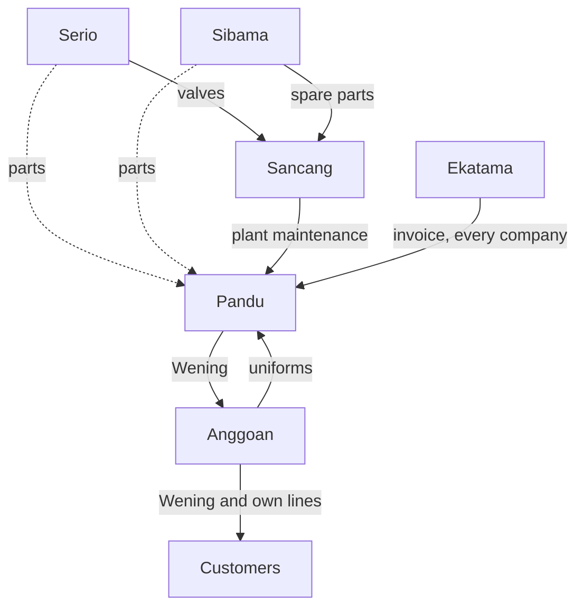

# Company Roles and Modules

Part of [[Holding ERP]] and [[00 Start Here]]. This is my best reading based on what each company does plus what I was told. Anything marked *(assumed)* still needs a confirm.

**Key:** FA = Finance Accounting, HC = Human Capital, GA = General Affairs (together: FAHCGA)

## Quick overview

| Company                           | Role                                  | Main modules                                                     |
| --------------------------------- | ------------------------------------- | ---------------------------------------------------------------- |
| [[PT Pandu Dwiloka Teknik]]       | System owner, manufacturer            | All                                                              |
| [[PT Serio Prima Indotek]]        | Valve maker and machining *(assumed)* | Sales & Marketing, Procurement, Production, Warehouse, Inventory |
| [[PT Siar Bagja Maraloka]]        | Spare parts trader *(assumed)*        | Sales & Marketing with POS, Procurement, Warehouse, Inventory    |
| [[PT Sancang Anugerah Nusantara]] | Maintenance services and AC, HVAC     | Procurement, Sales, light Inventory                              |
| [[PT Anggoan Karya Narasena]]     | Dealer and supplier                   | Sales & Marketing with CRM and POS, stock view                   |
| [[PT Ekatama Tiara Advisindo]]    | Consultant for the group              | FA only                                                          |

## Per company

### [[PT Pandu Dwiloka Teknik]]
System owner, soap manufacturer under the brand Wening.
- Modules: all of them
- FA, HC, GA: runs its own, in full
- The 2 super users belong to the holding, not to Pandu (HR's sheet lists them as HOLDING, Jingga 2026-10-13)
- Production and Inventory need:
    - Formulas (BOM): the recipe per product (oils, fragrance, packaging, and so on)
    - Batch and expiry tracking: every batch gets a number and expiry date so a bad batch can be traced or recalled
    - QC per batch before it goes into finished goods
    - Raw material and packaging stock with reorder points
- Sells mostly to Anggoan, so most of Pandu's sales are intercompany

### [[PT Serio Prima Indotek]]
Valve maker and machining *(assumed)*.
- Modules: Sales & Marketing, Procurement, Production, Warehouse, Inventory
- FA, HC, GA: its own. GA matters because it has a plant in Cikarang
- Supplies valves to [[PT Sancang Anugerah Nusantara|Sancang]]
- Supplies parts to [[PT Pandu Dwiloka Teknik|Pandu]] _(assumed)_

### [[PT Siar Bagja Maraloka]]
Spare parts trader _(assumed)_.
- Modules: Sales & Marketing with POS (parts counter), Procurement, Warehouse, Inventory. No production
- FA, HC: its own. GA: light
- Supplies spare parts to [[PT Sancang Anugerah Nusantara|Sancang]]
- Supplies parts to [[PT Pandu Dwiloka Teknik|Pandu]] _(assumed)_

### [[PT Sancang Anugerah Nusantara]]
Maintenance services.
- Modules: Procurement (confirmed), Sales for service invoices, light Inventory for spare parts _(assumed)_
- FA, HC: its own. GA: tools and vehicles
- Buys from [[PT Serio Prima Indotek|Serio]], [[PT Siar Bagja Maraloka|Sibama]], and [[PT Anggoan Karya Narasena|Anggoan]]
- Does plant maintenance for Pandu's soap production machines and plant, which is an intercompany service

### [[PT Anggoan Karya Narasena]]
Sales and marketing arm for Wening, and also a dealer and supplier of konveksi, safety gear, and chemicals (confirmed from its website).
- Modules: Sales & Marketing with CRM and POS (confirmed)
- Own product catalog and stock, with Wening as one product line inside it
- Leads from the Wening and Anggoan websites go into its CRM
- FA, HC, GA: minimal, handled through authorization in Pandu's ERP _(assumed)_
- Sells safety gear, uniforms, and chemicals to everyone in the group, including uniforms to Pandu

### [[PT Ekatama Tiara Advisindo]] (ETA)
Consultant for the group.
- Modules: FA only (confirmed)
- Invoices every company, recorded as ETA's sales in AR

## Wening flow in the ERP
1. Anggoan orders Wening from Pandu. That's a PO from Anggoan, which automatically becomes an SO at Pandu
2. Pandu ships it. Pandu's stock goes down, Anggoan's stock goes up, and an invoice is created between them
3. Anggoan sells it to stores and customers through POS, CRM, and marketing, together with its other products
4. The holding view leaves out the Pandu to Anggoan sale. Only Anggoan's sale to outside customers counts as group revenue
## How the companies serve each other's FA, HC, and GA

Three companies naturally act as internal service providers for the group.

> [!info] FA goes to Ekatama
> Advises every company on finance, legal, and tax, and bills them for it.

> [!info] GA goes to Sancang and Anggoan
> - Sancang maintains buildings, HVAC, and electrical for everyone
> - Anggoan supplies the consumables: safety gear, uniforms, and cleaning chemicals

> [!warning] HC has nobody yet
> No company provides HR as a service. My pick: each company keeps its own HC data in Pandu's HR module, with one HR admin per company and payroll run separately, since each PT pays its own employees and taxes.

> [!info] HC goes to everyone
> Every company has their own HC data in the main ERP HR module

So in the system these show up as normal intercompany transactions:
- A company's GA needs an AC repair: it creates a PO to Sancang
- A company needs uniforms: it creates a PO to Anggoan
- Every month, Ekatama invoices them all

Dashed lines are assumed, still to confirm.

## To confirm

- [ ] Serio is a valve maker and machining company
- [ ] Sibama is a spare parts trader
- [ ] Serio and Sibama send parts to Pandu (dashed in the diagram): which parts, and for what?
- [x] ~~The 2 super users sit in Pandu~~ They belong to the holding (HR's sheet, Jingga 2026-10-13)
- [ ] Sancang needs Sales and light Inventory
- [ ] Anggoan's FA, HC, GA run through authorization in Pandu's ERP
- [ ] HC approach: one HR admin per company, payroll separate

## To update

- [ ] My deck: change Pandu from "industrial manufacturing" to "soap manufacturer (Wening)" on slide 3 and in the module table
- [ ] Daifullah's restyled deck: same change