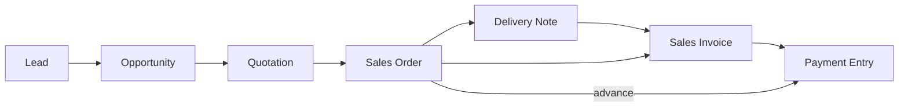
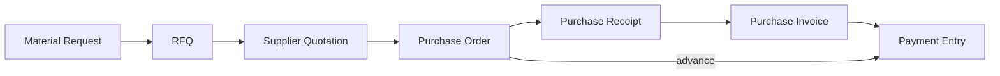
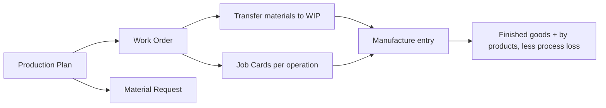

# ERPNext Architecture

How ERPNext builds the modules we need, read from its code (`frappe/erpnext` develop, 21 Oct 2026, and `frappe/hrms` for HR and payroll). Part of [[Holding ERP]]. Compared with ours and the others in [[ERP Best Practices]]. The other references: [[Odoo Architecture]], [[Colleague Architecture]].

> [!warning] Reference, not rules
> ERPNext is GPL 3.0. We take ideas only, never its code. Its defaults are one company's design choices, not rules for Pandu. A rule only counts once Jingga or the supervisor confirms it in the module's own note.

## In one page
- **Every document has three states:** draft (editable), submitted (frozen), cancelled. A wrong submitted document is never edited: you cancel it, and "amend" makes a new draft copy numbered `-1`, `-2`. Cancelling writes mirror image ledger rows instead of deleting
- **Status is worked out, not typed.** A sales order shows "To Deliver and Bill", "To Bill" or "Completed" from its % delivered and % billed. Only Closed, On Hold and Lost are set by hand
- **Documents are made from the one before.** A "make" button copies a quote into an order, an order into a delivery, and so on, and each line keeps a link back to its source line. That link drives the % delivered and % billed
- **Two ledgers carry everything:** the stock ledger (every movement, with the running cost) and the general ledger. The GL amount of a stock movement always comes from the stock ledger
- **Settings, not code, decide most rules:** tolerances, who may override, Stop or Warn
- **No Indonesian package.** Only an Indonesian chart of accounts and PPN 11 % tax templates. Nothing for e-Faktur, PPh 21, PPh 23 or BPJS

## Shared patterns

### Document numbers
- Each document type has a "naming series" like `SAL-ORD-.YYYY.-`, with variables for year, month, company abbreviation and fiscal year. Users can add or reorder series
- Returns get their own series (`-RET-`). Amended copies add `-1`, `-2`

### Approvals
- **Authorization Rule:** "documents above this amount (or discount) need this role". It is a hard block at submit: the approver has to submit the document themselves. It isn't a routed approval
- **Workflow:** configurable per document type: states, who may move it, which field changes. ERPNext ships no workflows; each company sets its own
- **Override roles in settings:** credit controller, over billing, over delivery, back dated stock, frozen accounts, budget exceptions

### Period locks (three layers)
1. **Accounting Period:** a closed period per document type, with an exempt role
2. **Accounts frozen till date:** nothing posts before it, except one role
3. **Period Closing Voucher:** zeroes the P&L into equity at year end. Nothing can post on or before it
- Optional **immutable ledger:** a cancel posts the reversal dated today instead of on the original date

### Accounting dimensions
- Cost center and project come built in. A company can add more (branch, product line). Each dimension is copied onto every GL line, can be required for some accounts, and can be filtered in reports

## Selling

| Record | Statuses | Notes |
|---|---|---|
| Quotation | Draft, Open, Partially Ordered, Ordered, Lost, Expired, Cancelled | Revisions (`revision_of`, latest one active). Expires on its valid till date by a daily job. An order from an expired quote is blocked unless a setting allows it. A lead or prospect becomes a customer when ordered |
| Sales Order | Draft, To Deliver and Bill, To Bill, To Deliver, To Pay (advance requested), Completed, Closed, On Hold, Cancelled | Credit limit checked at submit. Can reserve stock. Same rate as the quote can be enforced (Stop or Warn) |
| Delivery Note | Draft, To Bill, Partially Billed, Completed, Return, Closed | Posts stock out and COGS |
| Sales Invoice | Draft, Unpaid, Overdue, Partly Paid, Paid, Credit Note Issued, Return | Overdue set daily from the payment schedule. Can also act as the delivery (update stock) |

**Journals**

| Step | Debit | Credit |
|---|---|---|
| Delivery Note | COGS (or "delivered but not billed") | Stock |
| Sales Invoice | Receivable | Income, output tax |
| Payment | Bank | Receivable |

**Credit limit:** per customer and company, falling back to customer group then company. Outstanding = unpaid invoices + unbilled orders + unbilled deliveries. Checked at the order, or skipped there and checked at delivery and invoice. A credit controller role can pass. There is also an overdue limit.

**Pricing rules:** by item, group or brand, by customer or territory, by qty and date, with priority. Discount, special rate or free item.

## Buying

| Record | Notes |
|---|---|
| Material Request | Types: purchase, transfer, issue, manufacture. Made by hand, by reorder, or by production planning |
| RFQ, Supplier Quotation | Emailed to suppliers with a portal. Quotes expire. A supplier scorecard can block or warn new RFQs and POs |
| Purchase Order | Statuses like the sales order: To Receive and Bill, To Bill, To Receive, To Pay, Completed. Budget checked |
| Purchase Receipt | Accepted and rejected qty, rejected warehouse. Quality inspection can be required |
| Purchase Invoice | Supplier invoice number unique per year (a setting). An invoice can be put on hold until a date |

**Journals**

| Step | Debit | Credit |
|---|---|---|
| Purchase Receipt | Stock | Stock received but not billed |
| Purchase Invoice | Stock received but not billed (or expense), input tax | Payable |
| Payment | Payable | Bank |

**Tolerances:** over receipt and over billing as a %, per item or global, with a role that may go over. Over ordering against a material request too.

**Down payments:** an advance payment against the order, optionally booked to a separate "advance paid" account. The invoice picks it up later (manually or automatically) and the advance is cleared against it. There is no separate down payment invoice.

## Accounts
- **GL entries are never edited.** Cancel writes a reversal. Changing a cost center or dimension on a submitted payment rebuilds its GL through a "repost" document, only for types allowed in settings
- **Payment ledger:** one row per receivable or payable effect. Outstanding amounts are always the sum of these rows, so partial payments, advances and credit notes all add up the same way
- **Multi currency:** every amount in the document currency and the company currency. Exchange gain or loss is booked automatically when paid. **Exchange Rate Revaluation** books unrealised gains and losses at month end and reverses them the next day
- **Budget:** per cost center or project and account; Stop, Warn or Ignore on actuals, material requests and POs
- **Bank reconciliation:** import the statement, match to payments and journals, create missing entries
- **Inter company:** customer and supplier records marked "internal" and linked to the other company. Buttons create the mirror document: SO to PO, DN to PR, SI to PI, journal to journal. Back links are kept on both sides and on cancel. **There is no automatic elimination** in the consolidated report
- **Consolidation:** companies form a tree; a child copies the parent's chart. The consolidated report shows one column per company, matching accounts by name or number

## Stock
- **Stock ledger:** every movement row keeps the running qty, the cost and the value after it. It is never edited; cancel writes reversal rows
- **Back dated entries:** a background job recalculates every later row for that item and warehouse, then rebuilds their GL. This is the price of a running cost: it is complex and can be slow. Mitigations: a role for back dating, a stock frozen date, and a monthly Stock Closing Entry
- **Valuation per item and warehouse:** FIFO, moving average, LIFO, or **standard cost** (newest: fixed cost per item with an effective date, differences to purchase price variance and manufacturing variance)
- **Batches:** shelf life gives the expiry. Expired batches are blocked from use, except to write them off. Picking order is a global setting: FIFO, LIFO or **by expiry (FEFO)**
- **Traceability report:** backward and forward through production, from a finished batch to material batches and back
- **Reorder:** per item and warehouse, level and qty; a daily job makes material requests (purchase, transfer or **manufacture**)
- **Other records:** pick lists, put away rules with capacity, stock reservations, landed cost vouchers (freight and duty spread by qty or amount, then the cost is redone)

## Manufacturing

- **BOM:** versioned and submitted (frozen). Operations with workstations and hour rates, **process loss %**, and secondary items (co product, by product, scrap). Cost from valuation, last purchase or price list. A tool replaces a BOM everywhere or updates costs
- **Work order statuses:** Not Started, In Process, Completed, Stopped, Closed. Overproduction % allowed by setting. Materials taken by BOM or by what was actually moved to WIP
- **Finished good cost:** materials actually consumed + operating cost (time on job cards x hour rate) + extra costs, divided by the good qty after process loss
- **Production plan (MRP):** from sales orders or material requests, explodes the BOM, nets against projected stock and safety stock, then makes work orders and material requests. One period, not time phased

## Quality
- **Quality Inspection:** readings against a template (numeric min and max, or text, or a formula). Required per item before purchase or delivery, per BOM for finished goods, per operation in production. Missing or rejected: Stop or Warn
- **Rejected qty** goes to a rejected warehouse, valued at zero by default
- **No quarantine or batch release status.** The inspection doesn't move stock. A "QC warehouse then transfer" is a user habit, not a built feature
- **Quality management** (goals, procedures, reviews, actions, non conformance) is ISO style paperwork, **not linked** to batches, inspections or suppliers

## Assets
- **Register** with category accounts, location, custodian, movements
- **Finance books:** one depreciation schedule per book, for example "book" and "tax". Methods: straight line, double declining, written down value, manual. A daily job posts the depreciation journals. Fits PMK 72/2023 as a "fiscal" book
- **Disposal, sale, revaluation, repair** (can be added to the asset's cost), capitalisation of a composite asset
- **Asset maintenance:** preventive tasks per asset with a log

## Projects, support and service
- **Projects and tasks** with costs rolled up. **Timesheets** with billing and costing rates; billed onto a sales invoice. They post no GL themselves
- **Maintenance schedule and visit:** for servicing customers' equipment (fits Sancang)
- **Issues** with a service level agreement engine (response and resolution deadlines in working hours). Warranty claims

## HR and payroll (`frappe/hrms`)
- **Attendance from check ins:** device or phone (with location) logs, grouped per shift, become attendance automatically; late and early flags; absent filled in
- **Leave ledger:** every allocation, use, carry over and expiry is a row; the balance is their sum. Earned leave, encashment, compensatory leave. (On cancel it deletes rows instead of reversing them, a weak spot)
- **Salary structure with formulas:** components with conditions and formulas over the base pay and employee fields, effective dated per employee. "Additional Salary" is the one door for bonuses, overtime, encashment and recoveries
- **Payroll posts three journals:** accrual (expenses, deductions payable, salaries payable), employer contributions, and the bank payment
- **Income tax** is India shaped (annual projection). **PPh 21 TER doesn't fit it**: it would need its own code through the regional hook. BPJS fits as formula components, but the yearly caps would need a settings record
- **Expense claims and employee advances** with their journals; **appraisals** with goals, not linked to pay

## Patterns worth borrowing
1. Submitted documents frozen; cancel and amend; reversal rows
2. Status worked out from progress (% delivered, % billed), never typed
3. Line links back to the source line, so partial delivery and billing just add up
4. One payment ledger for outstanding amounts, including advances
5. Tolerances as settings with a role that may go over
6. Finance books for book and tax depreciation
7. Leave as a ledger of rows (with reversals, not deletes)
8. A regional hook per country for Indonesian rules

## Weak spots (don't copy)
- Back dated stock triggers big recalculations
- Authorization Rule blocks instead of routing
- Quality has no quarantine or release, and non conformance is not linked to anything
- Inter company has no elimination
- MRP is one period only
