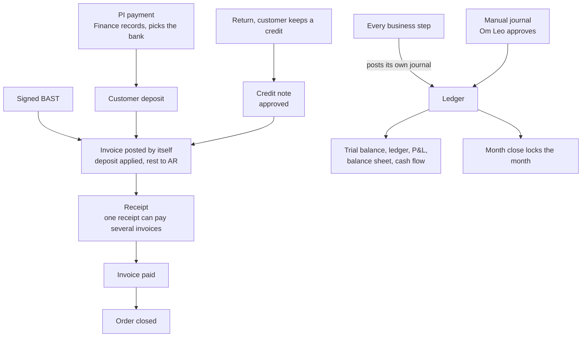

# Finance Accounting Tax Module

Phase 5 in [[Pandu Roadmap]], built before Stock and Procurement (Jingga, 2026-10-22). Part of [[Holding ERP]]. Company context is in [[Company Roles and Modules]]. All modules: [[Module Overview]].

Called Finance A&T or FAT in other notes. Part of FAHCGA, the group name for Finance Accounting Tax, HR and GA.

## Overview and scope
- **In the ERP:** chart of accounts, account mappings, bank and cash accounts, tax codes, the journal engine every module posts through, manual journals, month closing, the ledger and statements, customer deposits and refunds, customer invoices, receipts, AR aging, credit notes, bank reconciliation, PPN reporting, the actual FOH %, the Finance dashboard, marketing cost, fixed assets with depreciation, year end close
- **Built with other modules:** COGS and stock value with Stock (Phase 4, next after Finance). Vendor invoices, vendor payments, vendor down payments, GR/IR, PPh 23 and foreign currencies with Procurement. Payroll, PPh 21 and BPJS with HR. Intercompany and elimination in Phase 9
- **Which companies use it:** all 6. Pandu first. ETA uses only this module and invoices every company (Phase 9)
- **Main reference:** the colleague's built Finance ([[Colleague Architecture#Finance A&T]]), plus ERPNext, Odoo and general practice ([[ERP Best Practices#Phase 5: Money (Finance A&T)]]). His rules are ideas, not rules: each one here is ours once listed in this note

## Decisions for this module (Jingga, 2026-10-22)
- Finance comes before Procurement and Stock. After Finance the next phase is Stock
- The whole module is planned at once, mainly from the colleague's design
- One shared approval engine is built first (slice F0), and Procurement reuses it
- **A signed BAST creates and posts the customer invoice by itself**, dated the day it is signed *(ask supervisor)*
- **No COGS in the books until Stock exists.** Until then Finance posts revenue only; GP in reports uses the typed item cost as a management number
- **Chart of accounts: the colleague's starter chart, extended,** with the same codes in every company

## General idea (first notes, kept)
- Cost Control and Analyze
- Tax Analyze
- Marketing Cost
- Production Cost
- Distribution Cost
- Cost Structure
- Salary Structure

## Key terms
All terms are in [[Glossary]]: journal, account mapping, AR, customer deposit, credit note, Faktur Pajak, DPP, period.

## Records the module owns
| Record | Main fields | Statuses | Links to |
|---|---|---|---|
| Approval rule | Document type, step (1 to 5), amount band, approver | Active, Inactive | |
| Approval request | Document, amount, asked by, steps with who decided, decision, note | Pending, Approved, Refused, Returned, Cancelled | Any document that needs one |
| Account | Code like `1-1100`, name, type (asset, liability, equity, revenue, expense), heading or postable | Active, Inactive | Parent heading |
| Account mapping | Job (AR, customer deposit, sales revenue, PPN out, bank...), account | | Account |
| Bank or cash account | Bank, number, name, currency, kind (bank or cash), GL account | Active, Inactive | Account |
| Tax code | Code, rate, DPP as an exact fraction (like 11/12), valid from, for sales or purchases | Active, Inactive | |
| Journal | Number `JE-MMYY-NNN`, date, event, source document, memo, lines (account, debit or credit, department, partner) | Posted, Reversed | Source document, its reversal |
| Manual journal | Number `MJ-MMYY-NNN`, date, memo, lines | Draft, Submitted, Posted, Refused, Cancelled, Reversed | Journal, approval request |
| Period | Month | Open, Closed | |
| Deposit refund | Order, amount, bank, date, reason | Paid, Cancelled | SO, its PI payments |
| Invoice | Number `INV-MMYY-NNN`, DO / BAST, SO, customer, date, due date, tax code, subtotal, PPN, total, deposit applied, Faktur Pajak number, lines | Open, Partly paid, Paid, Cancelled (worked out) | DO / BAST, SO, journal |
| Receipt | Number `RCV-MMYY-NNN`, customer, bank, amount, day received, reference, allocations to invoices | Received, Cancelled | Invoices, journal |
| Credit note | Number `CN-MMYY-NNN`, invoice, reason (return or price correction), amount, PPN | Pending, Posted, Refused, Cancelled | Invoice, return, approval request |
| Bank statement line | Bank, date, amount, description, matched to | Unmatched, Matched | Receipt, payment or journal |
| Marketing campaign | Name, category (ATL, BTL, trade promotion, support), budget, dates | Planned, Running, Done | Expense accounts |
| Fixed asset | Code, category, cost, date in use, life and method for the books and for tax | In use, Disposed | Accounts, its depreciation lines |

## Main flow

## Business rules
| Rule | How the system enforces it |
|---|---|
| One shared approval engine | Rules per document type and amount band, up to 5 steps. A document with no matching rule is approved at once. Refuse and return need a note. Two people deciding at once can't both win |
| Nobody approves their own document | The engine refuses an approver who is the requester |
| Above Rp 100 jt: Super Admin, then a Super User | The Super Admin approves first, a Super User gives the final approval. A Super User approves nothing else. Jingga, 2026-10-14 |
| Bands up to Rp 100 jt | Up to Rp 5 jt the department's Manager, up to Rp 25 jt the GM, up to Rp 100 jt the Super Admin *(assumed, the colleague's numbers, ask supervisor)*. Changed in Settings without code |
| A journal balances | PostgreSQL refuses a journal with fewer than 2 lines, debit not equal to credit, or a zero total, when the transaction ends |
| Posted journals never change | PostgreSQL refuses any change to a line and any change to an entry except posted to reversed. A correction is a reversal journal, debit and credit swapped, dated today |
| Every step posts its own journal | The journal is written in the same transaction as the step, so the step and its journal both happen or neither does |
| Accounts through mappings | A step finds its account by job (AR, sales revenue...), so each company can point a job at its own account |
| Reversals by a Manager | Reversing a manual journal, a receipt or a PI payment needs a Finance Manager or up. Jingga, 2026-10-14 |
| Om Leo approves journals | Manual journals wait for whoever holds `journals.approve`. Om Leo holds it in every company. Automatic journals never wait *(assumed: manual only, ask supervisor)*. Jingga, 2026-10-14 |
| A closed month takes no journal | PostgreSQL refuses a journal dated in a closed month. Reversals are dated today, so they still work |
| Closing and reopening a month | Only a month that has ended can close, and not while a manual journal of it waits. Reopening needs a reason and an approval *(assumed)* |
| Same account codes in every company | The starter chart is seeded the same for all 6, so the holding view adds up without mapping |
| An account's type is fixed once used | An account with lines can't change type or become a heading. An account used by a mapping or a bank can't be switched off |
| Tax by date | A document takes the tax code valid on its date. A new rate is a new tax code row, no code change |
| PPN amount | Round(base x DPP fraction x rate, 2), per document. 11 % on the full base today *(assumed, same as the PI)* |
| PI payment goes to a bank | Recording a PI payment needs a bank or cash account. It posts Dr bank, Cr customer deposit |
| A wrong PI payment is reversed | A Finance Manager reverses it with a reason. The PI's paid amount goes down. The original row stays, marked reversed |
| Refund on a cancelled order | Money received on a cancelled order is paid back from a bank by a Finance Manager, through the approval engine |
| Signed BAST makes the invoice | Signing posts the invoice: Dr customer deposit (what is applied), Dr AR (the rest), Cr sales revenue, Cr PPN out. One invoice per BAST *(ask supervisor)* |
| Deposit applied to the invoice | CBD: the whole BAST value, so the invoice is paid at once. Progress: the down payment % of that BAST's value, the rest due on the plan's parts in order *(assumed)*. Tempo: none |
| Due date | Tempo: the signing day + the order's days. Progress: the plan's part dates. CBD: paid |
| Receipts | One receipt pays one or more open invoices of one customer, never more than they owe. Partly paid when not all |
| Order closes when paid | A tempo or progress order is Closed once every line is signed and every invoice is paid. CBD closes on the last signed BAST, as built |
| Credit check counts unpaid invoices | Exposure = live orders not yet invoiced + unpaid invoices + the new order |
| Credit note | From a return the customer won't take back, or a price correction. Approved through the engine. Posts Dr sales revenue, Dr PPN out, Cr AR (or customer deposit when the invoice is paid) |
| Invoice can't be edited once posted | It is cancelled (reversal) only while it has no receipt. The Faktur Pajak number can be added later |
| No COGS before Stock | Until Phase 4 a signed BAST posts no COGS. Then COGS posts at moving average on the signed BAST, with revenue |
| FOH | Pricing keeps the standard FOH % set by Finance. Finance sees last month's actual % from the ledger next to it. The books follow PSAK 202. Jingga, 2026-10-21 |
| Fixed asset depreciation | Two schedules per asset: the books and tax (PMK 72/2023 groups). The books post monthly |
| Year end | Revenue and expense accounts close into retained earnings |

## Handoffs to other modules
| Module | What it does for this module | Where in the flow |
|---|---|---|
| Sales | PI payments, signed BASTs, returns, cancelled orders | Deposits, invoices, credit notes, refunds |
| Marketing | Uses the FOH % and the actual FOH %, marketing cost against budget | Pricing, campaigns |
| Stock (Phase 4) | Posts COGS, stock in and out, counts, returns back to stock, opening stock | Every stock movement |
| Procurement | Posts GR/IR, vendor invoices, vendor payments, vendor down payments, PPh 23 | Buy to pay |
| HR (Phase 7) | Posts payroll, PPh 21, BPJS, claims, loans, cash advances | Payroll and claims |
| GA (Phase 7) | Asset location and holder, bills | Fixed assets, expenses |
| Holding (Phase 9) | Intercompany due to and due from, elimination, ETA's invoices to every company | Group view |

## Posting rules
| Event | Debit | Credit | Slice |
|---|---|---|---|
| PI payment received | Bank or cash | Customer deposit | F6 |
| PI payment reversed | Customer deposit | Bank or cash | F6 |
| Deposit refunded | Customer deposit | Bank or cash | F6 |
| Signed BAST, invoice | Customer deposit (applied), AR (the rest) | Sales revenue, PPN out | F7 |
| Invoice cancelled | reversal of the invoice journal | | F7 |
| Receipt | Bank or cash | AR | F8 |
| Credit note | Sales revenue, PPN out | AR, or customer deposit when paid | F9 |
| Bank charge or interest from the statement | Bank charges, or bank | Bank, or interest income | F10 |
| Depreciation | Depreciation expense | Accumulated depreciation | F15 |
| Asset disposed | Accumulated depreciation, bank, loss | Fixed asset, gain | F15 |
| Year end close | Revenue accounts | Expense accounts, retained earnings (the difference) | F16 |
| Manual journal | Free lines, balanced | | F3 |
| Signed BAST, COGS | COGS | Inventory, at moving average | With Stock |

## Starter chart of accounts
The colleague's starter chart (in [[Colleague Architecture#Journal engine]]) plus the accounts Finance needs. Same codes in every company. Pandu's real chart replaces it if one exists (open question).

| Code | Account | Code | Account |
|---|---|---|---|
| 1-1100 | Cash on hand | 2-1100 | Accounts payable |
| 1-1110 | Petty cash | 2-1200 | GR/IR clearing |
| 1-1200 | Bank | 2-1300 | PPN out |
| 1-1300 | Accounts receivable | 2-1400 | Customer deposits |
| 1-1400 | Inventory | 2-1500 | Employee claims payable |
| 1-1410 | Goods in transit | 2-1600 | Salaries payable |
| 1-1420 | Costs to be capitalised | 2-1700 | PPh 21 payable |
| 1-1430 | Work in progress | 2-1710 | PPh 23 payable |
| 1-1500 | Employee advances | 2-1800 | BPJS payable |
| 1-1510 | Employee loans | 3-1000 | Share capital |
| 1-1600 | PPN in | 3-2000 | Retained earnings |
| 1-2000 | Fixed assets | 3-3000 | Opening balance equity |
| 1-2100 | Accumulated depreciation | 4-1000 | Sales revenue |
| 5-1000 | COGS | 4-2000 | Other income (interest, FX gain, asset gain) |
| 5-2000 | Purchase price variance | 6-1000 to 6-3200 | Operating expenses (general, office, utilities, rent, repair, transport, travel, salaries, BPJS, THR) |
| 5-3000 | Inventory adjustment | 6-4000 | Marketing expense (ATL, BTL, trade promotion, support) |
| 6-5000 | Research and development | 6-6000 | Depreciation expense |
| 6-7000 | Bank charges | 6-8000 | Other expense (FX loss, asset loss, rounding) |

## Costing and pricing
From Jingga, 2026-10-14 (explaining the office whiteboard, [[2026-10-14 Whiteboard costing and pricing]]). Finance owns this model; S&M and Procurement use it. Words are in [[Glossary]].

**The parts of a product's cost**
- **COGM** (cost of goods material, here *not* "manufactured"): all the materials that make the product, like chemical + packaging + looks (sticker, cap and so on). Seen per material ("head to head") or as one sum
- **MAP** (moving average price): the costing method. Each material's price is its moving average, and those prices build the COGM
- **DL** (direct labor): what the people making it cost per month, like operator Rp 5.000.000 and factory SPV Rp 7.000.000
- **FOH** (factory overhead): electricity, water, rent and so on, per month
- **COGS** (cost of goods sold) = COGM + DL + FOH

**Margin and price**
- **GP** (gross profit, the margin) = (selling price - COGS) / selling price
- **SPPR** (selling price publish rate, HET on the whiteboard) = COGS + GP

**Two ways to work it out**
1. **Finance's way** (Finance advises with this one):
   - revenue - COGM = **VA** (value added)
   - VA - DL - FOH = GP
2. **Marketing's way**: DL and FOH are grouped as one standard rate, just called FOH. Then SPPR = COGM + % FOH + % margin. This is the same as SPPR = COGS + GP, broken down

Finance and Marketing work it out together: Finance advises from the numbers, Marketing knows the market.

**Who sees what**
- Sales only knows the SPPR, never cost or margin
- Procurement knows the MAP (material prices)
- **Cost and margin are seen only by the GM, the Super Admin, the Super User and the Finance manager** (Jingga, 2026-10-21, replaces "Marketing and Finance see it"; the code changes in S&M change plan R3). Marketing Manager and Director are open there
- **FOH, general practice** (checked 2026-10-21, after Jingga asked): two different uses.
  - *For the books* (PSAK 14, now PSAK 202, same as IAS 2): only **production** overhead goes into stock and COGS. Fixed production overhead is spread by **normal capacity**, not by what was sold, and what isn't absorbed in a slow month is an expense. General admin, selling and marketing costs never go into COGS; they are period expenses
  - *For pricing* (management accounting): any rule the company likes. Most ERPs use a **predetermined rate** (a standard %, or a rate per machine or labour hour, like ERPNext's workstation hour rates and Odoo's work center cost per hour), checked against actuals each month, so prices don't swing month to month
  - The colleague's rule (all indirect costs, office included, spread by sales value, last month's actual %) is a pricing rule. As a ledger COGS it would break PSAK 202 on two counts: admin costs in COGS, and spreading by sales instead of production
  - **Adopted by Jingga 2026-10-21, flagged *(ask supervisor and FAT)***: price with a standard FOH % that Finance sets (what we have), and in Phase 5 show Finance last month's actual % from the ledger next to it as the number to update it from. The books follow PSAK 202: production overhead only, by normal capacity
- **FOH from the ledger** (Jingga, 2026-10-21): the month's indirect costs from the general ledger, spread over the month's products by sales value, last month's FOH % for pricing. The standard % of COGM below stays until this is built in Phase 5. A COGS adjustment by Finance never goes below the system COGS

**Open questions on this**
- [x] FOH is a rate: whatever DL and FOH cost that month is split over the units you want to look at (per bottle, per liter and so on), giving a rupiah amount per unit. Jingga, 2026-10-14
- [x] In pricing, the FOH rate is a standard **% of COGM**, one for the company, like 15 %: COGS = COGM x 115 %. Finance works it out from the monthly DL and FOH split (per PC, per L, per batch, per month or per machine hour). Second whiteboard, 2026-10-14 *(Claude's reading, ask supervisor)*. Example: COGM Rp 10.000, FOH 15 %, GP 40 %: COGS Rp 11.500, SPPR = 11.500 / 60 % = Rp 19.167
- [x] The margin in Marketing's way is the GP on the price: SPPR = COGS / (1 - GP). Example: COGS Rp 12.000 at 25 % GP gives Rp 16.000. Jingga, 2026-10-14
- [x] One FOH rate for the whole company: the month's total, split per unit. Jingga, 2026-10-14. Finance calculates it (Jingga, 2026-10-14). Until the Finance module (Phase 5) works it out, Finance Managers type the rate per unit *(assumed)*
- [x] One SPPR per item. Dis A Surabaya and Dis B Bandung on the whiteboard are probably about something else. Jingga, 2026-10-14
- [x] Marketing sets the SPPR with Finance's advice. Jingga, 2026-10-14
- [x] Sales can't type a price, only propose one with a reason, approved by a Manager or up in Marketing (Finance not needed). Sales sees only the SPPR, never the COGS or margin. Pandu has no bottom price. Jingga, 2026-10-14

## Rules from Jingga
- Om Leo (a director, "super finance") approves the journals of every company, and gives finance people access to make journal entries. Jingga, 2026-10-14
- Every reversal (correcting a posted entry) is done by a Manager. Jingga, 2026-10-14

## Notes from the Inbox
From Jingga's Inbox, processed 2026-10-14. Raw notes, not rules yet.
- A recorded payment can't be edited. It must match its invoice. The invoice is what can be edited *(assumed: before it is paid)*. Planned: a payment is never edited, a Manager reverses it; a posted invoice is cancelled and made again only while it has no receipt
- Down payment and progress payments are received before the invoice. The payment and the invoice must match in the end (see progress in [[Sales and Marketing Module]]). Planned: payments sit as a customer deposit and the invoice uses them up

## Pandu baseline
- What Pandu does here today: unknown. Ask FAT which chart of accounts, books and tax tools Pandu uses
- What Wening changes (batches, expiry, formulas): nothing in the ledger directly. Stock value per batch comes with Phase 4 and 6
- Records that cross into Anggoan: Pandu's invoices to Anggoan. Intercompany is Phase 9; until then Anggoan is a normal customer
- What the holding view excludes: sales, debts and unsold profit between group companies (elimination, Phase 9)

## Open questions
For the supervisor and FAT. Each one names the slice it blocks; the rest is built with the *(assumed)* answer.
- [ ] *(ask supervisor, F7)* A signed BAST creates and posts the invoice by itself, one invoice per BAST. Right for Pandu, or does Finance invoice several BASTs together?
- [ ] *(ask FAT, F1)* Does Pandu have a chart of accounts today? Until answered, the colleague's starter chart, extended
- [ ] *(ask supervisor, F3)* Which journals does Om Leo approve: only manual ones (planned), or more?
- [ ] *(ask supervisor, F3)* How does Om Leo approve manual journals in every company? He is a Super User, who may only give a final approval above Rp 100 jt (Jingga, 2026-10-14). Options: a Director level with a journal approval permission in each company, or a step for him by name. Until answered the Super Admin approves *(assumed)*
- [ ] *(ask FAT, F7)* PPN: 11 % on the full base (built for the PI), or 12 % on a DPP of 11/12? When is the Faktur Pajak made, and who types its number?
- [ ] *(ask supervisor, F0)* Approval bands up to Rp 100 jt. The colleague's 5 / 25 / 100 jt are used until answered
- [ ] *(ask supervisor, F6 and F9, Jingga 2026-10-22)* Who approves a credit note and a deposit refund? Built with the starting bands: up to Rp 5 jt the asker's department Manager, up to Rp 25 jt the GM, above that the Super Admin, and above Rp 100 jt a Super User after the Super Admin
- [ ] *(ask supervisor, F7)* Progress: the deposit applied as the down payment % of each BAST, the rest due on the plan's parts in order?
- [ ] *(ask supervisor, F6)* Reversing a PI payment: a Finance Manager alone (built), or also an approval? A refund goes through the engine (built)
- [ ] *(ask FAT, confirm, F7)* An invoice is dated the day the customer received the goods. If that month is already closed, signing the BAST is refused until Finance reopens it *(assumed)*. Or date it the day Warehouse records the signature? Not answered by the colleague: his invoices are made by hand, dated by Finance (today by default)
- [ ] *(ask FAT, F11)* Check the Coretax import file against a real Coretax import: transaction code, goods code, unit code, and buyers without NPWP. Who sets the NPWP and NITKU, and does Pandu have more than one place of business (NITKU)?
- [ ] *(ask FAT, confirm, F7)* PPN on an invoice is worked out once on its own total and rounded to the sen *(assumed, same as the colleague)*. A CBD order's PI was worked out on the whole order, so a few sen of deposit can stay unused after the last BAST. Round to whole rupiah instead? The line side is handled in F7b: the last invoice of an order line takes the rest of its amount (the colleague's rule)
- [ ] *(ask supervisor, F9)* A credit note on a paid invoice leaves the customer a credit (customer deposit). How is it used: paid back, or taken off a later invoice? Not answered by the colleague either (his decisions, 2026-10-11)
- [ ] *(confirm, F9)* Who asks a credit note: a Sales Manager for now (Jingga 2026-10-22, migration 0069), like the colleague's Sales after a return's QC. Or Finance?
- [ ] *(ask supervisor, confirm, F6)* A refund is paid and posted on the day it is approved *(assumed)*. Should Finance type the day the money actually left instead? Not answered by the colleague: he has no refunds (his decisions, 2026-10-11)
- [ ] *(ask supervisor, confirm, F6)* Once an order is cancelled its PI is void, so a wrongly recorded payment on it can no longer be reversed, only refunded *(assumed)*. Is that right? Not answered by the colleague: he never cancels an order with money on it, the payment is cancelled first
- [ ] *(ask FAT, F4)* Who closes and reopens a month? Planned: a Finance Manager closes, reopening is approved
- [ ] *(ask FAT, F16)* Year end close by a Finance Manager, approved like a reopen?
- [ ] *(ask supervisor, F15)* Fixed assets owned by Finance, with GA adding location and holder in Phase 7?
- [ ] *(ask supervisor, F14)* Marketing cost categories (ATL, BTL, trade promotion, support, from the colleague's plan) and who sets the budgets
- [ ] *(ask FAT, F10)* Which banks does Pandu use, and can they export a statement file (CSV)? Built with a simple layout (date, description, amount or in and out); send a real file so the import reads it as it is
- [ ] *(ask supervisor, F10)* Bank and cash entries (petty cash and the like) post at once by Finance SPVs and Managers. Should larger ones wait for approval, and from what amount?
- [ ] Production Cost is also listed in [[Production Module]]. Which module owns it?
- [ ] Purchase price differences on vendor invoices: to a price variance account (colleague) or into the item's cost? (with Procurement)
- [ ] PPh 23 on services bought: needed? (with Procurement, planned yes)
- [ ] Before payment, foreign currency purchases show in IDR at which rate? (with Procurement)

## Acceptance checks
Written before the build. Each one is something Jingga can click through, as Pandu.
- [ ] A manual journal that doesn't balance can't be saved. One that balances waits for Om Leo, and after approval shows in the ledger
- [ ] Nobody can approve their own document. A Super User can only give the final approval above Rp 100 jt
- [ ] A posted journal can't be changed; reversing it makes a mirror journal dated today
- [ ] A closed month refuses a manual journal dated in it
- [ ] The trial balance always has equal debit and credit totals; P&L and balance sheet match it
- [ ] Recording a PI payment asks for the bank and posts a customer deposit. A Finance Manager can reverse a wrong one
- [ ] Signing a tempo BAST makes an invoice with the right due date, AR, revenue and PPN. Signing a CBD BAST makes a paid invoice that uses up the deposit
- [ ] One receipt pays two invoices of the same customer. The order closes when every invoice is paid
- [ ] A tempo order is refused credit when unpaid invoices push the customer over the limit
- [ ] A credit note from a return lowers what the customer owes
- [ ] Someone from Anggoan, a Super User or a person without the permission can't see or change any of Pandu's finance records (database rules, with tests)

## Build plan
**Approved by Jingga 2026-10-22.** Whole module at once, mainly from the colleague's design. Every table has `company_id`, the read and write rule pair, no delete, the audit log and a company isolation test, like every table so far.

### Changes to finished modules (approved with this plan)
- **Sales, PI payments:** `proforma_payments` gets a bank account and a reversed state (who, when, why). Today a payment can never change. Earlier test payments have no bank and get no journal
- **Sales, To invoice:** replaced by Finance's Invoices list. The order's progress gains Invoiced and Paid
- **Sales, credit check:** unpaid invoices join the exposure
- **Foundation:** the shared approval engine and one To approve inbox. Sales and Marketing approvals stay as built; moving them onto the engine is a later refactor, asked first

### Data model
| Table | Holds | Notes |
|---|---|---|
| `approval_rules` | Document type, step, min and max amount, approver kind (department manager, GM, Director, Super Admin, Super User, holder of a permission) | Bands without gaps, checked on save |
| `approval_requests`, `approval_steps` | The request and each step's decision | One guarded update per decision |
| `accounts` | Code, name, type, parent heading, postable | Through the shared master record module |
| `account_mappings` | Job, account | One per job per company |
| `bank_accounts` | Bank, number, name, kind (bank or cash), currency, GL account | |
| `tax_codes` | Code, rate, DPP fraction, valid from, for | Replaces the PPN constant in code; a PI keeps its own copy |
| `journal_entries`, `journal_lines` | The ledger | Department and partner on each line |
| `manual_journals`, `manual_journal_lines` | Manual journals | Approved through the engine |
| `accounting_periods` | Closed months | No row means open |
| `deposit_refunds` | Refunds on cancelled orders | |
| `sales_invoices`, `sales_invoice_lines` | Invoices from signed BASTs | Status worked out from receipts and credit notes |
| `customer_receipts`, `receipt_allocations` | Receipts and what they pay | One receipt, several invoices |
| `credit_notes` | Credit notes | Approved through the engine |
| `bank_statement_lines` | Imported statements | F10 |
| `marketing_campaigns`, `campaign_budgets` | Marketing cost | F14 |
| `fixed_assets`, `asset_categories`, `depreciation_lines` | Assets and both schedules | F15 |

Document numbers in the group style, per company per month: `JE`, `MJ`, `INV`, `RCV`, `CN`, `RFD` *(assumed prefixes)*.

### Screens
A **Finance** section in the sidebar: Journals, Manual journals, Invoices, Receipts, Credit notes, Deposits and refunds, Banks and reconciliation, Periods, Reports (trial balance, ledger, P&L, balance sheet, cash flow, AR aging, PPN out), Dashboard, Fixed assets, and Finance settings (chart, mappings, banks, tax codes). One **To approve** inbox for every module.

### Who does what (starting grants, all *(assumed)*, changed on the Roles screen)
| Work | Who |
|---|---|
| See finance records and reports | Finance every level, GM, Director, supers |
| Chart, mappings, banks, tax codes | Finance Manager and up |
| Make manual journals | Finance SPV and up |
| Approve manual journals | Holder of `journals.approve` (Om Leo) |
| Reverse a journal, a receipt or a PI payment | Finance Manager and up |
| Record receipts, refunds | Finance Manager and up, like PI payments today |
| Close a month | Finance Manager and up |
| Approval rules | Company Admin |

### Slices
One record end to end each, with the strict code review after each.
- [x] **F0. Shared approval engine**: rules, requests and steps, the To approve inbox (called My approvals in the app), approval rules in Settings. Built 2026-10-22, migration 0058. PostgreSQL decides who may decide a step. A Super User's final approval lets that one transaction write in that company only. Starting rules *(assumed)*: manual journals and reopening a month by the Super Admin until F3 and F4; deposit refunds and credit notes on the 5 / 25 / 100 jt bands *(ask supervisor)*. Strict review: one rules shape by step, no casts, a shared test helper. 332 tests pass, clicked through in a browser
- [x] **F1. Finance setup**: chart of accounts, mappings, banks and cash, tax codes, the Finance section. Built 2026-10-22, migration 0059. The chart table is `gl_accounts` (the login library owns `accounts`). Every company seeded with the starter chart, 8 jobs, a CASH account and PPN-11 (11 % on the full price, *(assumed)*). Code, type and heading never change; an account a job or bank uses stays active; each bank or cash account posts to its own asset account; a tax code's rate never changes. Finance sees, Finance Managers change *(assumed)*. Strict review: one account lookup, the shared percent parser. 339 tests pass, clicked through in a browser
- [x] **F2. Journal engine**: posting and reversal in PostgreSQL, journal list and page. Built 2026-10-22, migration 0060. `postJournal` finds accounts by job; PostgreSQL checks the balance when the transaction ends, refuses any change, adds lines only with their journal, marks a journal reversed once when its mirror posts. Lines carry a department, and a customer or a vendor. Strict review: reversals post through `postJournal`, typed events. 344 tests pass, clicked through in a browser
- [x] **F3. Manual journals**: with Om Leo's approval, and the opening balances journal. Built 2026-10-22, migration 0061. Finance SPVs and Managers type a draft with balanced lines (opening balances against 3-3000), send it for approval; approved it posts as the approver, returned it is a draft again, refused it ends; a draft or waiting one can be cancelled, a posted one reversed by a Finance Manager. The starting approver is the Super Admin *(assumed)*: Om Leo is a Super User, who may only give a final approval above Rp 100 jt, so his access waits for the supervisor. Strict review: one lines table, one JSON rows reader. 350 tests pass, clicked through in a browser
- [x] **F4. Periods**: month close and reopen. Built 2026-10-22, migration 0062. A Finance Manager closes a month that has ended, once no manual journal of it waits; PostgreSQL then refuses any journal dated in it, reversals still post (dated today); reopening asks a reason and waits for approval (Super Admin to start, *(assumed)*). Strict review: typed columns in the reopen check. 354 tests pass, clicked through in a browser
- [x] **F5. Statements**: trial balance, ledger, P&L, balance sheet, CSV export. Built 2026-10-22, no migration. Sums in PostgreSQL; P&L takes cost of goods sold from accounts under 5-0000 (none posted until Stock); the balance sheet shows the profit not yet closed as its own equity line until the year end close (F16). Strict review: no blocking findings. 360 tests pass, clicked through in a browser
- [x] **F6. Deposits**: bank on PI payments, reversal by a Manager, refunds on cancelled orders. Built 2026-10-22, migrations 0063 and 0064. A PI payment goes to a bank or cash account and posts Dr bank, Cr customer deposit. A Finance Manager reverses a wrong one with a reason (its journal reversed today), not once a DO / BAST stands on the order *(assumed)*. An order with money on its PI can now be cancelled: the PI is voided with it and the money stays the customer's deposit. A Finance Manager asks a refund (amount, bank, reason) in Finance, Refunds; it waits for approval (starting bands, *(ask supervisor)*) and posts once approved, Dr customer deposit, Cr bank, dated the approval day *(assumed)*. PostgreSQL keeps refunds within what the order holds. Strict review: live delivery statuses and the bank lookup reused, one bank picker, one held amount lookup. 369 tests pass, clicked through in a browser
- [x] **F7. Invoices**: posted by a signed BAST for CBD, tempo and progress, Faktur Pajak number, order Invoiced, Paid and Closed
  - [x] **F7a.** Built 2026-10-22, migration 0065. Signing a DO / BAST posts its invoice in the same step, dated the day received, at the order's prices with the sales tax code valid that day. The deposit is used up first: all of it on CBD, the down payment % on progress *(assumed)*, none on tempo; the rest is owed, due as the old To invoice list showed. Journal Dr customer deposit and AR, Cr sales revenue and PPN out. PostgreSQL checks the BAST, the customer, the lines and the deposit held (one shared `order_deposit_held`, also used by refunds). Finance, Invoices list and page replace Sales, To invoice; an order shows Invoiced instead of Handed to FAT. Strict review: one locked read of the order, the deposit share by payment type. 374 tests pass, clicked through in a browser
  - [x] **F7b.** Built 2026-10-22, migration 0066. A Finance Manager cancels an invoice with a reason (its journal reversed today, its deposit the order's again) and invoices its BAST again from the cancelled one. The Faktur Pajak number is typed on the invoice, once per company *(assumed: a Finance Manager types it, ask FAT)*. The last invoice of an order line takes the rest of its amount, so the invoices add up to the order to the rupiah (the colleague's rule). PostgreSQL keeps one standing invoice per BAST, never charges an order line for more than it, and cancels only with the journal reversed. Receipts (F8) will block cancelling an invoice that has one. Strict review: one invoiced-so-far query, a plain message for two remakes at once. 377 tests pass, clicked through in a browser
- [x] **F8. Receipts**: one receipt for several invoices, AR aging, overdue, unpaid invoices in the credit check
  - [x] **F8a.** Built 2026-10-22, migration 0067. One receipt pays one or more open invoices of a customer, never more than each owes, not before an invoice's date: Dr the bank, Cr AR. All of a receipt goes on invoices *(assumed: money in advance is a PI payment)*. A Finance Manager records and cancels receipts *(assumed)*; an invoice with a receipt can't be cancelled until the receipt is. What is paid on an invoice is one PostgreSQL `invoice_paid`; a tempo or progress order is Closed once every invoice is paid. Strict review: the invoices are locked before checking what they owe
  - [x] **F8b.** Built 2026-10-22, no migration. AR aging as of today (not due, 1 to 30, 31 to 60, 61 to 90, over 90 days, the colleague's buckets) with CSV; Overdue on invoices; the credit check counts what live orders will still put on credit plus what invoices still owe, so a receipt frees room. Strict review: one shared "still owes" condition. 384 tests pass, clicked through
- [x] **F9. Credit notes**: from returns and price corrections. Built 2026-10-22, migration 0068. Asked on the invoice by a Sales Manager *(Jingga 2026-10-22, to be confirmed; like the colleague's Sales after a return's QC)*, typed before PPN with the invoice's tax code, approved through the engine (credit note bands, ask supervisor). Posted: Dr sales revenue and PPN out, Cr AR for what the invoice still owes, Cr customer deposit for the rest. PostgreSQL keeps credit notes within the invoice; a posted one counts as paid on it; an invoice with one can't be cancelled. Our returns are of rejected BASTs, which are never invoiced, so "goods returned" is typed by hand for now. Strict review: no blocking findings (refunds and credit notes share a small waiting-document pattern, to extract when a fourth comes). 388 tests pass, clicked through
- [x] **F10. Bank**: statement import, reconciliation of every bank line, petty cash
  - [x] **F10a.** Built 2026-10-22, migration 0070. Every journal line on a bank or cash account is ticked when found on the statement, with its day and reference (the colleague ticks only customer and vendor payments). The page shows the book balance, money in and out not on the statement yet, and what the statement should show. Like the colleague's, a ticked line is final and its journal can't be reversed. Finance SPVs and Managers tick *(assumed)*
  - [x] **F10b.** Built 2026-10-22, migration 0071. Bank and cash entries, like ERPNext's (the colleague has none): money out to an account (petty cash, bank charges), money in from one, a transfer between bank and cash accounts (topping up petty cash). Numbered CB. Posted at once by Finance SPVs and Managers *(assumed, ask whether larger ones need approval)*; a Finance Manager reverses a wrong one
  - [x] **F10c.** Built 2026-10-23, migration 0072. The bank's CSV imported as statement lines (ERPNext's bank transactions, Odoo's statement lines; the colleague has none), each matched to the book line of the same amount and side within 7 days, or posted as a bank or cash entry and matched. Importing the same file again adds nothing. CSV layout *(assumed, ask FAT)*: header with date, description, amount (or in and out), comma or semicolon. Strict review: one shared action button for three screens. 400 tests pass, clicked through
- [x] **F11. Tax**: tax codes by date, PPN out report, Coretax e-Faktur export file
  - [x] **F11a.** Built 2026-10-23, no migration. The PI, the payment plan amounts and the credit check use the sales tax code valid today, like invoices (the fixed 11 % is gone; the colleague stores valid from but never uses it). PPN on the DPP share: 12 % on 11/12 is 11 % of the price. Reports, PPN out: a month's invoices and posted credit notes with Faktur Pajak numbers, NPWP, base and PPN, CSV
  - [x] **F11b.** Built 2026-10-23, migration 0073. A tax profile per company (NPWP, NITKU; NITKU defaults to the NPWP and 000000), set on Tax codes. PPN out downloads the month's invoices without a Faktur Pajak number as Coretax's XML import (TaxInvoiceBulk). The colleague has none; layout from DJP's template and Odoo's Indonesian e-Faktur module *(check with FAT before first use: transaction code 01, or 04 on a DPP fraction; goods code 000000; unit code UM.0018; a buyer without NPWP sent as Other ID)*. Found and fixed: money rounding threw on an odd divisor. 404 tests pass, clicked through
- [ ] **F12. Actual FOH %**: from the ledger, next to the standard % on Pricing
- [ ] **F13. Finance dashboard**: revenue, VA, GP by product, area and month, net profit
- [ ] **F14. Marketing cost**: campaigns, budgets by category, spend from the journals
- [ ] **F15. Fixed assets**: book and tax depreciation, disposal
- [ ] **F16. Year end and cash flow**: close into retained earnings, cash flow statement

### Where we differ from the colleague, and why
1. His engine design is kept: event codes, mappings, a balance check when the transaction ends, reversal only, a month lock
2. Reversals by a Manager only (our rule), not OPR and up
3. Reopening a month needs an approval; his needs only a reason
4. One receipt pays several invoices from the start; his pays one, and adding it later means a data change
5. Tax codes really chosen by date; his stores the date but never uses it
6. Our departments are the cost centers, instead of a separate cost center list
7. Bank reconciliation covers every bank line, with a statement import; his only ticks customer and vendor payments
8. Om Leo is the holder of a permission, so "super finance" can be given to someone else later
9. The invoice comes from the signed BAST by itself; his is made by hand later *(ask supervisor)*
10. COGS waits for Stock; his posts it when goods leave
