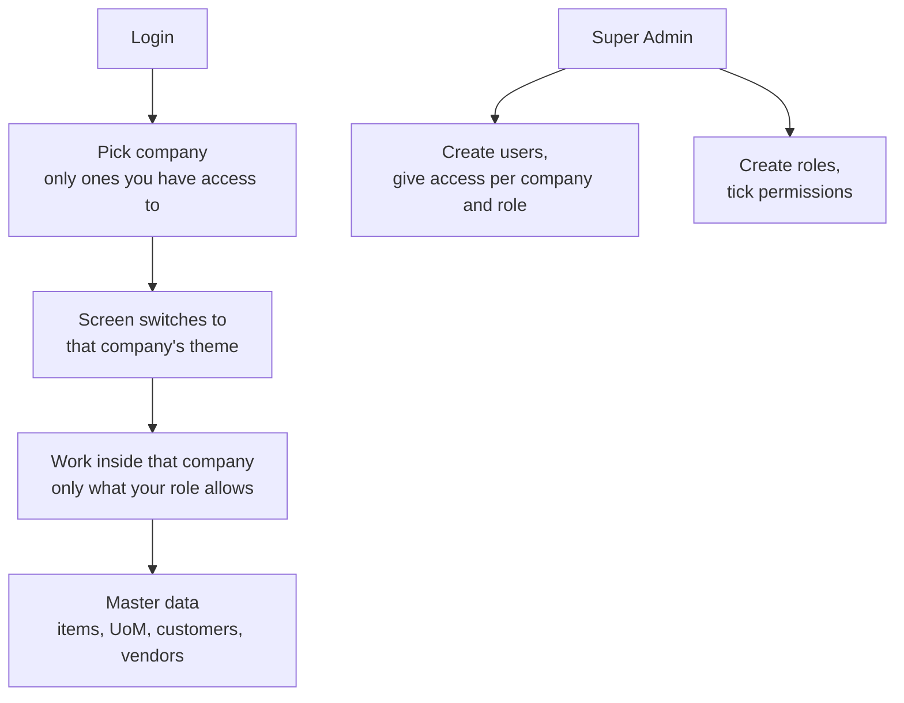

# Foundation Module

Part of [[Holding ERP]]. Company context is in [[Company Roles and Modules]]. This is Phase 1 in [[Pandu Roadmap]]: everything the other modules need before they can start. Even a quote needs a user, a company, a customer and an item.

## Overview and scope
- **In the ERP:** login, the 6 companies with their own color theme, the 2 super users (Super Admin and Super User), users, roles and permissions, which user can work in which company, and master data (items, units, customers, vendors)
- **Handed to other modules:** nothing. Every other module reads from this one
- **Which companies use it:** all 6. Pandu first, the others are seeded but switched on in Phase 9
- **UI language:** English

## Key terms
All terms are in [[Glossary]].

## Records the module owns
| Record | Main fields | Statuses | Links to |
|---|---|---|---|
| Company | Code, name, short name, is holding, theme colors, logo | Active, Inactive | |
| User | Name, email, Employee ID, password, platform role (none, Super Admin, Super User), two-step login setup | Active, Inactive | |
| Role | Name, list of permissions | Active, Inactive | Permissions |
| Access | User, company, role | | User, Company, Role |
| Session | User, current company, expiry | | User |
| Audit log | Company, table, record, action, old and new values, who, when *(assumed)* | | Company, User |
| UoM | Code, name | Active, Inactive | Company |
| Item | Code, name, UoM, buy or make flag | Active, Inactive | Company, UoM |
| Customer | Code, name, address, contact, group company link (empty for outside customers, used later for intercompany), order type (PO first or work first), rework report needed | Active, Inactive | Company, linked group company |
| Vendor | Code, name, address, contact, group company link (empty for outside vendors, used later for intercompany) | Active, Inactive | Company, linked group company |

Notes:
- Buy or make, order type and rework report come from [[Sales and Marketing Module]]. They are stored now so S&M doesn't have to change these records later
- Minimum margin and credit limit are not added yet. They come with S&M
- Nothing is ever hard deleted *(assumed)*. Records are set to Inactive so old documents still point to them

## Main flow

## Business rules
| Rule | How the system enforces it |
|---|---|
| Every record belongs to one company | `company_id` on every record. The API only returns records from the company picked at login |
| You only see companies you have access to | The company picker and the server both check the user's access. Super Admin and Super User see all |
| Your role decides what you can do | Every API action checks the permission. Hiding a button is not enough |
| Super Admin can do everything | Skips the permission check, in every company |
| Super User can never change anything | Every write is refused for a Super User, in every company, and the screens hide write buttons for them |
| There is one Super Admin and one Super User | Seeded at setup. The screen does not offer "make Super Admin" *(assumed)* |
| Each company has its own theme | The company's theme and logo are loaded when you open that company. Themes are the approved logo based ones (see [[Holding ERP]]) |
| Log in with email or Employee ID | Either one plus the password |
| Two-step login for Super Admin and Super User | They must enter a code from an authenticator app. Normal users do not |
| Forgot password | A reset link goes to the user's email |
| Nothing is hard deleted *(assumed)* | Master data and users go Inactive instead. Inactive items, customers and vendors can't be picked on new documents |
| Codes are unique inside a company *(assumed)* | Two items in Pandu can't share a code. Pandu and Anggoan can |

## Handoffs to other modules
| Module | What it does for this module | Where in the flow |
|---|---|---|
| All modules | Read users, access, companies and master data from here | Everywhere |
| S&M | Uses customers and items | Quote, PO cust, SO |
| Procurement | Uses vendors and items | PR, PO |

## Placeholders until Jingga decides
These are built now so work isn't blocked, and are easy to change later. All are *(assumed)*.
- **Super users:** two anonymous accounts, one Super Admin and one Super User. Real names and emails replace them later. Where they sit (Pandu or Serio) is still open
- **Roles:** the 6 templates from the colleague's repo, for now: company admin, director, manager, supervisor, staff, viewer. What each one can do per module is still to be confirmed

## Pandu baseline
- What Pandu does here today: unknown. Item, customer and vendor lists probably live in Excel *(assumed)*, so an Excel import may be wanted later
- What Wening changes: items need batch and expiry later (Phase 6). Not in this module
- Records that cross into Anggoan: Anggoan is a customer of Pandu. Intercompany is discussed later, the group company link just gets stored for now
- What the holding view excludes: nothing here. The group company link is what later lets the holding view drop intercompany sales

## Open questions
- [ ] Who are the 2 super users, and do they sit in Pandu or Serio?
- [ ] Does Pandu already give staff an ID number? If so, the ERP uses it as the Employee ID
- [ ] Confirm the 6 role templates, and what each one can do per module
- [ ] Master data per company or shared? Spec currently says per company (Anggoan has its own catalog). If per company, how does a Wening item at Pandu match the same item at Anggoan for the automatic PO to SO?
- [x] Currency: IDR, plus Chinese yuan (CNY), US dollar (USD), Singapore dollar (SGD), Australian dollar (AUD), euro (EUR) and Japanese yen (JPY) for procurement. Jingga, 2026-10-13. Follow ups in [[Procurement Module]]
- [ ] Does anyone besides the super users manage users and roles (one admin per company)?
- [ ] Do we need an Excel import for items, customers and vendors at the start?
- [ ] Seed demo items outside production (local and staging)? None for now. Needs Pandu's real item list, since the colleague's demo items (hand soap, dish soap) aren't Wening. See the slice 6 plan
- [ ] Password rules: how long, and must it mix letters and numbers? The ERP uses Better Auth's minimum of 8 characters for now *(assumed)*
- [ ] How long does a login last before people must sign in again? Better Auth's default for now: 7 days, renewed while in use *(assumed)*
- [ ] Lock an account after several wrong passwords? For now Better Auth only slows down repeated attempts *(assumed)*

## Known issues
Things that work for users but should be fixed later.
- [ ] An unknown company address (like `/nope`) shows the not found page, but the server answers HTTP 200 instead of 404. The company check runs after the page starts streaming. Fix later, for example by checking the company before rendering (in `proxy.ts`). Found in slice 2
- [ ] Same cause: opening the login page while already signed in sends you on with a redirect inside the page instead of an HTTP redirect, so it only happens once the page's JavaScript runs. Works in every normal browser. Found in slice 3
- [x] Add User and Manage on the Users screen cleared what was typed when a save was refused. Fixed 2026-10-13: they use the same form dialog as master data now
- [ ] Better Auth keeps its rate limit counts in server memory, so they reset on restart and aren't shared between servers. Move them to the database before running more than one server on AWS. Found in slice 3

## Acceptance checks
Written before the build. Each one is something Jingga can click through.
- [x] Log in as Super Admin, see all 6 companies in the picker
- [ ] Log in as Super User, see all 6 companies, and every save or create is refused
- [ ] Switch company, the colors change, the data changes
- [x] Create a user with the viewer role in Pandu only. Log in as them: only Pandu shows, and they can view but not create items (items part checked in slice 6)
- [x] That user can't open an Anggoan record, even by typing its URL
- [ ] Create an item, a customer and a vendor in Pandu. They don't show up in Anggoan (items and customers checked in slices 6 and 7, vendors wait for slice 8)
- [ ] Set an item Inactive, it disappears from pick lists but stays on its detail page (slice 6: it leaves the items list and its page still opens. The first pick list comes with the S&M quote)
- [ ] A second browser sees a new item appear without refreshing (real-time check)
- [ ] All labels and buttons are in English

## Build plan
Draft by Claude, waiting for Jingga's approval. Stack is in the decisions table in [[Holding ERP]].

- Data model: the records table above, one PostgreSQL database, `company_id` on every business record
- Screens: login, company picker, user list and form, role list and form (permission checkboxes), item, UoM, customer and vendor list and form
- Server: Next.js server side (server actions or route handlers). Login, logout, current user, switch company, then list, create, edit and deactivate for each record above
- Repo layout (`jingaega/PT-SERIO-ERP`):
  - One Next.js app with TypeScript: `app/login`, `app/[company]/...`, `modules/<module>` for each module's server code, shared components, themes
  - `db/` schema, migrations and seed data for PostgreSQL, with Drizzle
  - `CLAUDE.md` from [[Claude Code Instructions]], `README.md`, `docker-compose.yml` for the database, `Makefile`, CI that runs tests and builds
  - Specs stay in this vault, not in the repo
- Slices (small, one record end to end):
  - [x] 1. Scaffold: repo layout, local PostgreSQL in Docker, health check, empty Next.js shell in English, CI, `CLAUDE.md` (done 2026-10-13)
  - [x] 2. Companies: 6 seeded with their approved themes and logos, company picker switches the theme (done 2026-10-13)
  - [x] 3. Login and logout with Better Auth (email or Employee ID), forgot password through Mailpit, two-step login for the holding accounts, placeholder Super Admin and Super User seeded (done 2026-10-13)
  - [x] 4. Roles and permissions with the 6 templates, checked on every server action, with tests for the access rules above (done 2026-10-13)
  - [x] 5. User admin: Super Admin creates users and gives access per company and role
  - [x] 6. Items and UoM, with the audit log (done 2026-10-13)
  - [x] 7. Customers, with the group company link and the S&M settings (done 2026-10-13)
  - [ ] 8. Vendors, with the group company link
  - [ ] 9. Real-time: lists update live in a second browser
- Open questions only block their own slice. Slices 1 to 3 and 6 to 9 can start now. Slices 4 and 5 use the 6 templates until they are confirmed

### Slice 7 plan: customers
Written 2026-10-13, approved by Jingga the same day with the defaults below. Covers the Customer record, with the group company link and the S&M settings (order type, rework report), and the acceptance check "Create a customer in Pandu, it doesn't show up in Anggoan". Built the same way as slice 6, reusing its form dialog, audit log and page layout.

**What changes for people**
- Customers joins Items and Units under Master data in the sidebar
- **Customers** (`/pandu/master-data/customers`): the list with search and "Show inactive", and Add customer
- **Customer page** (`/pandu/master-data/customers/<id>`): details, Edit, Deactivate and Reactivate, and History. Still opens for an inactive customer
- Super User and anyone without `customers.manage` see no write buttons

**Record**
| Field | Notes |
|---|---|
| Code | Numbered by the system per company: C-0001, C-0002 and so on, like the colleague's repo (Jingga's call). Nobody types it, and it never changes |
| Name | Required |
| Address | One free text address, optional |
| Contact | One contact person: name, phone, email, all optional |
| Group company | Empty for outside customers. Otherwise one of the other 5 group companies, like Anggoan for Pandu. Only stored for now, intercompany comes later |
| Order type | PO first (the customer's PO comes before the work) or work first (work before the PO, like Kopken). Not the payment type: tempo or CBD is picked on each quote |
| Rework report needed | Off by default |
| Active | Inactive customers can't be picked on new documents |

**Rules and defaults** (all *(assumed)* until confirmed)
- Order type starts at PO first (Jingga's call). Only Kopken, a Sancang customer, is work first in the spec. Work first is picked by hand
- A company can't be its own customer: Pandu's list offers the other 5 companies only
- At most one customer per group company inside a company (Pandu has one "Anggoan" customer), so intercompany can later find it without guessing. Confirmed by Jingga
- Nothing is deleted, the database refuses deletes. Every change goes in the audit log, history visible to everyone who can see the customer
- Permissions: `customers.view` (all 6 roles) and `customers.manage` (company admin and manager), the same split as items

**Under the hood**
- A person in Pandu can't read Anggoan's company row (company isolation), but the group company picker needs the 6 names. A small database function returns only the names and ids of the active companies, nothing else
- The group company link and the one-per-company rule are checked by the database too

**Not in this slice**
- Credit limit, payment terms, NPWP and tax: they come with S&M
- Several contacts or delivery addresses per customer. One of each for now (Jingga's call); several delivery addresses are noted as an S&M question for DO / BAST
- Vendors (slice 8). Customers and vendors share address, contact and group company fields, so slice 8 reuses them

**Built in two commits, each clicked through in a browser**
- 7a: customers table, permissions, list and Add customer
- 7b: customer page with Edit, Deactivate, Reactivate and History
- Then the strict code review on slice 7

**Tests**
- A Pandu user can't read or change Anggoan's customers
- Super User is refused every change, a viewer can view but not add, Super Admin can
- Codes count up per company with no gaps or doubles, also when two people save at once. Pandu and Anggoan each have their own C-0001
- Pandu can't pick itself as a group company, and can't link two customers to the same group company
- Deletes are refused, every change leaves an audit row

**Built (2026-10-13)**
- 7a customers list and Add customer, 7b customer page with Edit, Deactivate, Reactivate and History. Each clicked through in a browser as the Pandu admin and the Pandu viewer
- Codes are numbered by PostgreSQL per company and can't be typed or changed, also by a hand written query
- The group company picker lists the other 5 companies. A second customer for the same group company is refused
- Strict code review: shared list and record page layouts and one list filter, ready for vendors. 166 lines added, 349 removed. 111 tests pass

**Questions this plan raises** (built with the default shown until answered)
- [x] One address and one contact person per customer for now. Confirmed by Jingga
- [x] Customer codes are numbered by the system (C-0001), like the colleague's repo. Jingga's call, replaces typed codes
- [x] At most one customer per group company inside a company. Confirmed by Jingga
- [x] New customers start as PO first. Confirmed by Jingga
- [ ] **Ask supervisor:** who may add and change customers? Default: company admin and manager *(assumed)*. The colleague's repo lets staff add customers but only admin and manager change them

### Slice 6 plan: items and UoM
Written 2026-10-13, approved by Jingga the same day with the defaults below, plus three calls: the colleague's 11 starter units, the colleague's code format, and an audit log. Covers the Item and UoM records, the rules "Nothing is hard deleted", "Codes are unique inside a company" and "Inactive items can't be picked", and the acceptance checks on items.

**What changes for people**
- A new Master data section in the sidebar with Items and Units, for everyone who may view items
- **Units** (`/pandu/master-data/units`): the list, Add, Edit (name only), Deactivate and Reactivate
- **Items** (`/pandu/master-data/items`): the list with search and "Show inactive", and Add item
- **Item page** (`/pandu/master-data/items/<id>`): code, name, unit, buy or make, status, Edit, Deactivate and Reactivate, and its History. Still opens for an inactive item, with an Inactive badge
- Super User and anyone without `items.manage` see no write buttons

**Records**
| Record | Main fields | Notes |
|---|---|---|
| UoM | Company, code, name, active | Code: capital letters and numbers, up to 8, like `PCS` (colleague's format) |
| Item | Company, code, name, UoM, buy or make, active | Code: capital letters, numbers and dashes, 2 to 24, starts with a letter or number, like `WN-500` (colleague's format). The UoM must be one of the same company's |
| Audit log | Company, table, record, insert or update, old and new values, who, when | Written by PostgreSQL itself on every change, so nothing is missed. Nobody can edit or delete it |

**Rules and defaults** (all *(assumed)* until confirmed)
- Starter units for every company, from the colleague's repo: PCS piece, BTL bottle, JRG jerrycan, L liter, ML milliliter, KG kilogram, CTN carton, BOX box, SET set, UNIT unit, DRUM drum. Seeded once: running the seed again never brings back a unit someone renamed or deactivated
- Codes are typed in any case and saved in capitals. Unique inside a company, Pandu and Anggoan can share one
- Every item picks buy or make, nothing preset
- An item's or unit's code can't be changed after it is saved, because later documents print it
- An item's unit can be changed for now. Lock it once documents use the item (a later module)
- A unit that active items still use can be deactivated. The items keep it, new items and edits can't pick it
- Nothing is deleted: the database itself refuses deletes on items and units
- Permissions: `items.view` (all 6 roles) and `items.manage` (company admin and manager), covering items and units
- History on the item page is visible to everyone who can view the item (confirmed by Jingga)

**Audit log**
- New in this slice at Jingga's request. Not in the spec before, so its details are *(assumed)*
- One `audit_log` table for every company table. Items and units are the first to use it, later tables add one line to join
- Each insert and update keeps the old and new values, who did it and when. Changes made by the seed show as "System"
- The app can only read it, and only for companies the person may see (same company rules as everything else)

**Not in this slice**
- Item pick lists on documents: the first document (S&M quote) uses active items only. The acceptance check "disappears from pick lists" is closed there; here the items list hides inactive items unless "Show inactive" is ticked
- History for units and the older tables (users, roles): the log is there to add later
- Excel import, categories, batches and expiry (Phase 6), reorder levels (IMS)

**Built in three commits, each clicked through in a browser**
- 6a: audit log, units end to end, permissions, starter units
- 6b: items list and Add item
- 6c: item page with Edit, Deactivate, Reactivate and History
- Then the strict code review on slice 6

**Tests**
- A Pandu user can't read or change Anggoan's items, units or audit rows
- Super User is refused every change, a viewer can view but not add, Super Admin can
- A code used twice in one company is refused with a clear message, the same code in another company is fine. A badly formed code is refused
- An item can't use another company's unit or an inactive one
- Deletes are refused by the database
- Every change leaves an audit row with who and what; the app can't write or change audit rows

**Built (2026-10-13)**
- 6a audit log, units with the 11 starter units, `items.view` and `items.manage`. 6b items list with search and Show inactive, Add item. 6c item page with Edit, Deactivate, Reactivate and History
- Each part clicked through in a browser as the Pandu admin, the Pandu viewer and the Pandu and Anggoan staff member
- Found while clicking through: a refused save cleared what was typed. Fixed for the master data forms
- Strict code review: 6 findings, all fixed (one shared form dialog, one edit dispatcher, one item query, one code check, cleaner remount and types). 98 tests pass

**Questions this plan raises** (built with the default shown until answered)
- [ ] Seed demo items outside production (local and staging) for clicking through? Default: no. The colleague seeds made up Pandu products (hand soap, dish soap), which are wrong for Wening. Seed real ones once Pandu's item list is known
- [ ] **Ask supervisor:** item and unit codes can't change after saving? Default: yes *(assumed)*
- [ ] **Ask supervisor:** who may add and change items and units: company admin and manager? Default: yes *(assumed)*
- [x] Who may see an item's history: everyone who can see the item. Confirmed by Jingga, 2026-10-13

### Slice 5 plan: users and roles screens
Written 2026-10-13, approved by Jingga the same day with the defaults below, and built. This is account and access admin, not HR: it is about who can sign in to the ERP and what they may do, not about employees (see [[Glossary]], User and Employee). Covers the flow "Super Admin: create users, give access per company and role" and "Create roles, tick permissions", and the acceptance check "Create a user with the viewer role in Pandu only".

**Who can use these screens**
- Company admin (permission `users.manage`, and `roles.manage` for roles), inside their own company *(assumed)*
- Super Admin, in every company
- Super User and anyone with `users.view` can look but not change. Others don't see the menu item

**Screens, inside each company, under a Settings section in the sidebar**
- **Users** (`/pandu/settings/users`): everyone with access to this company, their Employee ID, email and role, active or not. Search by name, email or Employee ID
- **Add user**: name, email, Employee ID (optional), role
  - New email: makes the account and emails them a link to choose their own password, valid for 3 days *(assumed)*. Nobody types or sees someone else's password
  - Email that already has an account (someone from another group company): just gives them access here too, and says so
- **Change role**: pick another role. The database already allows several roles per person, the screen sets one for now (open question)
- **Remove access**: the person can't open this company any more, but keeps access to their other companies. The record stays, marked inactive (nothing is hard deleted)
- **Roles** (`/pandu/settings/roles`): the 6 roles with ticks for each permission, saved per company. Only the permissions that exist so far (people and roles) until the modules add theirs

**Super Admin only**
- **Deactivate account**: the person can't sign in anywhere and is signed out at once. A company admin can only remove access to their own company
- Super Admin and Super User accounts are never shown as editable here (spec: no "make Super Admin")

**Under the hood**
- shadcn/ui arrives for the first real forms and tables (decided in Phase 0), with the company theme colors
- New users are made through Better Auth's own admin functions, which also replaces the internal shortcut the seed uses today (noted in the slice 3 review)
- Every save calls `requirePermission` first, and runs inside `withUser`, so PostgreSQL's company rules apply too
- Employee IDs stay unique across all 6 companies; a taken one gets a clear message

**Built in three commits, each clicked through in a browser**
- 5a: shadcn/ui setup, the Settings section and the Users list (view only)
- 5b: Add user, with the set your password email (Mailpit locally)
- 5c: Change role, remove access, deactivate account, and the Roles screen
- Then the strict code review on slice 5

**Tests**
- A company admin can add people only to their own company; Pandu's admin can't add anyone to Anggoan, even by sending the form by hand
- Super User and a viewer are refused every change
- Removing access leaves the person's other companies alone; a deactivated account can't sign in
- An Employee ID or email already in use is refused with a clear message

**Questions this plan raises** (built with the default shown until answered)
- [ ] New people choose their own password from an emailed link, valid 3 days? Default: yes *(assumed)*
- [ ] Can a company admin give access to someone who already has an account in another group company? Default: yes, the screen says so *(assumed)*
- [ ] Only Super Admin can deactivate a whole account; a company admin only removes access to their own company? Default: yes *(assumed)*
- [ ] **Ask supervisor:** Employee ID required for every new user, or optional? Default: optional until Pandu's ID format is known *(assumed)*
- [ ] Nobody can change their own role, remove their own access or deactivate themselves, so an admin can't lock themselves out by mistake. Added while building 5c *(assumed)*
- [ ] A company admin can untick "Change what each role may do" on their own role and lose the Roles screen. Only a Super Admin can give it back. Should the screen stop that? Default: no guard *(assumed)*
- [ ] Deactivate has an undo: a Super Admin can reactivate the account, with its company access as it was. Added while building 5c *(assumed)*

**Built (2026-10-13)**
- 5a Users list with search, 5b Add user with the set your password email, 5c Manage (change role, remove access, give access back, deactivate and reactivate for Super Admin) and the Roles screen with a tick grid
- Running the seed again never undoes ticks changed on the Roles screen. A template permission is only given to a new role, or when the permission itself is new
- Not yet done: "a viewer can view but not create items" in the acceptance check waits for slice 6 (items)

### Slice 4 plan: roles, permissions and company data isolation
Written 2026-10-13, approved by Jingga the same day with the defaults below, and built. Covers the rules "You only see companies you have access to", "Your role decides what you can do", "Super Admin can do everything" and "Super User can never change anything".

**What changes for people**
- The company picker only shows the companies you have access to. Super Admin and Super User still see all 6
- Opening a company you have no access to (by typing its address) shows "You don't have access to this company" instead of the page
- Someone with access to no company sees "Your account has no company yet, ask an admin" after login
- If you have access to exactly one company, login takes you straight into it *(assumed)*
- The sidebar shows your role in that company, like "Viewer"
- Super User sees a "Read only" badge

**New records**
| Record | Main fields | Notes |
|---|---|---|
| Permission | Key like `users.manage`, description | Fixed list in the code, copied into the database so roles can point to it |
| Role | Company, key (company admin, director, manager, supervisor, staff, viewer), name, active | The 6 templates, made for each of the 6 companies |
| Role permission | Role, permission | Which permissions a role has |
| Access | User, company, role, active | Usually one role per person per company, but not settled: exceptions may exist, so the database allows several roles, and their permissions add up. One person can have access to several companies |

**Which permissions exist in slice 4**
Only the ones for things that exist so far: `users.view`, `users.manage`, `roles.manage`, all given to company admin only *(assumed)*. Every later slice adds its own (like `items.view`, `items.edit`) with a suggested default per role, marked *(assumed)* until the role list is confirmed.

**How the database keeps companies apart (the important part)**
- Every record that belongs to a company gets a PostgreSQL rule (row level security) so the database itself only returns rows of companies the signed in person has access to. Even a bug in the app code can't show another company's data
- For each request the app tells PostgreSQL who is asking (user and holding role), only for that one transaction, so connections shared between requests never mix people up
- Super Admin: sees and changes every company. Super User: sees every company, and the database refuses any change from them
- The app connects with its own limited database user, not the admin user. The admin user bypasses these rules, so it is used only for migrations and the seed
- Login tables (users, sessions) are not under these rules, because login has to work before anyone is known

**How the app checks permissions**
- One helper, `requirePermission(company, "users.manage")`, used by every server action before it changes anything. Hiding a button is not enough (spec rule)
- One helper, `can(...)`, for screens to hide buttons the person can't use
- Super Admin passes every check. Super User passes only view checks

**Demo data (local and staging only)**
Two demo users so the rules can be clicked through before slice 5 adds the user screens: a Pandu viewer (`PDT-00001`) and someone with access to both Pandu and Anggoan as staff (`PDT-00002`). Never seeded in production.

**Tests**
- A Pandu user can't read or change Anggoan's rows, even with a hand written query
- Super User can read every company and every change is refused by the database
- Super Admin can read and change every company
- With no user set, the database returns nothing
- `requirePermission` and `can` for each holding role and a normal role
- Picker, no access page and "straight in with one company" clicked through in a browser

**Acceptance checks this slice closes**
- [x] Log in as Super Admin, see all 6 companies in the picker
- [x] That user can't open an Anggoan record, even by typing its URL (checked with the demo Pandu viewer)

**Not in this slice**
Screens to create users, give access and edit roles (slice 5). Master data and its permissions (slices 6 to 8).

**Questions this plan raises** (built with the default shown until answered)
- [ ] One role per person per company, or can someone be both staff and supervisor in the same company? Not settled, Jingga says there may be exceptions. The database allows several, the screens give one for now *(assumed)*
- [ ] People with access to only one company go straight in? Default: yes *(assumed)*
- [ ] Who can manage users and roles inside a company: only company admin? Default: yes *(assumed)*, same as the existing open question above
