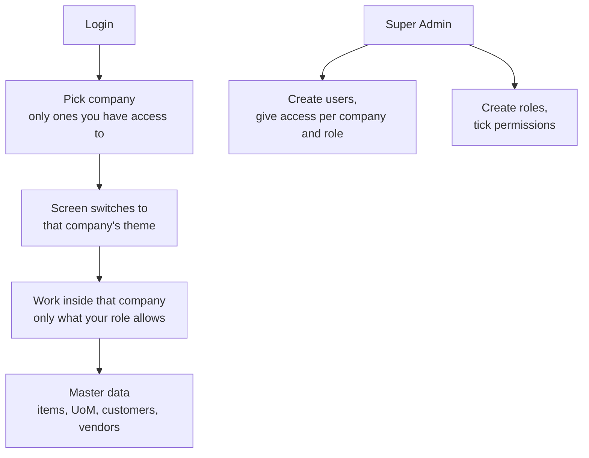

# Foundation Module

Part of [[Holding ERP]]. Company context is in [[Company Roles and Modules]]. This is Phase 1 in [[Pandu Roadmap]]: everything the other modules need before they can start. Even a quote needs a user, a company, a customer and an item.

## Overview and scope
- **In the ERP:** login, the 6 companies with their own color theme, the 2 super users (Super Admin and Super User), users, roles and permissions, which user can work in which company, and master data (items, units, customers, vendors)
- **Handed to other modules:** nothing. Every other module reads from this one
- **Which companies use it:** all 6. Pandu first, the others are seeded but switched on in Phase 9
- **UI language:** English

## Key terms
| Term | Meaning | Who makes it |
|---|---|---|
| Company | One of the 6 PTs. Every record belongs to one | Seeded at setup |
| Theme | A company's colors (and logo). The whole screen switches when you switch company | Super Admin |
| Super Admin | Holding level account. Can see and change everything in every company | Seeded at setup |
| Super User | Holding level account. Can see everything in every company, change nothing | Seeded at setup |
| User | A person who logs in | Super Admin |
| Role | A named set of permissions, like what a manager can do | Super Admin |
| Permission | One action on one record type, like "create item" or "view customer" | Fixed in the system |
| Access | A user gets a role inside a company. One user can have access to several companies | Super Admin |
| Item | Something we sell, buy or make | Company admin |
| UoM | Unit of measure (pcs, kg, liter, box) | Company admin |
| Customer | Who we sell to. Can be an outside company or another group company | Company admin |
| Vendor | Who we buy from. Can be an outside company or another group company | Company admin |

## Records the module owns
| Record | Main fields | Statuses | Links to |
|---|---|---|---|
| Company | Code, name, short name, is holding, theme colors, logo | Active, Inactive | |
| User | Name, email, password, platform role (none, Super Admin, Super User) | Active, Inactive | |
| Role | Name, list of permissions | Active, Inactive | Permissions |
| Access | User, company, role | | User, Company, Role |
| Session | User, current company, expiry | | User |
| UoM | Code, name | Active, Inactive | Company |
| Item | Code, name, UoM, buy or make flag | Active, Inactive | Company, UoM |
| Customer | Code, name, address, contact, group company link (empty for outside customers, used later for intercompany), order type (PO first or work first), rework report needed | Active, Inactive | Company, linked group company |
| Vendor | Code, name, address, contact, group company link (empty for outside vendors, used later for intercompany) | Active, Inactive | Company, linked group company |

Notes:
- Buy or make, order type and rework report come from [[Sales and Marketing Module]]. They are stored now so S&M doesn't have to change these records later
- Minimum margin and credit limit are not added yet. They come with S&M
- Nothing is ever hard deleted *(assumed)*. Records are set to Inactive so old documents still point to them

## Main flow

## Business rules
| Rule | How the system enforces it |
|---|---|
| Every record belongs to one company | `company_id` on every record. The API only returns records from the company picked at login |
| You only see companies you have access to | The company picker and the server both check the user's access. Super Admin and Super User see all |
| Your role decides what you can do | Every API action checks the permission. Hiding a button is not enough |
| Super Admin can do everything | Skips the permission check, in every company |
| Super User can never change anything | Every write is refused for a Super User, in every company, and the screens hide write buttons for them |
| There is one Super Admin and one Super User | Seeded at setup. The screen does not offer "make Super Admin" *(assumed)* |
| Each company has its own theme | The theme is loaded from the company record when you switch company |
| Nothing is hard deleted *(assumed)* | Master data and users go Inactive instead. Inactive items, customers and vendors can't be picked on new documents |
| Codes are unique inside a company *(assumed)* | Two items in Pandu can't share a code. Pandu and Anggoan can |

## Handoffs to other modules
| Module | What it does for this module | Where in the flow |
|---|---|---|
| All modules | Read users, access, companies and master data from here | Everywhere |
| S&M | Uses customers and items | Quote, PO cust, SO |
| Procurement | Uses vendors and items | PR, PO |

## Placeholders until Jingga decides
These are built now so work isn't blocked, and are easy to change later. All are *(assumed)*.
- **Super users:** two anonymous accounts, one Super Admin and one Super User. Real names and emails replace them later. Where they sit (Pandu or Serio) is still open
- **Colors:** one neutral default theme for all 6 companies. Colors are just fields on the company record, so changing them later is a data change, not a code change
- **Roles:** the 6 templates from the colleague's repo, for now: company admin, director, manager, supervisor, staff, viewer. What each one can do per module is still to be confirmed

## Pandu baseline
- What Pandu does here today: unknown. Item, customer and vendor lists probably live in Excel *(assumed)*, so an Excel import may be wanted later
- What Wening changes: items need batch and expiry later (Phase 6). Not in this module
- Records that cross into Anggoan: Anggoan is a customer of Pandu. Intercompany is discussed later, the group company link just gets stored for now
- What the holding view excludes: nothing here. The group company link is what later lets the holding view drop intercompany sales

## Open questions
- [ ] Who are the 2 super users, and do they sit in Pandu or Serio?
- [ ] Colors (and logos) for each company
- [ ] Confirm the 6 role templates, and what each one can do per module
- [ ] Master data per company or shared? Spec currently says per company (Anggoan has its own catalog). If per company, how does a Wening item at Pandu match the same item at Anggoan for the automatic PO to SO?
- [ ] Currency: IDR only?
- [ ] Does anyone besides the super users manage users and roles (one admin per company)?
- [ ] Do we need an Excel import for items, customers and vendors at the start?
- [ ] Where does it run, Pandu's server or cloud? (also in [[Holding ERP]])

## Acceptance checks
Written before the build. Each one is something Jingga can click through.
- [ ] Log in as Super Admin, see all 6 companies in the picker
- [ ] Log in as Super User, see all 6 companies, and every save or create is refused
- [ ] Switch company, the colors change, the data changes
- [ ] Create a user with the viewer role in Pandu only. Log in as them: only Pandu shows, and they can view but not create items
- [ ] That user can't open an Anggoan record, even by typing its URL
- [ ] Create an item, a customer and a vendor in Pandu. They don't show up in Anggoan
- [ ] Set an item Inactive, it disappears from pick lists but stays on its detail page
- [ ] A second browser sees a new item appear without refreshing (real-time check)
- [ ] All labels and buttons are in English

## Build plan
Draft by Claude, waiting for Jingga's approval. Stack is in the decisions table in [[Holding ERP]].

- Data model: the records table above, one PostgreSQL database, `company_id` on every business record
- Screens: login, company picker, user list and form, role list and form (permission checkboxes), item, UoM, customer and vendor list and form
- Server: Next.js server side (server actions or route handlers). Login, logout, current user, switch company, then list, create, edit and deactivate for each record above
- Repo layout (`jingaega/PT-SERIO-ERP`):
  - One Next.js app with TypeScript: `app/login`, `app/[company]/...`, `modules/<module>` for each module's server code, shared components, themes
  - `db/` migrations and seed data for PostgreSQL. The query and migration tools get picked in the slice 1 plan
  - `CLAUDE.md` from [[Claude Code Instructions]], `README.md`, `docker-compose.yml` for the database, `Makefile`, CI that runs tests and builds
  - Specs stay in this vault, not in the repo
- Slices (small, one record end to end):
  - [ ] 1. Scaffold: repo layout, local PostgreSQL in Docker, health check, empty Next.js shell in English, CI, `CLAUDE.md`
  - [ ] 2. Companies: 6 seeded with the default theme, company picker switches the theme
  - [ ] 3. Login and logout with sessions, placeholder Super Admin and Super User seeded
  - [ ] 4. Roles and permissions with the 6 templates, checked on every server action, with tests for the access rules above
  - [ ] 5. User admin: Super Admin creates users and gives access per company and role
  - [ ] 6. Items and UoM
  - [ ] 7. Customers, with the group company link and the S&M settings
  - [ ] 8. Vendors, with the group company link
  - [ ] 9. Real-time: lists update live in a second browser
- Open questions only block their own slice. Slices 1 to 3 and 6 to 9 can start now. Slices 4 and 5 use the 6 templates until they are confirmed
