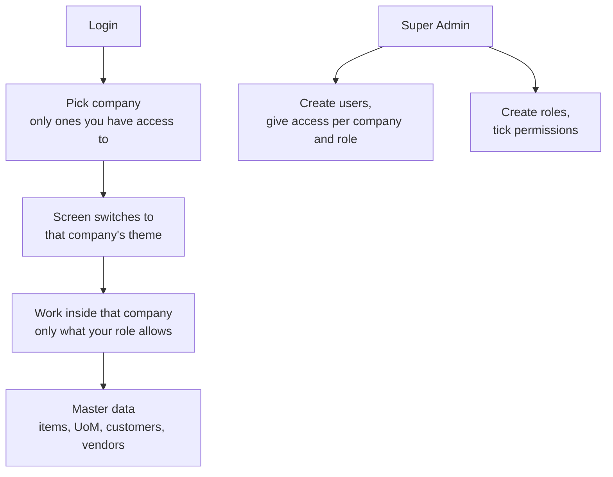

# Foundation Module

Part of [[Holding ERP]]. Company context is in [[Company Roles and Modules]]. This is Phase 1 in [[Pandu Roadmap]]: everything the other modules need before they can start. Even a quote needs a user, a company, a customer and an item.

## Overview and scope
- **In the ERP:** login, the 6 companies with their own color theme, the 2 super users (Super Admin and Super User), users, roles and permissions, which user can work in which company, and master data (items, units, customers, vendors)
- **Handed to other modules:** nothing. Every other module reads from this one
- **Which companies use it:** all 6. Pandu first, the others are seeded but switched on in Phase 9
- **UI language:** English

## Key terms
All terms are in [[Glossary]].

## Records the module owns
| Record | Main fields | Statuses | Links to |
|---|---|---|---|
| Company | Code, name, short name, is holding, theme colors, logo | Active, Inactive | |
| User | Name, email, NRP, password, platform role (none, Super Admin, Super User), two-step login setup | Active, Inactive | |
| Role | Name, list of permissions | Active, Inactive | Permissions |
| Access | User, company, role | | User, Company, Role |
| Session | User, current company, expiry | | User |
| Audit log | Company, table, record, action, old and new values, who, when *(assumed)* | | Company, User |
| UoM | Code, name | Active, Inactive | Company |
| Item | Code, name, UoM, buy or make flag | Active, Inactive | Company, UoM |
| Customer | Code, name, address, contact, group company link (empty for outside customers, used later for intercompany), order type (PO first or work first), rework report needed | Active, Inactive | Company, linked group company |
| Vendor | Code, name, address, contact, group company link (empty for outside vendors, used later for intercompany) | Active, Inactive | Company, linked group company |

Notes:
- Buy or make, order type and rework report come from [[Sales and Marketing Module]]. They are stored now so S&M doesn't have to change these records later
- Minimum margin and credit limit are not added yet. They come with S&M
- Nothing is ever hard deleted *(assumed)*. Records are set to Inactive so old documents still point to them

## Main flow

## Business rules
| Rule | How the system enforces it |
|---|---|
| Every record belongs to one company | `company_id` on every record. The API only returns records from the company picked at login |
| You only see companies you have access to | The company picker and the server both check the user's access. Super Admin and Super User see all |
| Your role decides what you can do | Every API action checks the permission. Hiding a button is not enough |
| Super Admin can do everything | Skips the permission check, in every company |
| Super User can never change anything | Every write is refused for a Super User, in every company, and the screens hide write buttons for them |
| There is one Super Admin and one Super User | Seeded at setup. The screen does not offer "make Super Admin" *(assumed)* |
| Each company has its own theme | The company's theme and logo are loaded when you open that company. Themes are the approved logo based ones (see [[Holding ERP]]) |
| Log in with email or NRP | Either one plus the password |
| Two-step login for Super Admin and Super User | They must enter a code from an authenticator app. Normal users do not |
| Forgot password | A reset link goes to the user's email |
| Nothing is hard deleted *(assumed)* | Master data and users go Inactive instead. Inactive items, customers and vendors can't be picked on new documents |
| Codes are unique inside a company *(assumed)* | Two items in Pandu can't share a code. Pandu and Anggoan can |

## Handoffs to other modules
| Module | What it does for this module | Where in the flow |
|---|---|---|
| All modules | Read users, access, companies and master data from here | Everywhere |
| S&M | Uses customers and items | Quote, PO cust, SO |
| Procurement | Uses vendors and items | PR, PO |

## Placeholders until Jingga decides
These are built now so work isn't blocked, and are easy to change later. All are *(assumed)*.
- **Super users:** two anonymous accounts, one Super Admin and one Super User. Real names and emails replace them later. They belong to the holding, not to one company: HR's sheet lists them as HOLDING (Jingga, 2026-10-13)
- **Roles:** the 6 templates from the colleague's repo, for now: company admin, director, manager, supervisor, staff, viewer. What each one can do per module is still to be confirmed

## Pandu baseline
- What Pandu does here today: unknown. Item, customer and vendor lists probably live in Excel *(assumed)*, so an Excel import may be wanted later
- What Wening changes: items need batch and expiry later (Phase 6). Not in this module
- Records that cross into Anggoan: Anggoan is a customer of Pandu. Intercompany is discussed later, the group company link just gets stored for now
- What the holding view excludes: nothing here. The group company link is what later lets the holding view drop intercompany sales

## Open questions
- [x] The 2 super users are the holding's admins, listed as HOLDING in HR's employee sheet, not part of one company. Jingga, 2026-10-13
- [ ] Which of the two is Super Admin (changes everything) and which is Super User (sees everything, changes nothing)? Their real accounts replace the placeholder ones
- [x] The NRP is given automatically when a new user is added. Jingga, 2026-10-13. Format still open (see slice 5 questions)
- [ ] Confirm the 6 role templates, and what each one can do per module
- [ ] **Departments** (later, Jingga): Jingga's answers name finance and procurement managers and above. The 6 roles (company admin, director, manager, supervisor, staff, viewer) have no department today. Add departments to access (manager in finance), or make roles per department (Finance Manager)? And does "above" mean director and company admin? Until decided, items and customers stay with company admin and manager
- [ ] Master data per company or shared? Spec currently says per company (Anggoan has its own catalog). If per company, how does a Wening item at Pandu match the same item at Anggoan for the automatic PO to SO?
- [x] Currency: IDR, plus Chinese yuan (CNY), US dollar (USD), Singapore dollar (SGD), Australian dollar (AUD), euro (EUR) and Japanese yen (JPY) for procurement. Jingga, 2026-10-13. Follow ups in [[Procurement Module]]
- [ ] **Ask supervisor:** do customers also have their own currency (selling abroad), or is every sale in IDR? Vendors have one currency each (Jingga, 2026-10-13), which slice 8 adds
- [x] Besides the super users, each company's admin manages users and roles (built in slice 5). Later HR adds users too, once departments exist. Jingga, 2026-10-13
- [x] Excel import and export are needed. Jingga, 2026-10-13. Import of vendors planned as slice 10 (below). Export gets its own plan later
- [ ] **Ask supervisor:** what does "real-time" in the scope mean? Our reading *(assumed)*: data is current the moment it is saved. Live lists (slice 9) are extra on top. Also ask: are live screens wanted now? Slice 9 is planned but skipped until then (Jingga, 2026-10-13)
- [ ] **Ask supervisor:** should the Excel import be looser than the form (for example, let a vendor in without a category)? Until then it makes the same checks as Add vendor
- [ ] **Ask supervisor:** who may see vendor bank accounts? Until then they are stored but shown nowhere, and the audit log keeps only that they changed
- [ ] Seed demo items outside production (local and staging)? None for now. Needs Pandu's real item list, since the colleague's demo items (hand soap, dish soap) aren't Wening. See the slice 6 plan
- [x] Password rules: at least 10 characters, no forced mix. Jingga, 2026-10-13
- [x] A login lasts one work day: it ends 9 hours after signing in, not renewed while in use (9 hours is Claude's reading of one work day). Jingga, 2026-10-13
- [x] Lock an account after 5 wrong passwords in a row, for 15 minutes. Jingga agreed, 2026-10-13. Built in slice 5e

## Known issues
Things that work for users but should be fixed later.
- [ ] An unknown company address (like `/nope`) shows the not found page, but the server answers HTTP 200 instead of 404. The company check runs after the page starts streaming. Fix later, for example by checking the company before rendering (in `proxy.ts`). Found in slice 2
- [ ] Same cause: opening the login page while already signed in sends you on with a redirect inside the page instead of an HTTP redirect, so it only happens once the page's JavaScript runs. Works in every normal browser. Found in slice 3
- [x] Add User and Manage on the Users screen cleared what was typed when a save was refused. Fixed 2026-10-13: they use the same form dialog as master data now
- [ ] Better Auth keeps its rate limit counts in server memory, so they reset on restart and aren't shared between servers. Move them to the database before running more than one server on AWS. Found in slice 3

## Acceptance checks
Written before the build. Each one is something Jingga can click through.
- [x] Log in as Super Admin, see all 6 companies in the picker
- [ ] Log in as Super User, see all 6 companies, and every save or create is refused
- [ ] Switch company, the colors change, the data changes
- [x] Create a user with the viewer role in Pandu only. Log in as them: only Pandu shows, and they can view but not create items (items part checked in slice 6)
- [x] That user can't open an Anggoan record, even by typing its URL
- [x] Create an item, a customer and a vendor in Pandu. They don't show up in Anggoan (checked in slices 6 to 8)
- [ ] Set an item Inactive, it disappears from pick lists but stays on its detail page (slice 6: it leaves the items list and its page still opens. The first pick list comes with the S&M quote)
- [ ] A second browser sees a new item appear without refreshing (real-time check). Comes with live lists, now an [[Pandu Roadmap#Additional features|additional feature]]
- [ ] All labels and buttons are in English

## Build plan
Draft by Claude, waiting for Jingga's approval. Stack is in the decisions table in [[Holding ERP]].

- Data model: the records table above, one PostgreSQL database, `company_id` on every business record
- Screens: login, company picker, user list and form, role list and form (permission checkboxes), item, UoM, customer and vendor list and form
- Server: Next.js server side (server actions or route handlers). Login, logout, current user, switch company, then list, create, edit and deactivate for each record above
- Repo layout (`jingaega/PT-SERIO-ERP`):
  - One Next.js app with TypeScript: `app/login`, `app/[company]/...`, `modules/<module>` for each module's server code, shared components, themes
  - `db/` schema, migrations and seed data for PostgreSQL, with Drizzle
  - `CLAUDE.md` from [[Claude Code Instructions]], `README.md`, `docker-compose.yml` for the database, `Makefile`, CI that runs tests and builds
  - Specs stay in this vault, not in the repo
- Slices (small, one record end to end):
  - [x] 1. Scaffold: repo layout, local PostgreSQL in Docker, health check, empty Next.js shell in English, CI, `CLAUDE.md` (done 2026-10-13)
  - [x] 2. Companies: 6 seeded with their approved themes and logos, company picker switches the theme (done 2026-10-13)
  - [x] 3. Login and logout with Better Auth (email or NRP), forgot password through Mailpit, two-step login for the holding accounts, placeholder Super Admin and Super User seeded (done 2026-10-13)
  - [x] 4. Roles and permissions with the 6 templates, checked on every server action, with tests for the access rules above (done 2026-10-13)
  - [x] 5. User admin: Super Admin creates users and gives access per company and role. Revised in 5d (NRP, phone, NIK) and 5e (existing NRPs, optional email, temporary passwords, lockout), done 2026-10-13
  - [x] 6. Items and UoM, with the audit log (done 2026-10-13)
  - [x] 7. Customers, with the group company link and the S&M settings (done 2026-10-13)
  - [x] 8. Vendors, with the group company link, currency, category and payment term (done 2026-10-13)
  - 9. Real-time lists: moved to [[Pandu Roadmap#Additional features]] (Jingga, 2026-10-14). The plan stays below
  - [x] 10. Excel import of vendors, starting with Pandu's supplier list (done 2026-10-14)
- Open questions only block their own slice. Slices 1 to 3 and 6 to 9 can start now. Slices 4 and 5 use the 6 templates until they are confirmed

### Slice 9 plan: real-time lists
Written 2026-10-13, approved by Jingga the same day after asking whether live updates are needed at all. Moved to [[Pandu Roadmap#Additional features]] on 2026-10-14: not needed to finish Foundation, built when a screen gains from it. Closes the acceptance check "A second browser sees a new item appear without refreshing".

**What changes for people**
- The Items, Units, Customers and Vendors lists update by themselves when someone else adds, edits or deactivates a record in the same company. No refresh button, no reload
- A search or filter you typed stays, and a dialog you have open stays open with what you typed
- Nothing else looks different *(assumed)*: no "new" highlight, no toast. Easy to add later
- If the live link drops (server restart, laptop asleep), the browser reconnects and loads the list once, so nothing is missed

**How it works**
- PostgreSQL announces each change itself, from the same trigger that writes the audit log (`audit_row`), so a change made any way (app, seed, a future import) is announced. Nothing is missed and no server code has to remember to do it
- The announcement only says "company X, table Y changed". It carries no record data
- The browser keeps one open link per company page (server-sent events, a plain HTTP route). On an announcement for a list on screen it asks the server for that page again
- That reload goes through the normal page and `withUser`, so PostgreSQL's company rules still decide every row anyone sees. The live link can't show data a person isn't allowed to see
- The server only sends you announcements for your company and for lists you may view (`items.view` for items and units, `customers.view`, `vendors.view`). Checked when the link opens, by the same rules as the pages
- Many changes close together (an import later) become one reload *(assumed: at most one per second)*
- Works with more than one server later: every server listens to the same database

**Rules to test**
- A change in Pandu reaches a Pandu viewer, not an Anggoan user
- A person without `customers.view` gets no customer announcements
- No session, or a company you can't open: the live link is refused
- Super User gets announcements (read only, like the pages)
- An announcement carries no record data
- An update that changes nothing is not announced (same as the audit log)

**Not in this slice** (to add later)
- Live record pages (an item page changing while open) and the Users list. Only the four master data lists for now (Jingga, 2026-10-13)
- "Added by X" on a new or changed row. Jingga likes it, later. No highlight for now (Jingga, 2026-10-13)
- Live counts or notifications. Notifications come with approvals

### Slice 10 plan: vendor Excel import
Written 2026-10-13 from a grilling session with Jingga, approved the same day. Built before slice 9, which is skipped for now. Uses Pandu's real supplier list (DATA_SUPPLIER_PANDU, uploaded 2026-10-13). Compared with the colleague's repo: we copy how their import works (template, preview, all or nothing, a line limit), never their rules.

**What changes for people**
- **Import** button next to Add vendor on the Vendors list, for anyone with `vendors.manage` (no new permission)
- Upload an .xlsx file. A preview shows every line as New, Warning or Error with the reason. Save adds all lines, or none if any line has an error
- A template to download, with column names in English or Indonesian. Pandu's own supplier list columns are recognised too, so the file can be imported as it is
- Vendor form: a **Fax** field, and the PIC email may hold several emails (on customers too, they share the PIC fields)

**Rules** (Jingga, 2026-10-13, unless marked)
- Each line gets the same checks as Add vendor: name, category, payment term, currency, NPWP, website, PIC email. Same messages as the form. Whether the import should be looser is a supervisor question
- Values are read leniently: any capitals, extra spaces, Indonesian words (Kimia, Kemasan, Percetakan, Tunai, "NET 30 Hari")
- A blank payment term is an error. A blank currency is IDR
- Add only: a name that matches an existing vendor (ignoring capitals and spaces) is an error, so the import never changes existing vendors. The same name twice in the file is an error too *(assumed)*
- A name that is the same after leaving out PT, CV, Tbk, UD, dots and commas gets a warning, and is still imported
- Names are kept exactly as written, like "Barca Trios Chemindo, PT"
- Fax and bank accounts are kept, even though bank accounts have no field yet. Any other column the import doesn't know is listed in the preview as "not imported"
- Bank account cell like "BCA : 2303466126" with "an : name" on the next line is split into bank, account number and account name. Several pairs in one cell become several accounts *(assumed)*. A cell that doesn't fit is an error, with an example
- An account holder different from the vendor (a CV or a person) is fine, no warning
- At most 2000 lines per import *(assumed)*
- Vendor codes V-0001 onward as usual. Every vendor added is in the audit log

**Bank accounts**
- Several per vendor: bank, branch, account number, account name
- Stored but shown on no screen until Procurement. The audit log keeps only that an account was added or changed, never the numbers *(assumed, supervisor question: who may see them)*

**Pandu's file**
- Columns: No, Kategori, Nama Perusahaan, Alamat, NPWP, Email, PIC, No Tlp., Fax, Term of Payment, Account Bank, Website, Remark. Title rows above the header, empty numbered rows below the last vendor
- Expected result: 7 new vendors, no errors, 3 with a bank account, 1 with a fax

**Built in two parts, one commit each**
- 10a: fax, several PIC emails, bank accounts table (a data model change to vendors and customers, approved by Jingga)
- 10b: the import, with the shared parts (reading the file, finding the header row, preview, all or nothing) written once, so items and customers can reuse them

**Tests**
- Header found by English, Indonesian and Pandu column names
- Each check gives the form's message; Indonesian values read right
- Existing name refused, similar name warns, any error saves nothing
- Viewer and Super User refused; Anggoan can't see Pandu's imported vendors or bank accounts
- Bank account numbers never in the audit log

**Built (2026-10-14)**
- 10a: Fax on the vendor form, several PIC emails on customers and vendors, the bank accounts table. Clicked through in a browser
- 10b: Import from Excel on the Vendors list, with a template to download and a preview. Pandu's real file imported in a browser as 7 new vendors, 3 with a bank account, 1 with a fax, no errors
- Found while clicking through: the Add vendor dialog was taller than a laptop screen, so its button couldn't be reached. Form dialogs scroll now
- Strict code review: one model for a checked line, and all vendors go in with one insert. 163 tests pass, CI green
- Tests use made up vendors in Pandu's layout, so no real bank details are in the code repo

### Slice 5e plan: existing NRPs and optional email
Written 2026-10-13, approved by Jingga the same day with the middle way on email and the safeguards below. Follows Jingga's answers on HR's employee sheet: the NRP is the staff ID and stays automated, staff don't need an email, and the HOLDING people are the admins.

**What changes for people**
- **Add User** has an **NRP** field, optional:
  - Empty: the person gets the next NRP automatically (new staff)
  - Filled: the NRP HR already gave them (existing staff, like `20123456`). Refused if someone else has it
- **Email is optional for staff and viewers, required for anyone who can change important things** (Jingga, 2026-10-13): a role with any "manage" permission or `users.personal_data`, today company admin and manager. Adding such a person, or giving someone such a role, needs an email
  - With an email: as today, an emailed link to choose their own password
  - Without one: after saving, the admin sees a **temporary password once**, to hand over. It works once, for **24 hours** (Jingga, 2026-10-13). At first sign in, the ERP makes the person choose their own password before anything else
- **Sign in** with NRP or email, as today
- **Forgot password** without an email: the page says to ask the admin. In Users, Manage, the admin can **Reset password**, which makes a new temporary password, shown once
- Nobody ever sees a password the person chose themselves

**Rules and defaults** (all *(assumed)* until confirmed)
- Automatic NRPs keep the current format, company code plus 5 digits (`PDT-00004`), until HR says how it numbers new staff (question below)
- A typed NRP: letters and numbers, 4 to 20 characters, unique across all 6 companies
- Temporary passwords: 12 characters, easy to read out (no 0/O or 1/l), valid 24 hours, one use
- Every password reset is in the audit log with who did it. Admins reset only after seeing the person or checking their NIK (a note on the Reset button)
- **Lockout:** 5 wrong passwords in a row lock the account for 15 minutes (Claude's suggestion, Jingga agreed). Applies to every account. The lock and its end are in the audit log
- Only people who may add users (company admin) can reset someone's password, inside their own company; holding accounts can't be reset this way

**Under the hood**
- The login library needs an email on every account. People without one get a hidden placeholder address that can never receive mail (`<id>@no-email.invalid`), and the screens show "No email". Nothing is ever sent to it
- A "must choose a new password" mark on the account, cleared when they do

**Built in three commits, each clicked through in a browser, then the strict review**
- 5e-1: the NRP field (typed or automatic)
- 5e-2: optional email, temporary password, choose your password at first sign in
- 5e-3: Reset password in Manage, forgot password without email
- 5e-4: lockout after 5 wrong passwords

**Tests**
- A typed NRP is saved; a taken one is refused; an empty one gets the next automatic NRP
- Someone without an email gets a temporary password that signs in once, is forced to choose a new one, and stops working after 3 days
- Nothing is ever sent to a placeholder address
- A viewer, a Super User and another company's admin can't reset passwords
- Adding a company admin or manager without an email is refused, so is giving that role to someone without one
- 5 wrong passwords lock the account for 15 minutes, even with the right password after; it opens again after

**Built (2026-10-13)**
- 5e-1 NRP field (typed for existing staff, automatic when empty), 5e-2 optional email with temporary passwords and the choose your password page, 5e-3 Reset Password in Manage and forgot password without email, 5e-4 lockout. Each clicked through in a browser
- Someone without an email who joins a second group company is found by their NRP
- The lock counts every way of signing in, also the login library's own web address, so it can't be skipped
- Found while building: the lock was never written to the audit log (a database type mistake). Caught by a test, fixed
- Strict code review: 4 findings fixed (Add User in named steps, one module for the sign in rules, account events kept out of record history, no type cast in the form dialog). 136 tests pass

**Questions this plan raises**
- [ ] **Ask HR:** how does HR number new staff? The sheet's NRPs are mostly 8 digits starting with 20, 24, 10 or 25, some start with F0. Is there a rule (year joined plus a number, F for one company)? Until then, automatic NRPs look like `PDT-00004` *(assumed)*
- [x] Temporary password valid 24 hours, one use. Jingga, 2026-10-13
- [ ] Someone without an email who gets promoted to manager: for now the role change is refused until they have an email. Adding an email to an existing account comes later *(assumed)*
- [x] Password at least 10 characters, a login lasts one work day. Jingga, 2026-10-13

### Employee data from HR (Data Karyawan 2026)
Jingga shared HR's employee sheet on 2026-10-13: 18 people across the group, 23 columns. Only the column list is kept here, never anyone's data. Claude's proposal of what Add User needs and what HR fills in later is waiting for Jingga's answer.

| Column | What it is | Filled | Proposal |
|---|---|---|---|
| NAMA LENGKAP | Full name | 18 of 18 | At account creation (already asked) |
| NRP | The group's existing staff number, 7 to 9 characters (some start with F0) | 18 of 18 | At account creation, as the NRP? See questions |
| NIK | KTP number, 16 digits | 18 of 18 | At account creation (already asked) |
| NO. TLP | Phone | 18 of 18 | At account creation (already asked) |
| GROUP | Which company (HOLDING listed apart from PT Serio Prima Indotek) | 18 of 18 | At account creation: the company giving access |
| JABATAN, GRADE | Job title and pay grade | 18 of 18 | Later by HR. Not the ERP role |
| NO. KK, NPWP | Family card number, tax number | 14 and 15 of 18 | Later by HR |
| TEMPAT LAHIR, TANGGAL LAHIR | Place and date of birth | 18 of 18 | Later by HR |
| TANGGAL MASUK, TANGGAL KELUAR | Start and leaving date | 10 and 0 of 18 | Later by HR |
| ID BPJS KES, ID BPJS KET | Health and employment insurance numbers | 6 and 5 of 18 | Later by HR |
| ALAMAT | Home address | 18 of 18 | Later by HR |
| AGAMA | Religion | 18 of 18 | Later by HR, only if HR needs it |
| BANK PAYROLL, CABANG BANK, NO. REKENING, NAMA ACCOUNT | Payroll bank account | 18, 9, 18, 17 of 18 | Later by HR or payroll, stricter access (financial data under UU PDP) |
| STATUS | Aktif | 17 of 18 | The account's active or deactivated status covers it |

- [x] KTP scan not needed, only the NIK. Jingga, 2026-10-13. The upload code stays, switched off (`ASK_FOR_KTP_SCAN` in the Add User dialog)
- [x] **NRP is the NRP** (Jingga, 2026-10-13). HR types it at account creation. Was: is the NRP the NRP (Pandu's existing staff number, which the 2026-10-13 decision says to use)? If so, HR types it at account creation and the automatic `PDT-00004` numbering is dropped or kept only for people without an NRP. How does HR give a new NRP?
- [x] **Email:** optional. People without one get a temporary password from the admin and choose their own at first sign in (Jingga agreed, 2026-10-13). Plan: slice 5e
- [x] **HOLDING:** the people listed as HOLDING are the admins, the holding level accounts (Super Admin and Super User), not a separate company. Jingga, 2026-10-13
- [x] Name, NRP, NIK, phone and company at account creation, the rest later by HR (Phase 7). Jingga agreed, 2026-10-13

### Slice 8 plan: vendors
Written 2026-10-13, approved by Jingga the same day with the changes from Pandu's supplier list (below). Covers the Vendor record with the group company link and its currency, and closes the acceptance check "Create an item, a customer and a vendor in Pandu. They don't show up in Anggoan". Built like customers (slice 7), reusing its list and record pages, numbering and audit log.

**What changes for people**
- Vendors joins Items, Units and Customers under Master data
- **Vendors** (`/pandu/master-data/vendors`): list with search and "Show inactive", Add vendor
- **Vendor page**: details, Edit, Deactivate, Reactivate and History

**Record**
| Field | Notes |
|---|---|
| Code | Numbered by the system per company: V-0001, V-0002, like customers *(assumed)*. Nobody types it, it never changes |
| Name | Required |
| Address | One free text address, optional, like customers |
| Contact | One contact person: name, phone, email, all optional, like customers |
| Group company | Empty for outside vendors, otherwise one of the other 5 group companies. At most one vendor per group company, like customers |
| Currency | IDR, CNY, USD, SGD, AUD, EUR or JPY. Purchases from this vendor use it (Jingga, 2026-10-13). Starts at IDR *(assumed)* |
| Active | Inactive vendors can't be picked on new documents |

**Rules and defaults** (all *(assumed)* until confirmed)
- A vendor's currency can be changed. It only affects purchases made after the change; a paid purchase keeps its locked rate (Jingga, 2026-10-13)
- Permissions `vendors.view` (all 6 roles) and `vendors.manage` (company admin and manager), until departments decide it (Jingga: later)
- Nothing deleted, every change in the audit log, companies kept apart, as for customers

**Not in this slice** (they come with the Procurement module)
- NPWP, NIB, bank accounts, payment terms, several contacts
- One-time or online marketplace sellers (the colleague's repo has them as a vendor type)
- Vendor rating and "blocked" status

**Built in one commit, clicked through in a browser, then the strict code review** (customers already built the shared parts)

**Tests**
- Codes count up per company with no doubles, separate from customer codes
- One vendor per group company, never the company itself
- Only the 7 currencies are accepted
- A Pandu user can't read or change Anggoan's vendors; viewer and Super User are refused changes; deletes refused; changes logged

**Questions this plan raises** (built with the default shown until answered)
- [x] Vendor codes numbered by the system, V-0001. Jingga, 2026-10-13
- [x] New vendors start in IDR. Jingga, 2026-10-13
- [x] A vendor's currency can be changed later; only new purchases use the new one. Jingga, 2026-10-13

**Changes from Pandu's supplier list** (DATA_SUPPLIER_PANDU, 7 suppliers, shared by Jingga 2026-10-13; only the columns are kept here)
- Added: category (Chemical, Packaging, Printing, the list can grow), payment term (CBD or Net with days; CBD is preselected since 6 of 7 use it *(assumed)*), NPWP, website and notes, all optional except category and payment term
- One contact person, called **PIC** like on the supplier list (also on customers, Jingga 2026-10-13); the phone field may hold several numbers
- Still for Procurement: bank accounts (stricter access), fax, one-time or online sellers, rating and "blocked"
- Compared with the colleague's repo: they type vendor codes, keep payment terms in a shared list (CBD, Net 14/30/45/60), category as free text, and have no vendor screen (vendors are made while sourcing)

**Built (2026-10-13)**
- Vendors list and vendor page with Edit, Deactivate, Reactivate and History, clicked through in a browser as the Pandu admin and viewer
- Customers and vendors now share their name, address, contact and group company code and fields
- Strict code review: shared detail rows and history labels, one check for fixed lists, one payment term label table. 146 tests pass

### Slice 5d plan: personal details and automatic NRP
Written 2026-10-13, approved by Jingga the same day with all defaults, to build after slice 8. Changes slice 5 (finished), so it is its own plan. From Jingga's answers: new users get an automatic NRP, and HR types the name, phone number, KTP number and a KTP scan (PNG or PDF) once, when the person is first added. Other details come later. The KTP handling follows the five points Jingga agreed to on 2026-10-13.

**What changes for people**
- **Add User** asks for: name, email (still needed to sign in and for the set your password link), phone number, KTP number, KTP scan, role. The NRP field goes away: it is given automatically, like `PDT-00001`, and shown after saving
- The KTP number and scan are asked **only when a new account is made**. Giving someone who already has an account access to another group company asks for nothing new
- After saving, nobody changes the KTP in the ERP *(assumed reading of "only there for the first time")*. A mistake is fixed later by HR (Phase 7)
- **Personal details** on the Users screen (phone, KTP number, View KTP scan) only for people with the new permission `users.personal_data`. Everyone else sees name, NRP, email and role as today

**Records**
| Record | Fields | Notes |
|---|---|---|
| Company | adds Code: SPI, PDT, SBM, SAN, AKN, ETA | The doc codes proposed in the colleague's repo (initials of the legal names). Used for NRPs now and document numbers later |
| Personal details | User, phone, KTP number, KTP scan (file), added by, added at | One per person, across all 6 companies. Kept apart from the login account. HR (Phase 7) grows from this record |
| KTP scan file | Stored outside the public folder, opened only through a checked link | PNG, JPG or PDF, up to 5 MB. Local disk now, private storage on AWS Jakarta later |

**Rules and defaults** (all *(assumed)* until confirmed)
- NRP: company code, a dash, 5 digits, numbered per company by the database: `PDT-00001`, `PDT-00002`. The company that adds the person first gives the prefix; it never changes, also when they join another group company. Unique across all 6
- Phone and KTP number and scan are required for new accounts. KTP number: 16 digits, unique across all 6 companies
- Who adds users stays the same for now (company admin, `users.manage`). "HR adds users" needs departments, which come later with the items and customers question
- `users.personal_data` (see phone, KTP, open the scan): company admin only by default. Super Admin can, Super User can't (it is not a view of normal data, it is personal data)
- Every time someone opens a KTP scan, the audit log records who and when. Changes to personal details are logged like everything else
- Existing accounts (the seeded holding and demo users) keep their NRPs and have no personal details. The counter starts after the highest existing number, so `PDT-00004` comes next

**Not in this slice**
- The "other details" (to be announced)
- Editing personal details, departments, HR
- Excel import and export (own plan)

**Built in three commits, each clicked through in a browser, then the strict review**
- 5d-1: company codes, automatic NRP, Add User without the NRP field
- 5d-2: personal details record with phone and KTP number, `users.personal_data`
- 5d-3: KTP scan upload and the checked link to open it, logged in the audit log

**Tests**
- NRPs count up per company with no doubles, also when two people are added at once, and never collide with existing ones
- A KTP number used twice is refused. A bad KTP number (not 16 digits) is refused. A file that isn't PNG, JPG or PDF, or is too big, is refused
- Without `users.personal_data` nobody sees phone or KTP, and the scan link refuses them, even typed by hand. Super User is refused
- Opening a scan leaves an audit row
- A person from another group company only gets access, no personal details asked or changed

**Built (2026-10-13)**
- 5d-1 company codes and automatic NRPs (the next Pandu user is PDT-00004), 5d-2 personal details with phone and KTP number, 5d-3 KTP scan upload and the checked link. Each clicked through in a browser
- Found while building: the audit log would have copied phone and KTP numbers where everyone in the company can read them. It now records only that details were added, and every time a scan is opened
- The scan is checked by its content (a text file renamed .png is refused), stored outside the public folder, removed again if the save fails, and served only to people with `users.personal_data`; everyone else gets "not found"
- After a refused save the person has to pick the scan file again: a browser can't put a chosen file back
- Strict code review: 4 findings fixed (scan always required in the database, simpler cleanup, real errors no longer hidden as not found, view entries in history). 122 tests pass

**Questions this plan raises** (built with the default shown until answered)
- [x] Company codes SPI, PDT, SBM, SAN, AKN, ETA? Yes, confirmed by Jingga
- [x] Nobody can change the KTP after the account is made? Yes, confirmed by Jingga
- [x] Phone, KTP number and scan required for every new account? Yes, confirmed by Jingga
- [x] Who may see personal details: company admin only for now? Yes, confirmed by Jingga

### Slice 7 plan: customers
Written 2026-10-13, approved by Jingga the same day with the defaults below. Covers the Customer record, with the group company link and the S&M settings (order type, rework report), and the acceptance check "Create a customer in Pandu, it doesn't show up in Anggoan". Built the same way as slice 6, reusing its form dialog, audit log and page layout.

**What changes for people**
- Customers joins Items and Units under Master data in the sidebar
- **Customers** (`/pandu/master-data/customers`): the list with search and "Show inactive", and Add customer
- **Customer page** (`/pandu/master-data/customers/<id>`): details, Edit, Deactivate and Reactivate, and History. Still opens for an inactive customer
- Super User and anyone without `customers.manage` see no write buttons

**Record**
| Field | Notes |
|---|---|
| Code | Numbered by the system per company: C-0001, C-0002 and so on, like the colleague's repo (Jingga's call). Nobody types it, and it never changes |
| Name | Required |
| Address | One free text address, optional |
| Contact | One contact person: name, phone, email, all optional |
| Group company | Empty for outside customers. Otherwise one of the other 5 group companies, like Anggoan for Pandu. Only stored for now, intercompany comes later |
| Order type | PO first (the customer's PO comes before the work) or work first (work before the PO, like Kopken). Not the payment type: tempo or CBD is picked on each quote |
| Rework report needed | Off by default |
| Active | Inactive customers can't be picked on new documents |

**Rules and defaults** (all *(assumed)* until confirmed)
- Order type starts at PO first (Jingga's call). Only Kopken, a Sancang customer, is work first in the spec. Work first is picked by hand
- A company can't be its own customer: Pandu's list offers the other 5 companies only
- At most one customer per group company inside a company (Pandu has one "Anggoan" customer), so intercompany can later find it without guessing. Confirmed by Jingga
- Nothing is deleted, the database refuses deletes. Every change goes in the audit log, history visible to everyone who can see the customer
- Permissions: `customers.view` (all 6 roles) and `customers.manage` (company admin and manager), the same split as items

**Under the hood**
- A person in Pandu can't read Anggoan's company row (company isolation), but the group company picker needs the 6 names. A small database function returns only the names and ids of the active companies, nothing else
- The group company link and the one-per-company rule are checked by the database too

**Not in this slice**
- Credit limit, payment terms, NPWP and tax: they come with S&M
- Several contacts or delivery addresses per customer. One of each for now (Jingga's call); several delivery addresses are noted as an S&M question for DO / BAST
- Vendors (slice 8). Customers and vendors share address, contact and group company fields, so slice 8 reuses them

**Built in two commits, each clicked through in a browser**
- 7a: customers table, permissions, list and Add customer
- 7b: customer page with Edit, Deactivate, Reactivate and History
- Then the strict code review on slice 7

**Tests**
- A Pandu user can't read or change Anggoan's customers
- Super User is refused every change, a viewer can view but not add, Super Admin can
- Codes count up per company with no gaps or doubles, also when two people save at once. Pandu and Anggoan each have their own C-0001
- Pandu can't pick itself as a group company, and can't link two customers to the same group company
- Deletes are refused, every change leaves an audit row

**Built (2026-10-13)**
- 7a customers list and Add customer, 7b customer page with Edit, Deactivate, Reactivate and History. Each clicked through in a browser as the Pandu admin and the Pandu viewer
- Codes are numbered by PostgreSQL per company and can't be typed or changed, also by a hand written query
- The group company picker lists the other 5 companies. A second customer for the same group company is refused
- Strict code review: shared list and record page layouts and one list filter, ready for vendors. 166 lines added, 349 removed. 111 tests pass

**Questions this plan raises** (built with the default shown until answered)
- [x] One address and one contact person per customer for now. Confirmed by Jingga
- [x] Customer codes are numbered by the system (C-0001), like the colleague's repo. Jingga's call, replaces typed codes
- [x] At most one customer per group company inside a company. Confirmed by Jingga
- [x] New customers start as PO first. Confirmed by Jingga
- [x] Who may add and change customers: managers and above in finance and procurement. Jingga, 2026-10-13. Needs departments, which roles don't have yet (see Open questions)

### Slice 6 plan: items and UoM
Written 2026-10-13, approved by Jingga the same day with the defaults below, plus three calls: the colleague's 11 starter units, the colleague's code format, and an audit log. Covers the Item and UoM records, the rules "Nothing is hard deleted", "Codes are unique inside a company" and "Inactive items can't be picked", and the acceptance checks on items.

**What changes for people**
- A new Master data section in the sidebar with Items and Units, for everyone who may view items
- **Units** (`/pandu/master-data/units`): the list, Add, Edit (name only), Deactivate and Reactivate
- **Items** (`/pandu/master-data/items`): the list with search and "Show inactive", and Add item
- **Item page** (`/pandu/master-data/items/<id>`): code, name, unit, buy or make, status, Edit, Deactivate and Reactivate, and its History. Still opens for an inactive item, with an Inactive badge
- Super User and anyone without `items.manage` see no write buttons

**Records**
| Record | Main fields | Notes |
|---|---|---|
| UoM | Company, code, name, active | Code: capital letters and numbers, up to 8, like `PCS` (colleague's format) |
| Item | Company, code, name, UoM, buy or make, active | Code: capital letters, numbers and dashes, 2 to 24, starts with a letter or number, like `WN-500` (colleague's format). The UoM must be one of the same company's |
| Audit log | Company, table, record, insert or update, old and new values, who, when | Written by PostgreSQL itself on every change, so nothing is missed. Nobody can edit or delete it |

**Rules and defaults** (all *(assumed)* until confirmed)
- Starter units for every company, from the colleague's repo: PCS piece, BTL bottle, JRG jerrycan, L liter, ML milliliter, KG kilogram, CTN carton, BOX box, SET set, UNIT unit, DRUM drum. Seeded once: running the seed again never brings back a unit someone renamed or deactivated
- Codes are typed in any case and saved in capitals. Unique inside a company, Pandu and Anggoan can share one
- Every item picks buy or make, nothing preset
- An item's or unit's code can't be changed after it is saved, because later documents print it
- An item's unit can be changed for now. Lock it once documents use the item (a later module)
- A unit that active items still use can be deactivated. The items keep it, new items and edits can't pick it
- Nothing is deleted: the database itself refuses deletes on items and units
- Permissions: `items.view` (all 6 roles) and `items.manage` (company admin and manager), covering items and units
- History on the item page is visible to everyone who can view the item (confirmed by Jingga)

**Audit log**
- New in this slice at Jingga's request. Not in the spec before, so its details are *(assumed)*
- One `audit_log` table for every company table. Items and units are the first to use it, later tables add one line to join
- Each insert and update keeps the old and new values, who did it and when. Changes made by the seed show as "System"
- The app can only read it, and only for companies the person may see (same company rules as everything else)

**Not in this slice**
- Item pick lists on documents: the first document (S&M quote) uses active items only. The acceptance check "disappears from pick lists" is closed there; here the items list hides inactive items unless "Show inactive" is ticked
- History for units and the older tables (users, roles): the log is there to add later
- Excel import, categories, batches and expiry (Phase 6), reorder levels (IMS)

**Built in three commits, each clicked through in a browser**
- 6a: audit log, units end to end, permissions, starter units
- 6b: items list and Add item
- 6c: item page with Edit, Deactivate, Reactivate and History
- Then the strict code review on slice 6

**Tests**
- A Pandu user can't read or change Anggoan's items, units or audit rows
- Super User is refused every change, a viewer can view but not add, Super Admin can
- A code used twice in one company is refused with a clear message, the same code in another company is fine. A badly formed code is refused
- An item can't use another company's unit or an inactive one
- Deletes are refused by the database
- Every change leaves an audit row with who and what; the app can't write or change audit rows

**Built (2026-10-13)**
- 6a audit log, units with the 11 starter units, `items.view` and `items.manage`. 6b items list with search and Show inactive, Add item. 6c item page with Edit, Deactivate, Reactivate and History
- Each part clicked through in a browser as the Pandu admin, the Pandu viewer and the Pandu and Anggoan staff member
- Found while clicking through: a refused save cleared what was typed. Fixed for the master data forms
- Strict code review: 6 findings, all fixed (one shared form dialog, one edit dispatcher, one item query, one code check, cleaner remount and types). 98 tests pass

**Questions this plan raises** (built with the default shown until answered)
- [ ] Seed demo items outside production (local and staging) for clicking through? Default: no. The colleague seeds made up Pandu products (hand soap, dish soap), which are wrong for Wening. Seed real ones once Pandu's item list is known
- [x] Item and unit codes can't change after saving. Jingga, 2026-10-13
- [x] Who may add and change items and units: managers and above in finance. Jingga, 2026-10-13. Needs departments, which roles don't have yet (see Open questions)
- [x] Who may see an item's history: everyone who can see the item. Confirmed by Jingga, 2026-10-13

### Slice 5 plan: users and roles screens
Written 2026-10-13, approved by Jingga the same day with the defaults below, and built. This is account and access admin, not HR: it is about who can sign in to the ERP and what they may do, not about employees (see [[Glossary]], User and Employee). Covers the flow "Super Admin: create users, give access per company and role" and "Create roles, tick permissions", and the acceptance check "Create a user with the viewer role in Pandu only".

**Who can use these screens**
- Company admin (permission `users.manage`, and `roles.manage` for roles), inside their own company *(assumed)*
- Super Admin, in every company
- Super User and anyone with `users.view` can look but not change. Others don't see the menu item

**Screens, inside each company, under a Settings section in the sidebar**
- **Users** (`/pandu/settings/users`): everyone with access to this company, their NRP, email and role, active or not. Search by name, email or NRP
- **Add user**: name, email, NRP (optional), role
  - New email: makes the account and emails them a link to choose their own password, valid for 3 days *(assumed)*. Nobody types or sees someone else's password
  - Email that already has an account (someone from another group company): just gives them access here too, and says so
- **Change role**: pick another role. The database already allows several roles per person, the screen sets one for now (open question)
- **Remove access**: the person can't open this company any more, but keeps access to their other companies. The record stays, marked inactive (nothing is hard deleted)
- **Roles** (`/pandu/settings/roles`): the 6 roles with ticks for each permission, saved per company. Only the permissions that exist so far (people and roles) until the modules add theirs

**Super Admin only**
- **Deactivate account**: the person can't sign in anywhere and is signed out at once. A company admin can only remove access to their own company
- Super Admin and Super User accounts are never shown as editable here (spec: no "make Super Admin")

**Under the hood**
- shadcn/ui arrives for the first real forms and tables (decided in Phase 0), with the company theme colors
- New users are made through Better Auth's own admin functions, which also replaces the internal shortcut the seed uses today (noted in the slice 3 review)
- Every save calls `requirePermission` first, and runs inside `withUser`, so PostgreSQL's company rules apply too
- NRPs stay unique across all 6 companies; a taken one gets a clear message

**Built in three commits, each clicked through in a browser**
- 5a: shadcn/ui setup, the Settings section and the Users list (view only)
- 5b: Add user, with the set your password email (Mailpit locally)
- 5c: Change role, remove access, deactivate account, and the Roles screen
- Then the strict code review on slice 5

**Tests**
- A company admin can add people only to their own company; Pandu's admin can't add anyone to Anggoan, even by sending the form by hand
- Super User and a viewer are refused every change
- Removing access leaves the person's other companies alone; a deactivated account can't sign in
- An NRP or email already in use is refused with a clear message

**Questions this plan raises** (built with the default shown until answered)
- [ ] New people choose their own password from an emailed link, valid 3 days? Default: yes *(assumed)*
- [ ] Can a company admin give access to someone who already has an account in another group company? Default: yes, the screen says so *(assumed)*
- [ ] Only Super Admin can deactivate a whole account; a company admin only removes access to their own company? Default: yes *(assumed)*
- [x] Every new user is added by someone allowed to add users. They type the name, a number, the KTP and the other details needed, and the NRP is given automatically. Jingga, 2026-10-13. This changes slice 5 (finished), so it needs a plan and approval first. The number is the phone number. The NRP is the company code plus a number, like `PDT-00001`. The KTP is stored as a number and as a scan (PNG or PDF). Other details: to be announced. KTP: kept in a separate personal details record with its own permission, the scan off the public web, every view logged, one per person (Jingga agreed 2026-10-13). Entered only once, when HR first creates the user. Plan: slice 5d below
- [ ] Nobody can change their own role, remove their own access or deactivate themselves, so an admin can't lock themselves out by mistake. Added while building 5c *(assumed)*
- [ ] A company admin can untick "Change what each role may do" on their own role and lose the Roles screen. Only a Super Admin can give it back. Should the screen stop that? Default: no guard *(assumed)*
- [ ] Deactivate has an undo: a Super Admin can reactivate the account, with its company access as it was. Added while building 5c *(assumed)*

**Built (2026-10-13)**
- 5a Users list with search, 5b Add user with the set your password email, 5c Manage (change role, remove access, give access back, deactivate and reactivate for Super Admin) and the Roles screen with a tick grid
- Running the seed again never undoes ticks changed on the Roles screen. A template permission is only given to a new role, or when the permission itself is new
- Not yet done: "a viewer can view but not create items" in the acceptance check waits for slice 6 (items)

### Slice 4 plan: roles, permissions and company data isolation
Written 2026-10-13, approved by Jingga the same day with the defaults below, and built. Covers the rules "You only see companies you have access to", "Your role decides what you can do", "Super Admin can do everything" and "Super User can never change anything".

**What changes for people**
- The company picker only shows the companies you have access to. Super Admin and Super User still see all 6
- Opening a company you have no access to (by typing its address) shows "You don't have access to this company" instead of the page
- Someone with access to no company sees "Your account has no company yet, ask an admin" after login
- If you have access to exactly one company, login takes you straight into it *(assumed)*
- The sidebar shows your role in that company, like "Viewer"
- Super User sees a "Read only" badge

**New records**
| Record | Main fields | Notes |
|---|---|---|
| Permission | Key like `users.manage`, description | Fixed list in the code, copied into the database so roles can point to it |
| Role | Company, key (company admin, director, manager, supervisor, staff, viewer), name, active | The 6 templates, made for each of the 6 companies |
| Role permission | Role, permission | Which permissions a role has |
| Access | User, company, role, active | Usually one role per person per company, but not settled: exceptions may exist, so the database allows several roles, and their permissions add up. One person can have access to several companies |

**Which permissions exist in slice 4**
Only the ones for things that exist so far: `users.view`, `users.manage`, `roles.manage`, all given to company admin only *(assumed)*. Every later slice adds its own (like `items.view`, `items.edit`) with a suggested default per role, marked *(assumed)* until the role list is confirmed.

**How the database keeps companies apart (the important part)**
- Every record that belongs to a company gets a PostgreSQL rule (row level security) so the database itself only returns rows of companies the signed in person has access to. Even a bug in the app code can't show another company's data
- For each request the app tells PostgreSQL who is asking (user and holding role), only for that one transaction, so connections shared between requests never mix people up
- Super Admin: sees and changes every company. Super User: sees every company, and the database refuses any change from them
- The app connects with its own limited database user, not the admin user. The admin user bypasses these rules, so it is used only for migrations and the seed
- Login tables (users, sessions) are not under these rules, because login has to work before anyone is known

**How the app checks permissions**
- One helper, `requirePermission(company, "users.manage")`, used by every server action before it changes anything. Hiding a button is not enough (spec rule)
- One helper, `can(...)`, for screens to hide buttons the person can't use
- Super Admin passes every check. Super User passes only view checks

**Demo data (local and staging only)**
Two demo users so the rules can be clicked through before slice 5 adds the user screens: a Pandu viewer (`PDT-00001`) and someone with access to both Pandu and Anggoan as staff (`PDT-00002`). Never seeded in production.

**Tests**
- A Pandu user can't read or change Anggoan's rows, even with a hand written query
- Super User can read every company and every change is refused by the database
- Super Admin can read and change every company
- With no user set, the database returns nothing
- `requirePermission` and `can` for each holding role and a normal role
- Picker, no access page and "straight in with one company" clicked through in a browser

**Acceptance checks this slice closes**
- [x] Log in as Super Admin, see all 6 companies in the picker
- [x] That user can't open an Anggoan record, even by typing its URL (checked with the demo Pandu viewer)

**Not in this slice**
Screens to create users, give access and edit roles (slice 5). Master data and its permissions (slices 6 to 8).

**Questions this plan raises** (built with the default shown until answered)
- [ ] One role per person per company, or can someone be both staff and supervisor in the same company? Not settled, Jingga says there may be exceptions. The database allows several, the screens give one for now *(assumed)*
- [ ] People with access to only one company go straight in? Default: yes *(assumed)*
- [ ] Who can manage users and roles inside a company: only company admin? Default: yes *(assumed)*, same as the existing open question above
