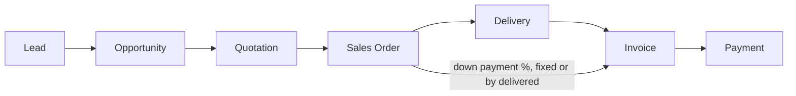
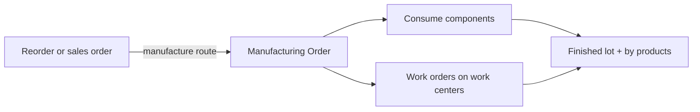

# Odoo Architecture

How Odoo builds the modules we need, read from Odoo 20.0 Community code (`odoo/odoo`, 21 Oct 2026). Part of [[Holding ERP]]. Compared with ours and the others in [[ERP Best Practices]]. The other references: [[ERPNext Architecture]], [[Colleague Architecture]].

> [!warning] Reference, not rules
> Odoo Community is LGPL 3.0. We take ideas only, never its code. Many features we care about are **Enterprise only** (paid, closed) and so not in this read: quality checks, approvals, payroll, product lifecycle (PLM), fixed assets, budgets, consolidation, automatic inter company documents, e-Faktur. Where that matters it says "Enterprise".

## In one page
- **All stock is moves between locations.** Suppliers, customers, inventory adjustment, production, scrap and transit are all "locations". A receipt moves goods from Supplier to Stock, a sale from Stock to Customer, a stock count from Inventory adjustment to Stock. No special documents
- **Routes and rules decide what happens next:** buy, manufacture, make to order, or take from stock. Reorder rules use the same routes, so a low finished good can make a production order and a low material a PO
- **Status comes from the children:** a transfer's status from its moves, a production order's from its moves and work orders
- **Locks on accounting:** lock dates, an irreversible hard lock, time boxed exceptions, and a hash chain that makes posted entries tamper evident
- **Indonesia:** a chart of accounts and PPN taxes. PPN 12 % for normal goods is set up as an 11 % rate labelled 12 % (the DPP 11/12 shortcut). WAPU taxes. QRIS payments. No e-Faktur and no PPh in Community

## Shared patterns

### Multi company and branches
- Every record has a company; links are checked to be in the same company
- **Branches:** a company can have a parent. Branches share the parent's chart, taxes and journals, and lock dates come from the parent
- One account can be shared by several companies

### Approvals
- **PO double approval:** one step, or two steps where orders above an amount (default 5.000 in company currency) go to "To approve" until a purchase manager approves. The check is one small rule that can be extended
- Leave and expense approvals by manager, HR or both
- General approval routing is Enterprise

### Locks and audit
- **Lock dates:** a global one, one for tax (set when the tax return is closed), and separate ones for sales and purchase journals
- **Hard lock date:** can only move forward, never back, no exceptions
- **Lock exceptions:** a temporary, time boxed, logged permission for one user or everyone, with a reason
- Posting into a locked period moves the date to the first open day instead of failing
- **Hash chain per journal:** each posted entry's fingerprint includes the previous one, so a change after posting shows up. Hashed entries can't go back to draft
- **Reversal instead of edit;** a strict audit mode forbids deleting posted entries

## Sales and CRM

- **Sales order states:** quotation, sent, sales order, cancelled, plus a separate lock. Confirming creates the deliveries
- **Quotation templates** with optional lines, validity days, online signature and prepayment %
- **Down payments:** an invoice for a %, a fixed amount, or what was delivered; deducted from the final invoice
- **Invoicing policy per product:** on ordered or on delivered qty
- **Credit limit:** per customer, **warning only, never blocks**
- **CRM:** leads become opportunities with stages, won and lost (with reasons), stage "rotting" after N days, predictive lead scoring

## Purchase
- **States:** RFQ, sent, to approve, purchase order, cancelled, plus a lock
- **Bill control per product:** bill on ordered qty or on received qty (this is the three way match). A matching view pairs PO lines with bill lines
- **Blanket orders:** agreed prices for a period, used on later POs. Comparing RFQs from several vendors is a separate module
- **Vendor down payments:** possible on POs (down payment lines)

## Stock
- **Warehouse steps** are one setting each, which builds the routes:
  - Receipt: 1 step, 2 steps (input then stock), or **3 steps: receive, quality control, store** (with its own QC location)
  - Delivery: ship only, pick then ship, or pick, pack, ship
  - Manufacturing: 1 step, pick before manufacture, store after
- **Removal strategies:** FIFO, LIFO, closest location, least packages, **FEFO** (with product expiry), set per product category or location
- **Put away rules** by product or category, package type and storage capacity
- **Lots and serials;** **expiry dates per lot:** expiration, best before, removal (drives FEFO) and alert, from day offsets on the product. Warns before validating a transfer with expired lots
- **Reorder rules:** min and max per product and location, optionally based on the last 7 to 365 days of demand or seasonality. The route picks **buy or manufacture**
- **Scrap** is a move to the scrap location with a reason; can trigger a re-order
- **Stock counts:** count on the stock record itself; the difference moves to or from the adjustment location. Cyclic counting per location (every N days)
- **Batch and wave picking**

## Valuation
- **Per product category:** standard, average (AVCO) or FIFO; and **periodic** (at closing) or **perpetual (at invoicing)**
- The value sits on each stock move; back dated changes are replayed. Manual value changes are logged with a reason
- **Perpetual at invoicing:** the vendor bill books the stock account and the customer invoice adds COGS lines. Receipts and deliveries themselves don't post journals (new in v20). Price differences on bills go to a price difference account
- **Periodic:** a closing entry (daily or monthly) books the difference between stock value and the books
- **Landed costs:** freight and duty split by qty, cost, weight or volume onto receipts

## Manufacturing (MRP)

- **BOM types:** normal, kit (sells as parts), subcontract. **By products** with a cost share. Operations on work centers, batch size
- **MO states:** draft, confirmed, in progress, to close, done, cancelled. If the used qty differs from the BOM, a warning asks to confirm
- **Unbuild** reverses a production
- **Work centers:** cost per hour, setup and cleanup time, **OEE** (productive time vs blocked), loss types (availability, performance, quality)
- **Finished good cost** = components + work order time x hour cost + extra cost, split by by product shares
- **Subcontracting** and **repair orders**

## Quality (Community)
- **No quality checks in Community** (Enterprise). What exists: the 3 step receipt with a QC location, lot expiry checks, scrap for rejects, and a "quality" loss type on work centers

## Accounting
- **Journals** for sales, purchase, cash, bank, credit card, general; numbers per journal without gaps
- **Payment terms** with several due lines and early payment discount
- **Taxes:** percent, fixed, group, included or not, tax on tax, cash basis
- **Reconciliation** with automatic exchange difference entries on payment. Month end revaluation of open items is Enterprise
- **Analytic plans:** several plans at once (department, project, product line), distributed by % on each line, with rules for which accounts need them
- **Fixed assets, budgets, deferred revenue, consolidation and the report engine:** Enterprise

## POS
- Sessions: opening (cash counted), open, closing (cash counted against expected), closed. Differences booked
- At closing, all non invoiced orders become **one sales receipt per session**, with payments per method. Invoiced orders keep their own invoices

## HR (Community)
- **Attendance:** check in and out from a kiosk (badge or PIN), the app (with GPS) or by hand. Overtime rules by threshold, schedule, weekday and holiday
- **Time off:** approval by nobody, HR, manager or both. **Accrual plans** (hourly to yearly, caps, carry over date)
- **Expenses:** submit, approve, then posted as a receipt to repay the employee, or as already paid by the company
- **Payroll:** Enterprise

## Maintenance
- Equipment with **MTBF, MTTR and next expected failure** computed from corrective requests
- Requests are corrective or preventive; preventive ones repeat every N days, weeks or months. Linking to manufacturing work centers is Enterprise

## Patterns worth borrowing
1. Everything stock is a move between locations, including virtual ones
2. Routes and reorder rules that choose buy or manufacture
3. Warehouse steps as one setting (receipt with QC, pick pack ship)
4. Expiry dates per lot with FEFO as a removal strategy
5. Status computed from the lines
6. Lock dates, an irreversible hard lock, time boxed exceptions, hash chain
7. Approval as one small rule with an amount threshold
8. Analytic plans for reporting by department or product line
9. Branches under a parent company sharing taxes and chart

## Weak spots (don't copy)
- Credit limit only warns
- Most compliance features (quality, assets, payroll, consolidation, e-Faktur) are Enterprise
- PPN 12 % DPP 11/12 is faked as an 11 % rate, which won't match Coretax's DPP field
- Receipts and deliveries post no journals in v20, so stock in the books only updates at invoicing or closing
