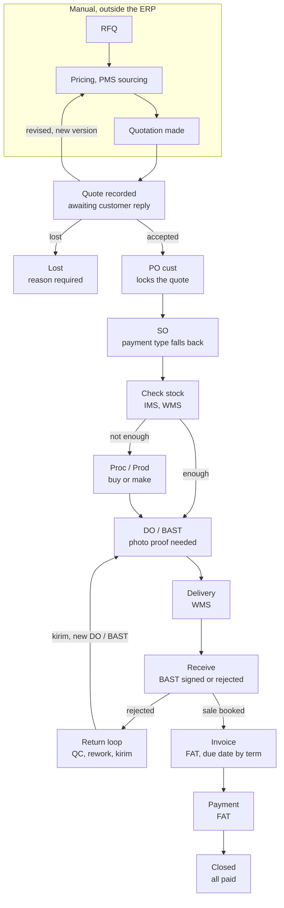
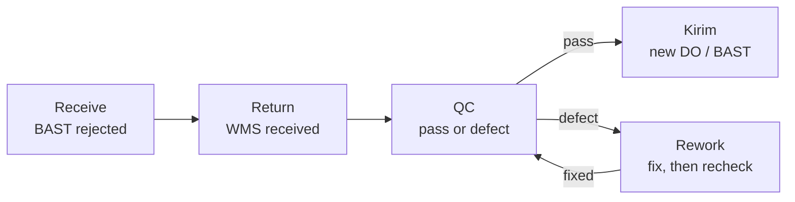

# Sales and Marketing Module

Part of [[Holding ERP]]. Company context is in [[Company Roles and Modules]].

## Overview and scope

The S&M module starts when a quotation is recorded. Everything before that (RFQ, pricing, PMS sourcing, making the quotation) is done manually and stays outside the ERP.

- **In the ERP:** quote record, customer PO, SO, DO / BAST, delivery and receive status, returns and rework
- **Handed to other modules:** stock (IMS/WMS), purchasing or production (Proc/Prod), invoice and payment (FAT)
- **Flows covered:** Tempo (default, credit terms), CBD (cash before delivery), and the Kopken work-first template
- **First build:** tempo only, starting at Quote recorded. CBD and Kopken come later (decision in [[Holding ERP]])
- **Not in Pandu's first release:** POS, CRM and website leads. They are needed later for Anggoan's own selling

> [!warning] Consequence
> Lost-deal reports only cover quotes that were actually recorded. Deals lost before a quote exists are never seen by the ERP.

## Key terms
All terms are in [[Glossary]].

## Records the module owns

Five records carry a deal from quote to delivery. Each one links to the one before it, so any order can be traced back to its quote. Orders from group companies are discussed later (see Pandu baseline).

| Record | Main fields | Statuses | Links to |
|---|---|---|---|
| Quote record | Customer, version (v1, v2...), lines (item, qty, price), total (sum of the lines), payment type (required), validity date, date sent, attached file | Awaiting reply, Accepted, Revised (superseded), Lost | Customer |
| PO cust | PO number, items, qty, price, payment term, delivery address, scan or file | Received, Matched, Mismatch flagged | Accepted quote version |
| SO | Items with our item codes, qty, price, payment type (optional, falls back to quote), delivered qty, invoiced qty, paid qty | Confirmed, Partially delivered, Delivered, Closed, Cancelled | PO cust |
| DO / BAST | Items and qty sent, delivery date, photo proof, customer signature | Created, Delivered, Signed, Rejected | SO |
| Return | Items returned, reason, WMS received date, QC result, rework count | Received, In QC, In rework, Passed, Sent out again | Rejected DO / BAST |

Notes on the quote record:
- Logged at the moment it is sent, so the sent date and validity date are real
- It has item lines, not just a total. That lets the ERP check the PO cust line by line, run the minimum margin check per line, and copy the lines into the SO
- Nego happens outside the ERP. The sales person only records the outcome: accepted (PO cust comes in), revised (new version entered, old one superseded), or lost (reason required)
- Expiry is automatic. Validity date passes with no reply, status becomes Lost (expired)

## Tempo flow (default)

Deliver first, invoice after the BAST is signed, customer pays by the due date from their term. Read it top down. The ERP starts at Quote recorded.

Step notes:
1. **Quote recorded.** Copy of the quote sent to the customer, status awaiting reply. Nego happens outside the ERP. Outcome is one of accepted, revised (new version, back to manual pricing) or lost
2. **PO cust.** Scanned or input, linked to the accepted quote version, which then locks. Differences from the quote (qty, price, term) are flagged
3. **SO.** Built from the PO with our item codes. Tracks delivered, invoiced and paid quantities, including partial deliveries
4. **Check stock (IMS, WMS).** Enough goes to DO / BAST. Not enough goes to Proc/Prod (buy or make flag on the item), which then feeds DO / BAST
5. **DO / BAST.** One document, statuses created, delivered, signed. Can't be signed without a photo
6. **Delivery (WMS), then Receive.** Signed BAST books the sale and triggers the invoice. Rejected goes to the return loop
7. **Invoice and payment (FAT).** Due date from the effective payment term. Order closes when everything is paid

## Return, QC and rework loop

A rejected delivery comes back through WMS and has to pass QC before it ships again. Nothing goes back out without passing QC.

QC is one step with two exits: defect goes to rework, pass goes to kirim. Rework always returns to the same QC step.

- Kirim creates a new DO / BAST linked to the original order. The original BAST stays Rejected, so the history is visible
- The return record keeps a rework count. The limit before scrap or a supplier claim is still open
- This is the default loop. Kopken uses a Rework Report instead and gets no new BAST (see the Kopken template below)

## CBD flow

> [!note] Later
> Not in the first build. Tempo comes first.

In CBD the customer pays before anything ships, so there is no AR and no credit risk.

1. RFQ comes in (on the whiteboard this flow starts at RFQ, see open questions)
2. Check stock. If not enough, go to Prod/Proc, then back to check stock
3. Issue the PI (proforma invoice)
4. Customer pays the PI in full
5. Create the DO / BAST only after payment is confirmed
6. Delivery, customer signs the BAST
7. Order closed (prepaid, nothing left to collect)

> [!important] Rule
> The system blocks DO / BAST creation until the PI is marked paid.

## Kopken work-first template

> [!note] Later
> Not in the first build. Kopken belongs to Sancang, not Pandu.

For Kopken (handled by [[PT Sancang Anugerah Nusantara]], AC service jobs) the work is done first and priced after, the reverse of tempo.

1. Kopken supervisor reports the AC problem to Kopken head office (pusat)
2. Pusat assigns the job to Sancang. Sancang opens an RFQ / WO (the AC job ticket)
3. Work is done. DO / BAST is created with photo proof. No photo, no BAST
4. Quotation is made after the work, with the actual price
5. If Kopken complains, Sancang makes a Rework Report (photos, what was fixed) and goes back to the WO. No new BAST
6. No complaint: Kopken issues their PO
7. Invoice for the finished job, then AR and payment as normal

Build notes:
- Make this an order type on the customer ("work first" vs "PO first"), not hardcoded for Kopken. Same documents, different order
- The Rework Report requirement is also a customer setting
- Add an aging flag on BASTs with no PO yet. Work is already done, so a missing PO is money at risk
- Create the SO automatically when Kopken's PO arrives, so billing still starts from an SO

## Business rules

| Rule | How the system enforces it |
|---|---|
| Payment type lives on the quote | Required field on every quote version (cash, tempo + days, down payment, installment) |
| SO payment type falls back to the quote | SO field is optional. Empty means follow the accepted quote version. Screen shows the effective value and where it came from |
| SO override gets flagged | If the SO or PO term differs from the quote (tempo 45 vs quoted 30), it is highlighted and needs approval |
| Quote locks on PO | Once PO cust is linked, that quote version can't be edited |
| Loss needs a reason | Price (customer says too expensive) *(assumed reading of "price too low")*, customer cancelled, no response, expired (auto) |
| Minimum margin check | A quote line with a margin below the minimum needs manager approval before the quote is sent. Decided 2026-10-13, replaces the floor price idea |
| No photo, no BAST | DO / BAST can't move to Signed without at least one photo |
| Sale is booked on BAST | Finance books revenue when the BAST is signed, not when the PO arrives. Signed BAST also triggers the invoice (tempo) |
| DO / BAST is one document | One record with statuses (created, delivered, signed, rejected), not two |
| Nothing ships without passing QC | Returned goods go through QC. Rework always goes back to QC before kirim |
| Kirim uses a new DO / BAST | Linked to the original order. The original BAST stays Rejected for history |
| Tempo invoice due date | Comes from the effective payment term (SO or quote) |

## Handoffs to other modules

> [!info] The split that matters
> PMS only gets a price before the customer commits. Proc/Prod spends real money, so it only opens after the SO is confirmed.

| Module | What it does for S&M | Where in the flow |
|---|---|---|
| PMS | Vendor price inquiry when there's no price yet. Nothing gets bought | Before the quote, manual, outside S&M |
| IMS / WMS | Stock check, DO / BAST, delivery, receiving, returns received | Check stock through receive, and the return loop |
| Proc / Prod | Buys or makes the goods when stock is short. Decided by a buy-or-make flag on the item | After SO, when check stock says no |
| FAT | Invoice, AR, payment, books the sale on signed BAST | After receive |

## Pandu baseline
- **Who Pandu sells to:** outside customers and other group companies. Anggoan is the main one, a B2B buyer, and goes through S&M
- **Group company orders:** intercompany is discussed later. Until then Anggoan is handled like any other customer
- **Outside customers:** full tempo flow, starting at Quote recorded
- **Before Stock and Finance exist (Phase 2):** check stock is a manual "stock confirmed" step on the SO, and a signed BAST sets the order to "handed to FAT". Real stock and invoices are wired in at Phases 4 and 5 (see [[Pandu Roadmap]])
- **What Wening changes:** batch and expiry on DO / BAST lines later, when Production and Stock exist (Phase 6)
- **What the holding view excludes:** Pandu's sales to group companies. Only sales to outside customers count as group revenue

## Open questions
- [ ] Does CBD also start at quote recorded, or at RFQ like the whiteboard? Decides if both flows share one entry point
- [ ] Add a credit gate before SO for tempo customers (credit limit and overdue AR)? Not on the whiteboard yet
- [ ] Rework limit: after how many failed QC rounds does it go to scrap or a supplier claim?
- [ ] Check stock N: tempo goes Prod/Purch to DO / BAST, CBD loops back to check stock. Same or different on purpose?
- [ ] Does a lost deal count as Closed? The whiteboard links Loss to Closed
- [ ] Kopken revenue timing: the price only exists after BAST, so when does finance book the sale?
- [ ] Minimum margin: margin against which cost (average stock cost, last purchase price)? What is the minimum, one % for the company or per item? Which manager approves?
- [ ] Is down payment its own payment type, or tempo with a first installment?
- [ ] Later, with intercompany: does Anggoan (or another group buyer) get a quote first, or does its PO go straight to an SO?
- [ ] What is PMS? It is not one of the 12 modules. Is it sourcing inside Procurement?
- [ ] Is "cash" on the quote the same as CBD? Installment has no flow yet
- [ ] Who approves an SO term override? Depends on the role list in [[Foundation Module]]
- [ ] Can a BAST be partly rejected, with some lines accepted and invoiced?
- [ ] Does a customer need several delivery addresses for the DO / BAST? Foundation keeps one address and one contact per customer for now. The colleague's repo has several of each
- [ ] Later: who owns the PI and its paid status in CBD, S&M or FAT? CBD has no PO cust or SO in the flow, but DO / BAST links to an SO
- [ ] Later: Kopken creates the BAST before any PO or SO exists, and the WO and Rework Report are not records yet. How do they link?

## Acceptance checks
Written before the build. Each one is something Jingga can click through.
- [ ] 

## Build plan
Filled in by Claude and approved before any code.
- Data model:
- Screens:
- API:
- Slices (small, one record end to end):
  - [ ] 
