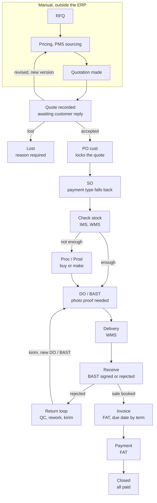
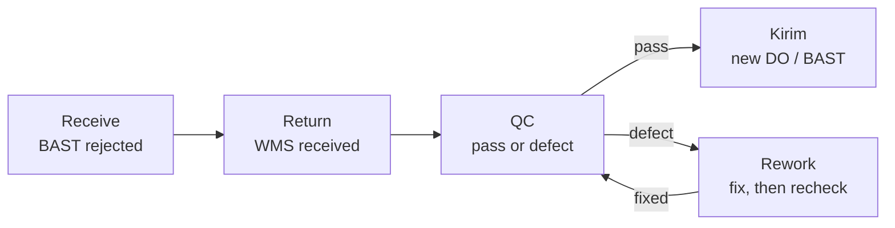

# Sales and Marketing Module

Part of [[Holding ERP]]. Company context is in [[Company Roles and Modules]].

## Overview and scope

The S&M module starts when a quotation is recorded. Everything before that (RFQ, pricing, PMS sourcing, making the quotation) is done manually and stays outside the ERP.

- **In the ERP:** quote record, customer PO, SO, DO / BAST, delivery and receive status, returns and rework
- **Handed to other modules:** stock (IMS/WMS), purchasing or production (Proc/Prod), invoice and payment (FAT)
- **Flows covered:** Tempo (default, credit terms), CBD (cash before delivery), and the Kopken work-first template
- **First build:** CBD first, then tempo and progress (down payment), all starting at Quote recorded. COD and Kopken come later (decisions in [[Holding ERP]], 2026-10-14)
- **Not in Pandu's first release:** POS, CRM and website leads. They are needed later for Anggoan's own selling

> [!warning] Consequence
> Lost-deal reports only cover quotes that were actually recorded. Deals lost before a quote exists are never seen by the ERP.

## Marketing module (change M, Jingga 2026-10-22)
Sales and Marketing share this spec, but in the app Marketing is its own module, like the colleague's repo. Its screens:
- **Price monitor** (its home): each active item's cost, COGS, SPPR in use, suggested SPPR and GP, the ones with GP under the minimum, an SPPR below the suggested one, no SPPR or no cost first. Each opens the item page, where the SPPR is set
- **Prices to approve**: prices Sales proposed, prices above the SPPR (to see) and customer PO prices below the quote
- **Pricing**: the FOH rate and the minimum and default GP

Sales keeps quotes, orders, PIs, deliveries, returns, To invoice, and its own To approve for payment terms (the GM) and credit (Sales Managers). Who sees what is unchanged: Marketing's screens need `margin.view` or `quotes.approve_price`.

## Key terms
All terms are in [[Glossary]].

## Records the module owns

Five records carry a deal from quote to delivery. Each one links to the one before it, so any order can be traced back to its quote. Orders from group companies are discussed later (see Pandu baseline).

| Record | Main fields | Statuses | Links to |
|---|---|---|---|
| Quote record | Customer, version (v1, v2...), lines (item, qty, price), total (sum of the lines), payment type (required), validity date, date sent, attached file | Awaiting reply, Accepted, Revised (superseded), Lost | Customer |
| PO cust | PO number, items, qty, price, payment term, delivery address, scan or file | Received, Matched, Mismatch flagged | Accepted quote version |
| SO | Items with our item codes, qty, price, payment type (optional, falls back to quote), delivered qty, invoiced qty, paid qty | Confirmed, Partially delivered, Delivered, Closed, Cancelled | PO cust |
| DO / BAST | Items and qty sent, delivery date, photo proof, customer signature | Created, Delivered, Signed, Rejected | SO |
| Return | Items returned, reason, WMS received date, QC result, rework count | Received, In QC, In rework, Passed, Sent out again | Rejected DO / BAST |

Notes on the quote record:
- Logged at the moment it is sent, so the sent date and validity date are real
- It has item lines, not just a total. That lets the ERP check the PO cust line by line, run the minimum margin check per line, and copy the lines into the SO
- Nego happens outside the ERP. The sales person only records the outcome: accepted (PO cust comes in), revised (new version entered, old one superseded), or lost (reason required)
- Expiry is automatic. Validity date passes with no reply, status becomes Lost (expired). Jingga, 2026-10-14: keep it
- The sales person is warned 3 days before the validity date *(assumed number)*
- An expired quote is never revived. If the customer still wants it, sales makes a new quote version with fresh prices

## Tempo flow (default)

Deliver first, invoice after the BAST is signed, customer pays by the due date from their term. Read it top down. The ERP starts at Quote recorded.

Step notes:
1. **Quote recorded.** Copy of the quote sent to the customer, status awaiting reply. Nego happens outside the ERP. Outcome is one of accepted, revised (new version, back to manual pricing) or lost
2. **PO cust.** Scanned or input, linked to the accepted quote version, which then locks. Differences from the quote (qty, price, term) are flagged
3. **SO.** Built from the PO with our item codes. Tracks delivered, invoiced and paid quantities, including partial deliveries
4. **Check stock (IMS, WMS).** Enough goes to DO / BAST. Not enough goes to Proc/Prod (buy or make flag on the item), which then feeds DO / BAST
5. **DO / BAST.** One document, statuses created, delivered, signed. Can't be signed without a photo
6. **Delivery (WMS), then Receive.** Signed BAST books the sale and triggers the invoice. Rejected goes to the return loop
7. **Invoice and payment (FAT).** Due date from the effective payment term. Order closes when everything is paid

## Return, QC and rework loop

A rejected delivery comes back through WMS and has to pass QC before it ships again. Nothing goes back out without passing QC.

QC is one step with two exits: defect goes to rework, pass goes to kirim. Rework always returns to the same QC step.

- Kirim creates a new DO / BAST linked to the original order. The original BAST stays Rejected, so the history is visible
- The return record keeps a rework count. The limit before scrap or a supplier claim is still open
- After QC, the customer gets the goods again (kirim) or a **credit note**: a document that takes the returned goods' value off what they owe, or leaves them a credit if they already paid. Jingga, 2026-10-14. The credit note needs invoices, so it comes with FAT (Phase 5). Until then only kirim. Who may issue a credit note and whether it needs approval is open
- This is the default loop. Kopken uses a Rework Report instead and gets no new BAST (see the Kopken template below)

## CBD flow

> [!note] First build
> Built first, before tempo (Jingga, 2026-10-14). It is also the default payment type.

In CBD the customer pays before anything ships, so there is no AR and no credit risk.

1. RFQ comes in (on the whiteboard this flow starts at RFQ, see open questions)
2. Check stock. If not enough, go to Prod/Proc, then back to check stock
3. Issue the PI (proforma invoice)
4. Customer pays the PI in full
5. Create the DO / BAST only after payment is confirmed
6. Delivery, customer signs the BAST
7. Order closed (prepaid, nothing left to collect)

> [!important] Rule
> The system blocks DO / BAST creation until the PI is marked paid.

## Kopken work-first template

> [!note] Later
> Not in the first build. Kopken belongs to Sancang, not Pandu.

For Kopken (handled by [[PT Sancang Anugerah Nusantara]], AC service jobs) the work is done first and priced after, the reverse of tempo.

1. Kopken supervisor reports the AC problem to Kopken head office (pusat)
2. Pusat assigns the job to Sancang. Sancang opens an RFQ / WO (the AC job ticket)
3. Work is done. DO / BAST is created with photo proof. No photo, no BAST
4. Quotation is made after the work, with the actual price
5. If Kopken complains, Sancang makes a Rework Report (photos, what was fixed) and goes back to the WO. No new BAST
6. No complaint: Kopken issues their PO
7. Invoice for the finished job, then AR and payment as normal

Build notes:
- Make this an order type on the customer ("work first" vs "PO first"), not hardcoded for Kopken. Same documents, different order
- The Rework Report requirement is also a customer setting
- Add an aging flag on BASTs with no PO yet. Work is already done, so a missing PO is money at risk
- Create the SO automatically when Kopken's PO arrives, so billing still starts from an SO

## Business rules

| Rule | How the system enforces it |
|---|---|
| Payment type lives on the quote | Required field on every quote version (cash, tempo + days, down payment, installment) |
| SO payment type comes from the quote | Taken from the accepted quote version, or from an approved PO cust mismatch (rule below) *(assumed, ask supervisor)* |
| Term change only through the PO cust | The SO has no free term field. Its term comes from the accepted quote. If the PO cust term differs (tempo 45 vs quoted 30), the mismatch is flagged: the GM approves it (Director if no GM) and it becomes the order's term, or sales makes a new quote version *(assumed, ask supervisor)* |
| Quote locks on PO | Once PO cust is linked, that quote version can't be edited |
| Loss needs a reason | Price (customer says too expensive) *(assumed reading of "price too low")*, customer cancelled, no response, expired (auto) |
| Suggested SPPR | The item page suggests an SPPR from the COGS and the default GP (**27 %** from 2026-10-21, set by Marketing Managers). This is the **system SPPR**: Marketing can take it or type a higher one, **never a lower one** (the floor, 2026-10-21). Jingga, 2026-10-21. Built in R2 |
| SPPR below the minimum GP | **Replaced 2026-10-21 by the floor**: an SPPR can't be below the system SPPR, which already keeps 27 % GP, so there is nothing below 17 % to approve. Built in R2: the GM's SPPR approval is gone; earlier waiting SPPRs were closed as refused, kept as history |
| Quote price below 27 % or 17 % GP | A quote price under the default GP (27 %) needs a Manager or up in Marketing, as any price below the SPPR does now. A price **under the minimum GP (17 %) is refused**, with no approval. Jingga, 2026-10-21. Built in R1: refused when Sales proposes it, and an approver can only refuse a waiting one (also on a customer's PO, assumed). PostgreSQL answers only yes or no, so Sales never sees the cost |
| Price comes from the SPPR | A quote line's price fills in from the item's SPPR. Sales can't type a price. Jingga, 2026-10-14 |
| Another price is a proposal | Sales proposes a price with a required reason. **Below the SPPR:** the quote waits and can't be sent until a Manager or up in Marketing approves; refused, the line goes back to the SPPR. **Above the SPPR:** the line takes the price at once and the quote can be sent; Marketing sees it under "Prices above the SPPR". Jingga, 2026-10-14; above changed 2026-10-21 *(ask supervisor to confirm)* |
| Approvers see the margin | The approver sees the COGS and the GP (price - COGS) / price at the proposed price. Sales never does. Below the minimum GP the approver sees a warning (to be replaced by the refusal above). Jingga, 2026-10-21. Who may see the numbers changed on 2026-10-21, see the next row |
| Who sees cost and margin | Only the GM, the Super Admin, the Super User and the Finance manager. Not Marketing, not Finance staff, not Sales, and the Director no longer (2026-10-21). Jingga, 2026-10-21. Built in R3, with the Marketing Manager keeping it to approve prices *(assumed)* |
| No photo, no BAST | DO / BAST can't move to Signed without at least one photo |
| Stock goes out when goods leave | Stock drops when the goods leave the warehouse, so nobody else is promised them *(assumed, ask supervisor and FAT)*. Manual until stock exists (Phase 4) |
| Sale is booked on BAST | Finance books revenue and its COGS together when the BAST is signed, not when the PO arrives or the goods leave. Signed BAST also triggers the invoice (tempo). COGS at the same moment is *(assumed, ask supervisor and FAT)* |
| DO / BAST is one document | One record with statuses (created, delivered, signed, rejected), not two |
| Nothing ships without passing QC | Returned goods go through QC. Rework always goes back to QC before kirim |
| Kirim uses a new DO / BAST | Linked to the original order. The original BAST stays Rejected for history |
| Tempo invoice due date | Comes from the effective payment term (SO or quote) |

## Handoffs to other modules

> [!info] The split that matters
> PMS only gets a price before the customer commits. Proc/Prod spends real money, so it only opens after the SO is confirmed.

| Module | What it does for S&M | Where in the flow |
|---|---|---|
| PMS | Vendor price inquiry when there's no price yet. Nothing gets bought | Before the quote, manual, outside S&M |
| IMS / WMS | Stock check, DO / BAST, delivery, receiving, returns received | Check stock through receive, and the return loop |
| Proc / Prod | Buys or makes the goods when stock is short. Decided by a buy-or-make flag on the item | After SO, when check stock says no |
| FAT | Invoice, AR, payment, books the sale on signed BAST | After receive |

## Costing and pricing (from Jingga, 2026-10-14)
The full model is in [[Finance Accounting Tax Module#Costing and pricing]]. What it means for S&M:
- Sales quotes from the **SPPR** (selling price publish rate) and never sees cost or margin. A quote line's price fills in from the item's SPPR; Sales can't type a price, only propose another one with a reason, approved by a Manager or up in Marketing (Jingga, 2026-10-14). Pandu has no bottom price
- The margin check uses COGS = COGM + DL + FOH, not just the material cost. GP = (price - COGS) / price
- The typed item cost from slice S0 is the **COGM** for now (assumed). DL and FOH are not in the ERP yet, so the S2 margin check needs them first. This changes the S2 plan, see the open questions in the Finance note
- MAP (moving average price) is the costing method, confirmed by Jingga. Procurement sees MAP

## What a customer's PO looks like
From the group's own POs (see [[Procurement Module#The group's PO templates]]): when a group company buys from Pandu, its PO is Pandu's **PO cust**. A customer's PO carries its own PO number and date, a requested delivery date, a **quote reference** (our quote number), the payment term, a delivery address with a PIC, and lines with item, qty, unit, unit price and amount, plus PPN and the grand total. So the PO cust record (slice S3) needs: their PO number and date, delivery date, our quote it answers, payment term, delivery address, lines, and the scan *(Claude's reading, for the S3 plan)*

## Notes from the Inbox
From Jingga's Inbox, processed 2026-10-14. Raw notes, not rules yet.
- **After the SO, Production comes before Procurement.** For goods Pandu makes, a shortage on an SO goes to Production, and Production asks Procurement for the raw materials. Pandu makes what it sells instead of buying finished goods. Fits the buy or make flag on items: make items go to Production first *(assumed reading)*
- **Marketing wants analysis:** sales by customer, favorite products, customer care, and complaints or rejects (voice of customer). Not in the first build. Needs a spec of its own when Marketing is planned. Listed with the other Marketing ideas in [[Pandu Roadmap#Additional features]]
- **Down payment and progress payments come before the invoice, and the payment and the invoice must match.** See [[Finance Accounting Tax Module]]

## Pandu baseline
- **Who Pandu sells to:** outside customers and other group companies. Anggoan is the main one, a B2B buyer, and goes through S&M
- **Group company orders:** intercompany is discussed later. Until then Anggoan is handled like any other customer
- **Outside customers:** full tempo flow, starting at Quote recorded
- **Before Stock and Finance exist (Phase 2):** check stock is a manual "stock confirmed" step on the SO, and a signed BAST sets the order to "handed to FAT". Real stock and invoices are wired in at Phases 4 and 5 (see [[Pandu Roadmap]])
- **What Wening changes:** batch and expiry on DO / BAST lines later, when Production and Stock exist (Phase 6)
- **What the holding view excludes:** Pandu's sales to group companies. Only sales to outside customers count as group revenue

## Open questions
- [x] *(compared 2026-10-21 with the colleague's newest code, `feat/marketing-sppr` of 20 Oct, nothing newer on any branch)* Three R4 and R5 choices. **Jingga approved all three recommendations 2026-10-22, built the same day**: the item page warns when the SPPR in use is below the suggested SPPR (the cost changed after it was set); areas are changed by Sales and Finance Managers and the GM (migration 0053); a city is in one active area only, refused with the other area's name, also when an inactive area comes back. 299 tests pass:
  - **A future SPPR checked against today's cost.** His `sppr_set` checks nothing but a price above 0 and a day not in the past; his floor (never below the system SPPR) is only planned, and his system SPPR is worked out when it is used, from last month's FOH. ERPNext and Odoo keep dated price lists with no cost check when a price is set; ERPNext can check the selling price against the cost on the sale itself. Gap in ours: if the cost rises before a future SPPR's day, that SPPR can be below the floor when it starts, and a quote line at the SPPR is never checked (only proposed prices are). Recommended: keep the check when it is set, and add a flag on the item page (like his margin monitor) when the SPPR in use is below today's suggested SPPR
  - **Who manages areas.** His areas are only planned (FN2: "city / region list, the customer's city fills it in"), no owner named; his customers already have a city. ERPNext's Territory (a tree, picked on the customer) is managed by the Sales Master Manager. Recommended: the same people as customers, Sales and Finance Managers and the GM, instead of Finance and Management
  - **One city in two areas.** Neither his plan nor ERPNext fills an area from a city; territories are drawn so they don't overlap. Recommended: refuse a city that is already in another active area (the message names it), instead of the first code winning
- [x] The colleague's revised Marketing plan (2026-10-20, see [[Colleague Repo Comparison#Their Marketing branch, revised (read 2026-10-21)]]) is **confirmed by Jingga, 2026-10-21**: GP default 27 % and minimum 17 % (refused below), FOH from the general ledger (a standard % until Phase 5), adjustments never below the system value, cost seen only by the GM, supers and the Finance manager, and the ideas (customer area, Finance dashboard, marketing cost, SPPR valid from a day). The code still has the old rules: see the change plan R1 to R5 under Slices
- [ ] *(ask supervisor, S5)* PPN on a PI: built as 11 % on top of the order total before PPN, taken from the colleague's repo, where the customer pays the total with tax. What is the rate, does it differ per item or customer, and how does PPN show on the PI and the later invoice? FAT decides how it shows; the rate is a constant in code until then. Jingga, 2026-10-21
- [ ] *(ask supervisor, S5)* Does a customer pay a CBD PI in parts? Built so (partly paid status and an amount paid, like the colleague's repo), and DO / BAST waits for the full amount. If it is always in full, the parts can go
- [ ] *(ask supervisor, S5)* A wrong payment entry can't be corrected: it can't be changed or deleted, so the PI can't be voided and its order can't be cancelled. Is a reversal needed before FAT?
- [ ] *(ask supervisor, S5)* An order with a payment on its PI can't be cancelled, since refunds come with FAT. Is that right, or should Finance refund first? Jingga said "idk" on 2026-10-21, so this is my call. Changed with Finance F6 (2026-10-22): the order cancels, its PI is voided, and Finance refunds the money through the approval engine
- [ ] Prefix `PI` for proforma numbers *(assumed)*, like `SQ` and `SO`
- [ ] Does CBD also start at quote recorded, or at RFQ like the whiteboard? Decides if both flows share one entry point
- [x] Credit gate before the SO for tempo customers, like the colleague's repo. Jingga, 2026-10-14. Each customer has a credit limit (0 by default). Exposure = open SOs not yet invoiced + unpaid invoices + the new SO. Over the limit: a warning, the SO waits for approval by a Manager or up in Sales, and no stock is held until approved. Overdue invoices are not checked separately *(assumed)*
- [ ] Rework limit: after how many failed QC rounds does it go to scrap or a supplier claim?
- [x] Check stock is automatic, like the colleague's repo: available stock is held for the SO when it is confirmed, and a shortage goes to Prod/Purch. Same for every payment type. Jingga, 2026-10-14
- [x] Until stock exists (Phase 4), check stock stays a manual "stock confirmed" step on the SO. It becomes automatic in Phase 4. Jingga, 2026-10-14
- [x] A lost deal counts as Closed, like the whiteboard. Jingga, 2026-10-14 *(assumed, ask supervisor to confirm)*
- [ ] Kopken revenue timing: the price only exists after BAST, so when does finance book the sale?
- [x] Minimum margin: settings from the colleague's repo, formula from the office whiteboard ([[2026-10-14 Whiteboard costing and pricing]]). Jingga, 2026-10-14. **Ask supervisor to confirm.** Margin is gross profit on the selling price: GP % = (price - COGS) / price x 100. COGS is the item's moving average cost, like the colleague's repo *(assumed, ask supervisor)*. One % per company: default 20 %, minimum 10 %, both changeable per company *(colleague's numbers)*. The GP formula is the whiteboard's *(ask supervisor to confirm)*. Below the minimum, a Manager or up in Marketing approves before the quote is sent
- [x] Cost method: MAP (moving average price) builds the COGM; VA is value added, not a cost method. Jingga, 2026-10-14 (see [[Finance Accounting Tax Module#Costing and pricing]]). Was: cost method, three things to confirm from the whiteboard: (1) what "VA" means, (2) moving average price, (3) standard price. Which one, and for which items (raw material, packaging, finished Wening goods)? Our pick for now: moving average for every item, with a typed standard cost until Phase 4. Claude's view: moving average is the usual choice in Indonesia, allowed by PSAK 14 and by tax rules (average or FIFO, used consistently), and simple. Picking the oldest batch first for expiry is a warehouse rule and works with any cost method. Standard price can be added later for finished goods if Production wants to compare planned and real cost. Jingga reads the "15 to 22" on the whiteboard as nothing important
- [x] Margin and cost are seen **only by Marketing and the Super Admin and Super User**. Nobody in Sales sees them, so they can't see the profit and push for a raise. Jingga, 2026-10-14, from the Inbox note "Marketing may have a margin, sales may not" *(ask supervisor to confirm)*. A quote line below the minimum only shows "needs approval". The colleague's repo differs: every sales staff who sees or makes a quote sees each line's margin
- [x] A quote below the minimum margin is approved by a Manager or up in Marketing, since Sales can't see margins. Jingga, 2026-10-14 *(ask supervisor to confirm)*
- [x] Until stock exists (Phase 4), Finance types a cost on each item (a standard price) and the margin check uses it. Jingga, 2026-10-14 *(assumed, to change in Phase 4 when the moving average cost exists)*
- [x] Down payment is its own payment type, called progress: a down payment before delivery, then the rest in parts, like the colleague's repo. Built in the first build. Jingga, 2026-10-14. COD comes later. Was: Is down payment its own payment type, or tempo with a first installment? Partly answered in meeting [[2026-10-14]]: sales payment types are ours to decide, default CBD, with COD, progress payment and Net up to 180 days. Which ones S&M builds first still to decide
- [ ] Later, with intercompany: does Anggoan (or another group buyer) get a quote first, or does its PO go straight to an SO?
- [ ] What is PMS? It is not one of the 12 modules. Is it sourcing inside Procurement?
- [ ] Is "cash" on the quote the same as CBD? Installment has no flow yet
- [x] SO term override is approved by the GM. Jingga, 2026-10-14. **Ask supervisor to confirm** where it happens: Claude suggested on the PO cust mismatch, not as a free field on the SO, and Jingga agreed (2026-10-14). Only a looser term (more days, or tempo instead of CBD) needs approval *(assumed)*. A company with no active GM falls back to a Director *(assumed)*
- [ ] Credit note after a return: who issues it, and does it need approval? (comes with Phase 5)
- [ ] Can a BAST be partly rejected, with some lines accepted and invoiced?
- [x] Every sale is in IDR. Meeting [[2026-10-14]]
- [ ] Does a customer need several delivery addresses for the DO / BAST? Foundation keeps one address and one contact per customer for now. The colleague's repo has several of each
- [ ] Later: who owns the PI and its paid status in CBD, S&M or FAT? CBD has no PO cust or SO in the flow, but DO / BAST links to an SO
- [ ] Later: Kopken creates the BAST before any PO or SO exists, and the WO and Rework Report are not records yet. How do they link?

## Acceptance checks
Written before the build. Each one is something Jingga can click through, as Pandu.
- [ ] A sales person records a quote (customer, lines, payment type, validity date, file) and sees it as Awaiting reply
- [ ] Revising a quote makes v2. v1 shows Revised and can't be edited
- [ ] Marking a quote lost asks for a reason. A quote past its validity date shows Lost (expired) by itself, and shows "expires soon" 3 days before
- [ ] A quote line below the minimum margin shows only "needs approval" to Sales. A Marketing Manager sees the GP % and approves or refuses it. A Sales Manager never sees a margin or a cost
- [ ] A customer PO is recorded against the accepted quote version. A different qty, price or term is flagged per line. A looser term waits for the GM. The quote version locks
- [ ] An SO is made from the PO cust and shows its payment type and term, and where they came from
- [ ] A tempo SO over the customer's credit limit waits for a Sales Manager. Under the limit it goes straight to Confirmed
- [ ] "Stock confirmed" on the SO is needed before any DO / BAST
- [ ] CBD: a PI is made from the SO. No DO / BAST can be made until Finance has recorded the full payment on the PI. After the last signed BAST the order is Closed (the PI and its payments are built in S5, the DO / BAST block and Closed come in S6)
- [ ] Progress: a down payment PI is paid before the first DO / BAST. The rest goes to FAT as a schedule
- [ ] A DO / BAST can't be signed without a photo. Partial deliveries update the SO's delivered qty
- [ ] Tempo: a signed BAST sets the delivery to "handed to FAT"
- [ ] A rejected BAST makes a return. QC defect goes to rework, rework goes back to QC (rework count goes up), pass makes a new DO / BAST linked to the same SO. The old BAST stays Rejected
- [ ] Someone from Anggoan, a Super User, or a person without the permission can't see or change any of Pandu's sales records (database rules, with tests)

## Build plan
Written and **approved by Jingga 2026-10-14**. Order: CBD first, then tempo and progress, all from Quote recorded. Phase 2 has no stock (Phase 4) and no invoices (Phase 5), so check stock is a manual "stock confirmed" step and tempo ends at "handed to FAT".

### Changes to Foundation first (finished module, needs approval)
Foundation is done, so these change its data model. Each one is small:
- **Marketing function.** Add `marketing` next to `sales` in the department functions. Both work in the S&M module, but only Marketing sees margins and approves low ones. Pandu gets a Marketing department at seed. Jingga, 2026-10-14
- **Quality function, empty.** Add `quality` to the department functions with no starting grants, so it is ready for the Quality module. QC on returns (S9) is given to Quality. Jingga, 2026-10-14
- **Customer fields** that S&M needs, all promised "with S&M" earlier: NPWP (15 or 16 digits, optional, kept because every column of the Excel sheets is a field when adding a record), credit limit (Rp, 0 by default), default payment type and term (CBD, tempo with Net 1 to 180 days, or progress), set by Sales and Finance Managers
- **Several delivery addresses per customer**, like the colleague's repo (Jingga, 2026-10-14). Built as extra addresses next to the customer's own address, which stays where it is (not copied)
- **Item cost**: a typed standard cost per item, changed only by Finance Managers and up, seen only by Marketing, the GM and the supers. Jingga, 2026-10-14 *(until Phase 4)*. Built: Finance sees it too, every level (Jingga, 2026-10-14)
- **New permission to see cost and margin** (`margin.view`): Marketing, Finance (Jingga, 2026-10-14), the GM and the supers. Jingga, 2026-10-14 *(GM: ask supervisor)*

### Data model
One table per record, each with `company_id`, the read and write rule pair, a company isolation test and the audit log, like every Foundation table.

| Table               | Holds                                                                                                                         | Notes                                                                       |
| ------------------- | ----------------------------------------------------------------------------------------------------------------------------- | --------------------------------------------------------------------------- |
| `sales_settings`    | Per company: default margin 20 %, minimum margin 10 %, quote warning days 3                                                   | *(assumed numbers, colleague's)*                                            |
| `quotes`            | Customer, number, current version, status (awaiting reply, accepted, lost), lost reason and note                              | Lost reasons: price, customer cancelled, no response, expired (auto)        |
| `quote_versions`    | Version number, payment type and term, validity date, date sent, file, status (current, revised) | Only the current version can change, and only before a PO cust. The progress down payment % is on the order's payment plan (S8), not the quote |
| `quote_lines`       | Item, qty, unit, price                                                                                                        | GP % is worked out when read, never stored, so cost changes show at once    |
| `customer_pos`      | Quote version, PO number, PO date, payment term, delivery address, scan, status (received, matched, mismatch)                 | One per accepted quote version                                              |
| `customer_po_lines` | Item, qty, price, plus the flag when it differs from the quote                                                                |                                                                             |
| `sales_orders`      | PO cust, payment type and term (copied, never typed), credit check result, stock confirmed (who, when), status                | Confirmed, Partially delivered, Delivered, Handed to FAT, Closed, Cancelled |
| `sales_order_lines` | Item, qty, price, delivered qty                                                                                               | Invoiced and paid qty come with FAT (Phase 5)                               |
| `proforma_invoices` | SO, kind (full for CBD, down payment for progress), subtotal, PPN rate and amount, amount, void (who, when, why)               | No AR, no journal. Paid and status are worked out from the payments |
| `proforma_payments` | PI, amount, day received, reference, recorded by                                                                              | Several per PI, never more than its amount. Never changed or deleted *(assumed)* |
| `deliveries`        | SO, number, date, status (created, delivered, signed, rejected), receiver name, rejection reason, replaces (for kirim)        | The DO / BAST, one document                                                 |
| `delivery_lines`    | SO line, qty                                                                                                                  |                                                                             |
| `delivery_photos`   | Photo files                                                                                                                   | Stored like the KTP scan (`lib/file-storage.ts`)                            |
| `returns`           | Rejected delivery, reason, received by warehouse (who, when), status, rework count                                            | Received, In QC, In rework, Passed, Sent out again                          |
| `return_checks`     | Each QC round: pass or defect, what was wrong, who                                                                            | The rework count is the number of defect rounds                             |
| `approval_requests` | Document, kind (low margin, term mismatch, credit limit), asked by, decided by, decision, note                                | One shared table so there is one "To approve" list *(design choice)*        |

Document numbers in the group's official style (Jingga, 2026-10-14): `SQ-1025-001` for quotes, then SO, PI and DO the same way, numbered per company per month.

### Screens
All under the company, in a new **Sales** menu:
- **Quotes**: list (filter by status, "expires soon"), record a quote, quote page with versions, revise, mark lost, record PO cust
- **Orders**: list, SO page with lines, stock confirmed button, PIs, deliveries and returns on one page, the document chain on top
- **Deliveries**: list for the warehouse, DO / BAST page with photo upload, sign or reject
- **Returns**: list, return page with QC rounds and kirim
- **To approve**: one list of everything waiting for me (low margins, term mismatches, credit limits)
- **Settings, Sales**: margin numbers and warning days (Company Admin)

### Who does what (starting grants, all *(assumed)*, changed on the Roles screen)
| Work | Who |
|---|---|
| Record quotes, PO cust and SOs, mark lost | OPR and up in Sales |
| See margin and cost | Marketing and Finance (every level), the GM and the supers, never Sales (GM: ask supervisor) |
| Approve proposed prices | Manager and up in Marketing |
| Set the SPPR of items | Manager and up in Marketing, with Finance's advice |
| Approve a looser term on a PO cust | GM (Director if no GM) |
| Approve a credit limit overrun | Manager and up in Sales |
| Confirm stock, make and sign DO / BAST, receive returns | OPR and up in Warehouse |
| Make a PI | OPR and up in Sales *(assumed)* |
| Record a payment on a PI | Manager and up in Finance |
| Void a PI that has no payment | Manager and up in Sales or Finance *(assumed)* |
| QC and rework on returns | OPR and up in Quality |
| See all sales records | Everyone in Sales, Marketing, Warehouse and Finance, plus Director and GM |

### Slices
One record end to end each, with the strict code review after each slice.
- [x] **S0. Foundation changes**: built. What it built, assumed and reviewed: [[Sales and Marketing Build Notes#S0. Foundation changes]]
- [x] **S1. Quotes**: built. What it built, assumed and reviewed: [[Sales and Marketing Build Notes#S1. Quotes]]
- [x] **S2. Price proposals and approvals**: built. What it built, assumed and reviewed: [[Sales and Marketing Build Notes#S2. Price proposals and approvals]]
- [x] **S3. Customer PO**: built. What it built, assumed and reviewed: [[Sales and Marketing Build Notes#S3. Customer PO]]
- [x] **S3c. Suggested SPPR and SPPR approval**: built. What it built, assumed and reviewed: [[Sales and Marketing Build Notes#S3c. Suggested SPPR and SPPR approval]]
- [x] **S4. Sales order**: built. What it built, assumed and reviewed: [[Sales and Marketing Build Notes#S4. Sales order]]
- [x] **S2d. A price above the SPPR**: built. What it built, assumed and reviewed: [[Sales and Marketing Build Notes#S2d. A price above the SPPR]]
- [x] **S5. PI and CBD**: built. What it built, assumed and reviewed: [[Sales and Marketing Build Notes#S5. PI and CBD]]
- [x] **R. Costing rules change**: built. What it built, assumed and reviewed: [[Sales and Marketing Build Notes#R. Costing rules change]]
- [x] **S6. DO / BAST**: built. What it built, assumed and reviewed: [[Sales and Marketing Build Notes#S6. DO / BAST]]
- [x] **S7. Tempo**: built. What it built, assumed and reviewed: [[Sales and Marketing Build Notes#S7. Tempo]]
- [x] **S8. Progress**: built. What it built, assumed and reviewed: [[Sales and Marketing Build Notes#S8. Progress]]. Progress is credit checked for its part after the down payment, and its PI waits for the stock (Jingga, 2026-10-22, changing two "follow the colleague" answers)
- [x] **S9. Returns**: built. What it built, assumed and reviewed: [[Sales and Marketing Build Notes#S9. Returns]]. All four return questions and the permissions are flagged for the supervisor (Jingga, 2026-10-22)

- [x] **M. Marketing as its own module**: built. What it built and reviewed: [[Sales and Marketing Build Notes#M. Marketing as its own module]]

### Open questions this plan raises
- [ ] *(ask supervisor, flagged by Jingga)* Stock and the order's delivered qty go down when the goods leave (Delivered), not when the BAST is signed. **Jingga, 2026-10-21: ok, build it, but flag it.** Compared: the colleague's repo at "shipped", ERPNext at the delivery note, Odoo at validating the delivery
- [ ] *(my recommendation, ask FAT in Phase 5)* COGS timing. The colleague books COGS when goods leave; ERPNext too (or into a "delivered not billed" account); Odoo with the invoice. Ours books revenue and COGS together on the signed BAST, which matches PSAK 72 when the BAST is the customer's acceptance. Recommended: keep ours. When the ledger comes, goods that left but aren't signed sit in a "delivered, not yet accepted" stock account, and the signed BAST moves them to COGS with the revenue. Nothing to build in S6, which moves quantities only
- [ ] *(my recommendation)* A rejected BAST. The colleague keeps the delivered qty and counts returned and replacement qty on the delivery lines. Recommended: ours, the delivered qty goes back down on Reject, so "delivered" always means "left and not rejected" and the line is owed again for the new DO / BAST (kirim). The rejected DO keeps its lines, so what came back stays visible; S9 adds the return record, QC and the physical stock coming back
- [ ] *(ask supervisor, S6)* Photo retention, Jingga 2026-10-21 (on the signature and photo question): the photos of a BAST disappear after some time. Planned: the file is deleted 365 days after the BAST is signed, and the DO keeps who, when and "photo removed on <date>" *(assumed length, easy to change, one constant)*. A year covers the longest tempo term (180 days) and a late dispute. Question: is a year right, and does FAT or tax need the signed BAST kept longer than that (I believe tax records have to be kept for years, FAT to confirm)? A cleaner `pnpm` script does the removing, run daily when the app is on AWS
- [ ] *(ask supervisor, S6)* Signature and photo. Compared 2026-10-21: the colleague's repo asks for the receiver's name and a date between shipped and today, with the photo of the signed BAST optional (JPG, PNG, WebP, HEIC or PDF, 10 MB, 10 per document). Ours requires at least one photo ("No photo, no BAST"), no on screen signature, PNG, JPG or PDF. The ERPNext and Odoo notes in the vault show no delivery signature or photo rule. Phone photos in HEIC or WebP are not read yet *(assumed)*
- [ ] Is over delivery ever allowed (the customer takes more than the PO)? Planned: never
- [x] Several delivery addresses per customer, like the colleague's repo. Jingga, 2026-10-14
- [x] A CBD PI is marked paid by Finance, Manager and up. Jingga, 2026-10-14. The colleague's repo lets sales staff and managers record it (there was no finance role then), and later added an accountant role that can too
- [x] Quote prices are stored without PPN. Jingga, 2026-10-14. How PPN shows on documents comes with FAT
- [x] Document numbers follow the group's official style, like Pandu's `LK-0825-008`: prefix, month and year, then a number per company and month, so quotes are `SQ-1025-001`. Jingga, 2026-10-14. The SQ prefix is *(assumed)*: what does Pandu call its quotes today?
- [x] The GM sees margins. Jingga, 2026-10-14 *(ask supervisor)*
- [ ] Partly rejected BAST (some lines accepted): the plan rejects the whole BAST *(assumed)*. Was already open above
- [ ] Rework limit: the plan only counts rounds, no scrap *(assumed)*. Was already open above
- [ ] *(ask supervisor, S9)* Returns after a signed BAST (the customer finds a problem later): not built, only from a rejected BAST. To ask: a return window, who approves, a replacement or a credit note (Jingga, 2026-10-22: not now)
- [ ] *(ask supervisor, S9)* A rework limit: none, the count shows on the return and the list (Jingga, 2026-10-22: none for now)
- [ ] *(ask supervisor, S9)* Who passes QC: any department with the Quality function (a central one, or a section per division added as its own department). Does a division's section pass goods, or only the central Quality? May the one who reworked pass the next QC? Rework done is by Quality or Production (Jingga, 2026-10-22: ok but ask)
- [ ] *(ask supervisor, S9)* Scrap of goods that can't be fixed: not built, comes with stock in Phase 4 (Jingga, 2026-10-22: ok)
- [ ] *(ask supervisor, S9)* The return permissions: Warehouse receives (OPR and up), Quality QC, Quality or Production rework done, Sales, Marketing, Finance, Warehouse, Quality, Production and the Director look *(assumed)*
- [ ] *(my recommendation, S9)* The rejected goods are held from the moment the BAST is rejected, not only once the return is received, so nothing goes out for them before QC passes. If the goods never come back, that qty stays held until scrap or a claim exists (Phase 4). Recommended: keep it; ask the supervisor what happens to goods the customer keeps
- [ ] *(my recommendation, S9)* An order can still be cancelled while a return waits (a rejected DO doesn't stop the cancel, from S6), and then the return can't be sent out again. Recommended: ask the supervisor whether a waiting return should stop the cancel
- [x] QC on returns is done by Quality, a new empty department function. Jingga, 2026-10-14. Was: the plan said Production. The colleague's repo lets anyone in the company with the returns permission do it (every level except director and viewer), since it has no departments in roles
- [x] Progress uses the colleague's default: 30 % down before delivery, the rest 30 days after delivery, changeable per order. Jingga, 2026-10-14 *(ask supervisor)*
- [ ] From S3: is the order of payment terms right (CBD is tightest, then progress, then tempo with fewer days)? It decides which PO terms wait for the GM *(assumed)*
- [ ] From S3: should a PO with a different qty or price (not term) also need someone's approval, or is the flag enough? *(assumed: the flag is enough)*
- [ ] From S3: can the Director always decide a looser term, or only when the company has no GM? *(assumed: always)*
- [ ] From S4: a PO term tighter than the quote's (Net 14 against a quoted Net 30): does the SO take the customer's tighter term? *(assumed: no, the quote's term with a warning)*
- [ ] From S4: is `SO` the prefix Pandu uses for sales orders today?
- [ ] Does Pandu price per distributor, segment or customer (Dis A Surabaya, Dis B Bandung)? Planned design if yes: the SPPR stays the base, a segment or customer price overrides it, the most specific wins, each with a start date, set by Marketing with the GP check (decision 2026-10-21 in [[Holding ERP]])
- [ ] Market price survey (idea from the colleague's MK2): who records competitor and shop prices (Sales, Marketing or both), and which fields (where, brand, pack size, price, date, photo)? Each item would show the low, average and high market price next to the SPPR
- [ ] SPPR with a start date and history (idea from the colleague's MK3): Marketing sets the next SPPR ahead of time. Does a quote made before the date keep the old price, and does a revision take the new one?
- [ ] Marketing reports (idea from the colleague's MK5, and the Inbox note above): which first? Gross margin by customer, item and month; sold price against the SPPR at the time; returns, rejected deliveries and QC rejects by customer and item (voice of customer); a Marketing home with requests waiting and items under the minimum GP
