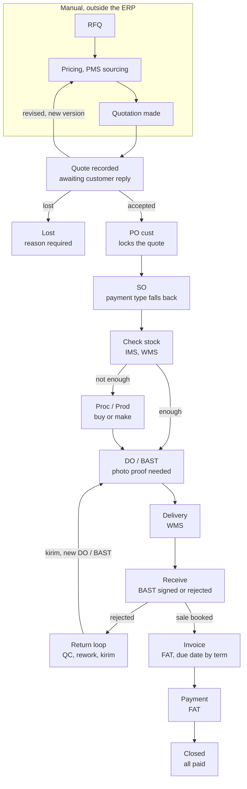
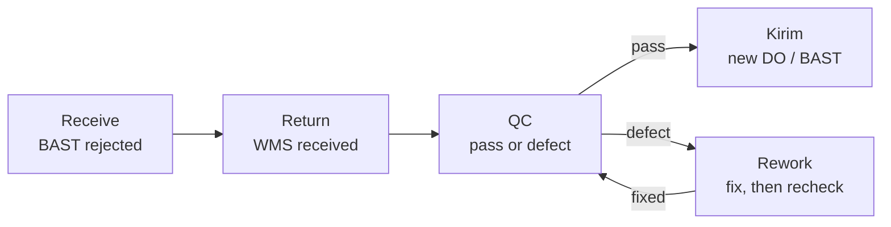

# Sales and Marketing Module

Part of [[Holding ERP]]. Company context is in [[Company Roles and Modules]].

## Overview and scope

The S&M module starts when a quotation is recorded. Everything before that (RFQ, pricing, PMS sourcing, making the quotation) is done manually and stays outside the ERP.

- **In the ERP:** quote record, customer PO, SO, DO / BAST, delivery and receive status, returns and rework
- **Handed to other modules:** stock (IMS/WMS), purchasing or production (Proc/Prod), invoice and payment (FAT)
- **Flows covered:** Tempo (default, credit terms), CBD (cash before delivery), and the Kopken work-first template
- **First build:** CBD first, then tempo and progress (down payment), all starting at Quote recorded. COD and Kopken come later (decisions in [[Holding ERP]], 2026-10-14)
- **Not in Pandu's first release:** POS, CRM and website leads. They are needed later for Anggoan's own selling

> [!warning] Consequence
> Lost-deal reports only cover quotes that were actually recorded. Deals lost before a quote exists are never seen by the ERP.

## Key terms
All terms are in [[Glossary]].

## Records the module owns

Five records carry a deal from quote to delivery. Each one links to the one before it, so any order can be traced back to its quote. Orders from group companies are discussed later (see Pandu baseline).

| Record | Main fields | Statuses | Links to |
|---|---|---|---|
| Quote record | Customer, version (v1, v2...), lines (item, qty, price), total (sum of the lines), payment type (required), validity date, date sent, attached file | Awaiting reply, Accepted, Revised (superseded), Lost | Customer |
| PO cust | PO number, items, qty, price, payment term, delivery address, scan or file | Received, Matched, Mismatch flagged | Accepted quote version |
| SO | Items with our item codes, qty, price, payment type (optional, falls back to quote), delivered qty, invoiced qty, paid qty | Confirmed, Partially delivered, Delivered, Closed, Cancelled | PO cust |
| DO / BAST | Items and qty sent, delivery date, photo proof, customer signature | Created, Delivered, Signed, Rejected | SO |
| Return | Items returned, reason, WMS received date, QC result, rework count | Received, In QC, In rework, Passed, Sent out again | Rejected DO / BAST |

Notes on the quote record:
- Logged at the moment it is sent, so the sent date and validity date are real
- It has item lines, not just a total. That lets the ERP check the PO cust line by line, run the minimum margin check per line, and copy the lines into the SO
- Nego happens outside the ERP. The sales person only records the outcome: accepted (PO cust comes in), revised (new version entered, old one superseded), or lost (reason required)
- Expiry is automatic. Validity date passes with no reply, status becomes Lost (expired). Jingga, 2026-10-14: keep it
- The sales person is warned 3 days before the validity date *(assumed number)*
- An expired quote is never revived. If the customer still wants it, sales makes a new quote version with fresh prices

## Tempo flow (default)

Deliver first, invoice after the BAST is signed, customer pays by the due date from their term. Read it top down. The ERP starts at Quote recorded.

Step notes:
1. **Quote recorded.** Copy of the quote sent to the customer, status awaiting reply. Nego happens outside the ERP. Outcome is one of accepted, revised (new version, back to manual pricing) or lost
2. **PO cust.** Scanned or input, linked to the accepted quote version, which then locks. Differences from the quote (qty, price, term) are flagged
3. **SO.** Built from the PO with our item codes. Tracks delivered, invoiced and paid quantities, including partial deliveries
4. **Check stock (IMS, WMS).** Enough goes to DO / BAST. Not enough goes to Proc/Prod (buy or make flag on the item), which then feeds DO / BAST
5. **DO / BAST.** One document, statuses created, delivered, signed. Can't be signed without a photo
6. **Delivery (WMS), then Receive.** Signed BAST books the sale and triggers the invoice. Rejected goes to the return loop
7. **Invoice and payment (FAT).** Due date from the effective payment term. Order closes when everything is paid

## Return, QC and rework loop

A rejected delivery comes back through WMS and has to pass QC before it ships again. Nothing goes back out without passing QC.

QC is one step with two exits: defect goes to rework, pass goes to kirim. Rework always returns to the same QC step.

- Kirim creates a new DO / BAST linked to the original order. The original BAST stays Rejected, so the history is visible
- The return record keeps a rework count. The limit before scrap or a supplier claim is still open
- After QC, the customer gets the goods again (kirim) or a **credit note**: a document that takes the returned goods' value off what they owe, or leaves them a credit if they already paid. Jingga, 2026-10-14. The credit note needs invoices, so it comes with FAT (Phase 5). Until then only kirim. Who may issue a credit note and whether it needs approval is open
- This is the default loop. Kopken uses a Rework Report instead and gets no new BAST (see the Kopken template below)

## CBD flow

> [!note] First build
> Built first, before tempo (Jingga, 2026-10-14). It is also the default payment type.

In CBD the customer pays before anything ships, so there is no AR and no credit risk.

1. RFQ comes in (on the whiteboard this flow starts at RFQ, see open questions)
2. Check stock. If not enough, go to Prod/Proc, then back to check stock
3. Issue the PI (proforma invoice)
4. Customer pays the PI in full
5. Create the DO / BAST only after payment is confirmed
6. Delivery, customer signs the BAST
7. Order closed (prepaid, nothing left to collect)

> [!important] Rule
> The system blocks DO / BAST creation until the PI is marked paid.

## Kopken work-first template

> [!note] Later
> Not in the first build. Kopken belongs to Sancang, not Pandu.

For Kopken (handled by [[PT Sancang Anugerah Nusantara]], AC service jobs) the work is done first and priced after, the reverse of tempo.

1. Kopken supervisor reports the AC problem to Kopken head office (pusat)
2. Pusat assigns the job to Sancang. Sancang opens an RFQ / WO (the AC job ticket)
3. Work is done. DO / BAST is created with photo proof. No photo, no BAST
4. Quotation is made after the work, with the actual price
5. If Kopken complains, Sancang makes a Rework Report (photos, what was fixed) and goes back to the WO. No new BAST
6. No complaint: Kopken issues their PO
7. Invoice for the finished job, then AR and payment as normal

Build notes:
- Make this an order type on the customer ("work first" vs "PO first"), not hardcoded for Kopken. Same documents, different order
- The Rework Report requirement is also a customer setting
- Add an aging flag on BASTs with no PO yet. Work is already done, so a missing PO is money at risk
- Create the SO automatically when Kopken's PO arrives, so billing still starts from an SO

## Business rules

| Rule | How the system enforces it |
|---|---|
| Payment type lives on the quote | Required field on every quote version (cash, tempo + days, down payment, installment) |
| SO payment type comes from the quote | Taken from the accepted quote version, or from an approved PO cust mismatch (rule below) *(assumed, ask supervisor)* |
| Term change only through the PO cust | The SO has no free term field. Its term comes from the accepted quote. If the PO cust term differs (tempo 45 vs quoted 30), the mismatch is flagged: the GM approves it (Director if no GM) and it becomes the order's term, or sales makes a new quote version *(assumed, ask supervisor)* |
| Quote locks on PO | Once PO cust is linked, that quote version can't be edited |
| Loss needs a reason | Price (customer says too expensive) *(assumed reading of "price too low")*, customer cancelled, no response, expired (auto) |
| Suggested SPPR | The item page suggests an SPPR from the COGS and the default GP (**27 %** from 2026-10-21, set by Marketing Managers). This is the **system SPPR**: Marketing can take it or type a higher one, **never a lower one** (the floor, 2026-10-21). Jingga, 2026-10-21. Built in R2 |
| SPPR below the minimum GP | **Replaced 2026-10-21 by the floor**: an SPPR can't be below the system SPPR, which already keeps 27 % GP, so there is nothing below 17 % to approve. Built in R2: the GM's SPPR approval is gone; earlier waiting SPPRs were closed as refused, kept as history |
| Quote price below 27 % or 17 % GP | A quote price under the default GP (27 %) needs a Manager or up in Marketing, as any price below the SPPR does now. A price **under the minimum GP (17 %) is refused**, with no approval. Jingga, 2026-10-21. Built in R1: refused when Sales proposes it, and an approver can only refuse a waiting one (also on a customer's PO, assumed). PostgreSQL answers only yes or no, so Sales never sees the cost |
| Price comes from the SPPR | A quote line's price fills in from the item's SPPR. Sales can't type a price. Jingga, 2026-10-14 |
| Another price is a proposal | Sales proposes a price with a required reason. **Below the SPPR:** the quote waits and can't be sent until a Manager or up in Marketing approves; refused, the line goes back to the SPPR. **Above the SPPR:** the line takes the price at once and the quote can be sent; Marketing sees it under "Prices above the SPPR". Jingga, 2026-10-14; above changed 2026-10-21 *(ask supervisor to confirm)* |
| Approvers see the margin | The approver sees the COGS and the GP (price - COGS) / price at the proposed price. Sales never does. Below the minimum GP the approver sees a warning (to be replaced by the refusal above). Jingga, 2026-10-21. Who may see the numbers changed on 2026-10-21, see the next row |
| Who sees cost and margin | Only the GM, the Super Admin, the Super User and the Finance manager. Not Marketing, not Finance staff, not Sales, and the Director no longer (2026-10-21). Jingga, 2026-10-21. Built in R3, with the Marketing Manager keeping it to approve prices *(assumed)* |
| No photo, no BAST | DO / BAST can't move to Signed without at least one photo |
| Stock goes out when goods leave | Stock drops when the goods leave the warehouse, so nobody else is promised them *(assumed, ask supervisor and FAT)*. Manual until stock exists (Phase 4) |
| Sale is booked on BAST | Finance books revenue and its COGS together when the BAST is signed, not when the PO arrives or the goods leave. Signed BAST also triggers the invoice (tempo). COGS at the same moment is *(assumed, ask supervisor and FAT)* |
| DO / BAST is one document | One record with statuses (created, delivered, signed, rejected), not two |
| Nothing ships without passing QC | Returned goods go through QC. Rework always goes back to QC before kirim |
| Kirim uses a new DO / BAST | Linked to the original order. The original BAST stays Rejected for history |
| Tempo invoice due date | Comes from the effective payment term (SO or quote) |

## Handoffs to other modules

> [!info] The split that matters
> PMS only gets a price before the customer commits. Proc/Prod spends real money, so it only opens after the SO is confirmed.

| Module | What it does for S&M | Where in the flow |
|---|---|---|
| PMS | Vendor price inquiry when there's no price yet. Nothing gets bought | Before the quote, manual, outside S&M |
| IMS / WMS | Stock check, DO / BAST, delivery, receiving, returns received | Check stock through receive, and the return loop |
| Proc / Prod | Buys or makes the goods when stock is short. Decided by a buy-or-make flag on the item | After SO, when check stock says no |
| FAT | Invoice, AR, payment, books the sale on signed BAST | After receive |

## Costing and pricing (from Jingga, 2026-10-14)
The full model is in [[Finance Accounting Tax Module#Costing and pricing]]. What it means for S&M:
- Sales quotes from the **SPPR** (selling price publish rate) and never sees cost or margin. A quote line's price fills in from the item's SPPR; Sales can't type a price, only propose another one with a reason, approved by a Manager or up in Marketing (Jingga, 2026-10-14). Pandu has no bottom price
- The margin check uses COGS = COGM + DL + FOH, not just the material cost. GP = (price - COGS) / price
- The typed item cost from slice S0 is the **COGM** for now (assumed). DL and FOH are not in the ERP yet, so the S2 margin check needs them first. This changes the S2 plan, see the open questions in the Finance note
- MAP (moving average price) is the costing method, confirmed by Jingga. Procurement sees MAP

## What a customer's PO looks like
From the group's own POs (see [[Procurement Module#The group's PO templates]]): when a group company buys from Pandu, its PO is Pandu's **PO cust**. A customer's PO carries its own PO number and date, a requested delivery date, a **quote reference** (our quote number), the payment term, a delivery address with a PIC, and lines with item, qty, unit, unit price and amount, plus PPN and the grand total. So the PO cust record (slice S3) needs: their PO number and date, delivery date, our quote it answers, payment term, delivery address, lines, and the scan *(Claude's reading, for the S3 plan)*

## Notes from the Inbox
From Jingga's Inbox, processed 2026-10-14. Raw notes, not rules yet.
- **After the SO, Production comes before Procurement.** For goods Pandu makes, a shortage on an SO goes to Production, and Production asks Procurement for the raw materials. Pandu makes what it sells instead of buying finished goods. Fits the buy or make flag on items: make items go to Production first *(assumed reading)*
- **Marketing wants analysis:** sales by customer, favorite products, customer care, and complaints or rejects (voice of customer). Not in the first build. Needs a spec of its own when Marketing is planned. Listed with the other Marketing ideas in [[Pandu Roadmap#Additional features]]
- **Down payment and progress payments come before the invoice, and the payment and the invoice must match.** See [[Finance Accounting Tax Module]]

## Pandu baseline
- **Who Pandu sells to:** outside customers and other group companies. Anggoan is the main one, a B2B buyer, and goes through S&M
- **Group company orders:** intercompany is discussed later. Until then Anggoan is handled like any other customer
- **Outside customers:** full tempo flow, starting at Quote recorded
- **Before Stock and Finance exist (Phase 2):** check stock is a manual "stock confirmed" step on the SO, and a signed BAST sets the order to "handed to FAT". Real stock and invoices are wired in at Phases 4 and 5 (see [[Pandu Roadmap]])
- **What Wening changes:** batch and expiry on DO / BAST lines later, when Production and Stock exist (Phase 6)
- **What the holding view excludes:** Pandu's sales to group companies. Only sales to outside customers count as group revenue

## Open questions
- [x] *(compared 2026-10-21 with the colleague's newest code, `feat/marketing-sppr` of 20 Oct, nothing newer on any branch)* Three R4 and R5 choices. **Jingga approved all three recommendations 2026-10-22, built the same day**: the item page warns when the SPPR in use is below the suggested SPPR (the cost changed after it was set); areas are changed by Sales and Finance Managers and the GM (migration 0053); a city is in one active area only, refused with the other area's name, also when an inactive area comes back. 299 tests pass:
  - **A future SPPR checked against today's cost.** His `sppr_set` checks nothing but a price above 0 and a day not in the past; his floor (never below the system SPPR) is only planned, and his system SPPR is worked out when it is used, from last month's FOH. ERPNext and Odoo keep dated price lists with no cost check when a price is set; ERPNext can check the selling price against the cost on the sale itself. Gap in ours: if the cost rises before a future SPPR's day, that SPPR can be below the floor when it starts, and a quote line at the SPPR is never checked (only proposed prices are). Recommended: keep the check when it is set, and add a flag on the item page (like his margin monitor) when the SPPR in use is below today's suggested SPPR
  - **Who manages areas.** His areas are only planned (FN2: "city / region list, the customer's city fills it in"), no owner named; his customers already have a city. ERPNext's Territory (a tree, picked on the customer) is managed by the Sales Master Manager. Recommended: the same people as customers, Sales and Finance Managers and the GM, instead of Finance and Management
  - **One city in two areas.** Neither his plan nor ERPNext fills an area from a city; territories are drawn so they don't overlap. Recommended: refuse a city that is already in another active area (the message names it), instead of the first code winning
- [x] The colleague's revised Marketing plan (2026-10-20, see [[Colleague Repo Comparison#Their Marketing branch, revised (read 2026-10-21)]]) is **confirmed by Jingga, 2026-10-21**: GP default 27 % and minimum 17 % (refused below), FOH from the general ledger (a standard % until Phase 5), adjustments never below the system value, cost seen only by the GM, supers and the Finance manager, and the ideas (customer area, Finance dashboard, marketing cost, SPPR valid from a day). The code still has the old rules: see the change plan R1 to R5 under Slices
- [ ] *(ask supervisor, S5)* PPN on a PI: built as 11 % on top of the order total before PPN, taken from the colleague's repo, where the customer pays the total with tax. What is the rate, does it differ per item or customer, and how does PPN show on the PI and the later invoice? FAT decides how it shows; the rate is a constant in code until then. Jingga, 2026-10-21
- [ ] *(ask supervisor, S5)* Does a customer pay a CBD PI in parts? Built so (partly paid status and an amount paid, like the colleague's repo), and DO / BAST waits for the full amount. If it is always in full, the parts can go
- [ ] *(ask supervisor, S5)* A wrong payment entry can't be corrected: it can't be changed or deleted, so the PI can't be voided and its order can't be cancelled. Is a reversal needed before FAT?
- [ ] *(ask supervisor, S5)* An order with a payment on its PI can't be cancelled, since refunds come with FAT. Is that right, or should Finance refund first? Jingga said "idk" on 2026-10-21, so this is my call
- [ ] Prefix `PI` for proforma numbers *(assumed)*, like `SQ` and `SO`
- [ ] Does CBD also start at quote recorded, or at RFQ like the whiteboard? Decides if both flows share one entry point
- [x] Credit gate before the SO for tempo customers, like the colleague's repo. Jingga, 2026-10-14. Each customer has a credit limit (0 by default). Exposure = open SOs not yet invoiced + unpaid invoices + the new SO. Over the limit: a warning, the SO waits for approval by a Manager or up in Sales, and no stock is held until approved. Overdue invoices are not checked separately *(assumed)*
- [ ] Rework limit: after how many failed QC rounds does it go to scrap or a supplier claim?
- [x] Check stock is automatic, like the colleague's repo: available stock is held for the SO when it is confirmed, and a shortage goes to Prod/Purch. Same for every payment type. Jingga, 2026-10-14
- [x] Until stock exists (Phase 4), check stock stays a manual "stock confirmed" step on the SO. It becomes automatic in Phase 4. Jingga, 2026-10-14
- [x] A lost deal counts as Closed, like the whiteboard. Jingga, 2026-10-14 *(assumed, ask supervisor to confirm)*
- [ ] Kopken revenue timing: the price only exists after BAST, so when does finance book the sale?
- [x] Minimum margin: settings from the colleague's repo, formula from the office whiteboard ([[2026-10-14 Whiteboard costing and pricing]]). Jingga, 2026-10-14. **Ask supervisor to confirm.** Margin is gross profit on the selling price: GP % = (price - COGS) / price x 100. COGS is the item's moving average cost, like the colleague's repo *(assumed, ask supervisor)*. One % per company: default 20 %, minimum 10 %, both changeable per company *(colleague's numbers)*. The GP formula is the whiteboard's *(ask supervisor to confirm)*. Below the minimum, a Manager or up in Marketing approves before the quote is sent
- [x] Cost method: MAP (moving average price) builds the COGM; VA is value added, not a cost method. Jingga, 2026-10-14 (see [[Finance Accounting Tax Module#Costing and pricing]]). Was: cost method, three things to confirm from the whiteboard: (1) what "VA" means, (2) moving average price, (3) standard price. Which one, and for which items (raw material, packaging, finished Wening goods)? Our pick for now: moving average for every item, with a typed standard cost until Phase 4. Claude's view: moving average is the usual choice in Indonesia, allowed by PSAK 14 and by tax rules (average or FIFO, used consistently), and simple. Picking the oldest batch first for expiry is a warehouse rule and works with any cost method. Standard price can be added later for finished goods if Production wants to compare planned and real cost. Jingga reads the "15 to 22" on the whiteboard as nothing important
- [x] Margin and cost are seen **only by Marketing and the Super Admin and Super User**. Nobody in Sales sees them, so they can't see the profit and push for a raise. Jingga, 2026-10-14, from the Inbox note "Marketing may have a margin, sales may not" *(ask supervisor to confirm)*. A quote line below the minimum only shows "needs approval". The colleague's repo differs: every sales staff who sees or makes a quote sees each line's margin
- [x] A quote below the minimum margin is approved by a Manager or up in Marketing, since Sales can't see margins. Jingga, 2026-10-14 *(ask supervisor to confirm)*
- [x] Until stock exists (Phase 4), Finance types a cost on each item (a standard price) and the margin check uses it. Jingga, 2026-10-14 *(assumed, to change in Phase 4 when the moving average cost exists)*
- [x] Down payment is its own payment type, called progress: a down payment before delivery, then the rest in parts, like the colleague's repo. Built in the first build. Jingga, 2026-10-14. COD comes later. Was: Is down payment its own payment type, or tempo with a first installment? Partly answered in meeting [[2026-10-14]]: sales payment types are ours to decide, default CBD, with COD, progress payment and Net up to 180 days. Which ones S&M builds first still to decide
- [ ] Later, with intercompany: does Anggoan (or another group buyer) get a quote first, or does its PO go straight to an SO?
- [ ] What is PMS? It is not one of the 12 modules. Is it sourcing inside Procurement?
- [ ] Is "cash" on the quote the same as CBD? Installment has no flow yet
- [x] SO term override is approved by the GM. Jingga, 2026-10-14. **Ask supervisor to confirm** where it happens: Claude suggested on the PO cust mismatch, not as a free field on the SO, and Jingga agreed (2026-10-14). Only a looser term (more days, or tempo instead of CBD) needs approval *(assumed)*. A company with no active GM falls back to a Director *(assumed)*
- [ ] Credit note after a return: who issues it, and does it need approval? (comes with Phase 5)
- [ ] Can a BAST be partly rejected, with some lines accepted and invoiced?
- [x] Every sale is in IDR. Meeting [[2026-10-14]]
- [ ] Does a customer need several delivery addresses for the DO / BAST? Foundation keeps one address and one contact per customer for now. The colleague's repo has several of each
- [ ] Later: who owns the PI and its paid status in CBD, S&M or FAT? CBD has no PO cust or SO in the flow, but DO / BAST links to an SO
- [ ] Later: Kopken creates the BAST before any PO or SO exists, and the WO and Rework Report are not records yet. How do they link?

## Acceptance checks
Written before the build. Each one is something Jingga can click through, as Pandu.
- [ ] A sales person records a quote (customer, lines, payment type, validity date, file) and sees it as Awaiting reply
- [ ] Revising a quote makes v2. v1 shows Revised and can't be edited
- [ ] Marking a quote lost asks for a reason. A quote past its validity date shows Lost (expired) by itself, and shows "expires soon" 3 days before
- [ ] A quote line below the minimum margin shows only "needs approval" to Sales. A Marketing Manager sees the GP % and approves or refuses it. A Sales Manager never sees a margin or a cost
- [ ] A customer PO is recorded against the accepted quote version. A different qty, price or term is flagged per line. A looser term waits for the GM. The quote version locks
- [ ] An SO is made from the PO cust and shows its payment type and term, and where they came from
- [ ] A tempo SO over the customer's credit limit waits for a Sales Manager. Under the limit it goes straight to Confirmed
- [ ] "Stock confirmed" on the SO is needed before any DO / BAST
- [ ] CBD: a PI is made from the SO. No DO / BAST can be made until Finance has recorded the full payment on the PI. After the last signed BAST the order is Closed (the PI and its payments are built in S5, the DO / BAST block and Closed come in S6)
- [ ] Progress: a down payment PI is paid before the first DO / BAST. The rest goes to FAT as a schedule
- [ ] A DO / BAST can't be signed without a photo. Partial deliveries update the SO's delivered qty
- [ ] Tempo: a signed BAST sets the delivery to "handed to FAT"
- [ ] A rejected BAST makes a return. QC defect goes to rework, rework goes back to QC (rework count goes up), pass makes a new DO / BAST linked to the same SO. The old BAST stays Rejected
- [ ] Someone from Anggoan, a Super User, or a person without the permission can't see or change any of Pandu's sales records (database rules, with tests)

## Build plan
Written and **approved by Jingga 2026-10-14**. Order: CBD first, then tempo and progress, all from Quote recorded. Phase 2 has no stock (Phase 4) and no invoices (Phase 5), so check stock is a manual "stock confirmed" step and tempo ends at "handed to FAT".

### Changes to Foundation first (finished module, needs approval)
Foundation is done, so these change its data model. Each one is small:
- **Marketing function.** Add `marketing` next to `sales` in the department functions. Both work in the S&M module, but only Marketing sees margins and approves low ones. Pandu gets a Marketing department at seed. Jingga, 2026-10-14
- **Quality function, empty.** Add `quality` to the department functions with no starting grants, so it is ready for the Quality module. QC on returns (S9) is given to Quality. Jingga, 2026-10-14
- **Customer fields** that S&M needs, all promised "with S&M" earlier: NPWP (15 or 16 digits, optional, kept because every column of the Excel sheets is a field when adding a record), credit limit (Rp, 0 by default), default payment type and term (CBD, tempo with Net 1 to 180 days, or progress), set by Sales and Finance Managers
- **Several delivery addresses per customer**, like the colleague's repo (Jingga, 2026-10-14). Built as extra addresses next to the customer's own address, which stays where it is (not copied)
- **Item cost**: a typed standard cost per item, changed only by Finance Managers and up, seen only by Marketing, the GM and the supers. Jingga, 2026-10-14 *(until Phase 4)*. Built: Finance sees it too, every level (Jingga, 2026-10-14)
- **New permission to see cost and margin** (`margin.view`): Marketing, Finance (Jingga, 2026-10-14), the GM and the supers. Jingga, 2026-10-14 *(GM: ask supervisor)*

### Data model
One table per record, each with `company_id`, the read and write rule pair, a company isolation test and the audit log, like every Foundation table.

| Table               | Holds                                                                                                                         | Notes                                                                       |
| ------------------- | ----------------------------------------------------------------------------------------------------------------------------- | --------------------------------------------------------------------------- |
| `sales_settings`    | Per company: default margin 20 %, minimum margin 10 %, quote warning days 3                                                   | *(assumed numbers, colleague's)*                                            |
| `quotes`            | Customer, number, current version, status (awaiting reply, accepted, lost), lost reason and note                              | Lost reasons: price, customer cancelled, no response, expired (auto)        |
| `quote_versions`    | Version number, payment type and term, down payment % for progress, validity date, date sent, file, status (current, revised) | Only the current version can change, and only before a PO cust              |
| `quote_lines`       | Item, qty, unit, price                                                                                                        | GP % is worked out when read, never stored, so cost changes show at once    |
| `customer_pos`      | Quote version, PO number, PO date, payment term, delivery address, scan, status (received, matched, mismatch)                 | One per accepted quote version                                              |
| `customer_po_lines` | Item, qty, price, plus the flag when it differs from the quote                                                                |                                                                             |
| `sales_orders`      | PO cust, payment type and term (copied, never typed), credit check result, stock confirmed (who, when), status                | Confirmed, Partially delivered, Delivered, Handed to FAT, Closed, Cancelled |
| `sales_order_lines` | Item, qty, price, delivered qty                                                                                               | Invoiced and paid qty come with FAT (Phase 5)                               |
| `proforma_invoices` | SO, kind (full for CBD, down payment for progress), subtotal, PPN rate and amount, amount, void (who, when, why)               | No AR, no journal. Paid and status are worked out from the payments |
| `proforma_payments` | PI, amount, day received, reference, recorded by                                                                              | Several per PI, never more than its amount. Never changed or deleted *(assumed)* |
| `deliveries`        | SO, number, date, status (created, delivered, signed, rejected), receiver name, rejection reason, replaces (for kirim)        | The DO / BAST, one document                                                 |
| `delivery_lines`    | SO line, qty                                                                                                                  |                                                                             |
| `delivery_photos`   | Photo files                                                                                                                   | Stored like the KTP scan (`lib/file-storage.ts`)                            |
| `returns`           | Rejected delivery, reason, received by warehouse (who, when), status, rework count                                            | Received, In QC, In rework, Passed, Sent out again                          |
| `return_checks`     | Each QC round: pass or defect, what was wrong, who                                                                            | The rework count is the number of defect rounds                             |
| `approval_requests` | Document, kind (low margin, term mismatch, credit limit), asked by, decided by, decision, note                                | One shared table so there is one "To approve" list *(design choice)*        |

Document numbers in the group's official style (Jingga, 2026-10-14): `SQ-1025-001` for quotes, then SO, PI and DO the same way, numbered per company per month.

### Screens
All under the company, in a new **Sales** menu:
- **Quotes**: list (filter by status, "expires soon"), record a quote, quote page with versions, revise, mark lost, record PO cust
- **Orders**: list, SO page with lines, stock confirmed button, PIs, deliveries and returns on one page, the document chain on top
- **Deliveries**: list for the warehouse, DO / BAST page with photo upload, sign or reject
- **Returns**: list, return page with QC rounds and kirim
- **To approve**: one list of everything waiting for me (low margins, term mismatches, credit limits)
- **Settings, Sales**: margin numbers and warning days (Company Admin)

### Who does what (starting grants, all *(assumed)*, changed on the Roles screen)
| Work | Who |
|---|---|
| Record quotes, PO cust and SOs, mark lost | OPR and up in Sales |
| See margin and cost | Marketing and Finance (every level), the GM and the supers, never Sales (GM: ask supervisor) |
| Approve proposed prices | Manager and up in Marketing |
| Set the SPPR of items | Manager and up in Marketing, with Finance's advice |
| Approve a looser term on a PO cust | GM (Director if no GM) |
| Approve a credit limit overrun | Manager and up in Sales |
| Confirm stock, make and sign DO / BAST, receive returns | OPR and up in Warehouse |
| Make a PI | OPR and up in Sales *(assumed)* |
| Record a payment on a PI | Manager and up in Finance |
| Void a PI that has no payment | Manager and up in Sales or Finance *(assumed)* |
| QC and rework on returns | OPR and up in Quality |
| See all sales records | Everyone in Sales, Marketing, Warehouse and Finance, plus Director and GM |

### Slices
One record end to end each, with the strict code review after each slice.
- [x] **S0. Foundation changes**: Marketing function, customer fields and delivery addresses, item cost, `margin.view`. Built 2026-10-14, see below
  - S0a: Marketing and Quality functions, every company gets both departments, `margin.view` for every level in Marketing and the GM
  - S0b: customer payment term (CBD, tempo Net 1 to 180, progress; CBD for new and existing customers), credit limit in rupiah, NPWP, delivery addresses with add, edit, deactivate
  - S0c: item cost, typed by Finance Managers (`items.cost`), kept in its own table that PostgreSQL only shows to people with `margin.view` or `items.cost`. The audit log keeps that it changed, never the amount
  - Found and fixed: the vendor payment term check in the database let Net through with no days (a NULL slips past a CHECK). The new customer check had the same hole
  - Strict review: 6 fixes (one insert per address, money formatting without floats, shared Net days limit, cleaner payment term field, no cast on the item page, one permission check for "see or change costs"). 206 tests pass, clicked through in a browser
  - Also from Jingga during S0: address, PIC name and PIC phone are required for customers and vendors, PIC email optional. The Excel import checks the same
- [x] **S1. Quotes**: built 2026-10-14
  - S1a: SPPR on items, set by Manager and up in Marketing (and the GM), seen by everyone who sees items, in the item's history
  - S1b: record a quote with lines priced from the SPPR (Sales never types a price), numbered `SQ-PDT-2026-10-0001` per company and month, edit while being prepared. Sales menu with Quotes
  - S1c: Mark as Sent (date, and the file that was sent, PDF, PNG or JPG up to 5 MB), Revise (a new version at today's SPPR, the old one kept), Mark Lost (price, customer cancelled or no response, plus a note)
  - Expires soon shows 3 days before the validity date, Lost (expired) after it. Worked out from the date, not stored
  - Strict review: a sent version's lines can't change in PostgreSQL either, plus 4 tidy ups. 225 tests pass, clicked through in a browser
  - Not in the plan, built *(assumed, easy to change)*: a quote is saved first as **Being prepared**, then marked sent. The spec said a quote is recorded when it is sent, but the price proposals of S2 need it to wait before sending. New quotes are valid 14 days. Sales, Marketing and Finance (every level) and the Director see quotes; Sales records them
  - Left for S2: the Sales settings page (minimum margin, warning days). The 3 days and 14 days are fixed in code until then
- [x] **S2. Price proposals and approvals**: built 2026-10-14
  - S2a: Sales, Pricing: the **FOH rate as a % of COGM** (Finance Managers set it) and the **minimum GP** (Marketing Managers), seen only by people who see costs. COGS = cost x (1 + FOH %). The item page shows COGS and the GP at the SPPR to them
  - S2b: on a quote being prepared, Sales proposes another price for a line with a reason. The quote can't be sent while it waits. Sales, **To approve** lists them for Managers and up in Marketing (and the GM) with the price now, the proposed price, the COGS and the GP now and proposed, and a warning below the minimum GP. Approved: the line takes the price. Refused: it keeps its price, and Sales may propose again
  - Built *(assumed, easy to change)*: editing a quote being prepared resets its lines to the SPPR and drops their proposals; a revision starts at today's SPPR without earlier approved prices; one proposal can wait per line
  - Strict review: one money module, one save helper, a test race fixed. 235 tests pass, clicked through in a browser
- [x] **S3. Customer PO**: built 2026-10-14
  - S3a: on a sent quote that hasn't expired, **Record Customer PO**: their PO number and date, delivery date (optional), payment term, deliver to (the customer's address or one of its delivery addresses), a note, the scan, and per quote line the qty and price before PPN as their PO says (an empty qty means not ordered). The quote becomes **Accepted** and can't be revised or lost after. The quote page shows the PO, with a warning when it differs from the quote and the quoted qty or price under each line that differs
  - S3b: a payment term looser than the quote's waits for the GM on **To approve**, under Payment terms (new permission `quotes.approve_term`). Approved: the PO stands. Refused: the quote waits for the customer again, so Sales can revise it or record a new PO. The quote page lists refused POs with the GM's note
  - Built *(assumed, easy to change)*: looser means CBD, then progress, then tempo, and more Net days among tempo terms. Differences in qty, price or items are only flagged, nobody approves them. The Director can also decide terms, always, not only when there is no GM. While the term waits, the quote already shows Accepted; the SO (S4) waits for the decision
  - Strict review: quote changes now lock the quote, so two at once can't both pass (also for S1's revise, send and lost); deciding a term or a price is one statement, so two decisions at once can't both win; one file response and one item label shared. 246 tests pass, clicked through in a browser
- [x] **S3c. Suggested SPPR and SPPR approval**: built 2026-10-21, from Jingga's answers the same day (rules table: Suggested SPPR, SPPR below the minimum GP)
  - Pricing page: a **Default GP** next to the minimum GP, 20 % until set, changed by Marketing Managers (`items.sppr`)
  - Item page, for people who see costs: a **suggested SPPR** = COGS / (1 - default GP), rounded up to the whole rupiah *(assumed)*, shown next to the SPPR and offered in the Set SPPR dialog. The dialog shows the GP of the typed SPPR and warns below the minimum GP
  - An SPPR below the minimum GP doesn't change the item. It waits for the GM on **To approve**, under SPPRs (new permission `items.approve_sppr`, the GM and the Director). Approved: the item takes it. Refused: the item keeps its SPPR. The item page shows the waiting SPPR
  - *(assumed, easy to change)*: someone who may approve SPPRs (the GM, the Super Admin) sets one below the minimum directly, after the warning. Without a typed cost there is no GP, so the SPPR is set directly. One SPPR can wait per item; a new one can't be set while it waits
  - Data: one column on pricing settings, one new table for waiting SPPRs (company rules and audit like every table). Tests for each rule above
  - Also built *(assumed, easy to change)*: setting an SPPR needs seeing costs too, since its GP is checked. A Director now sees the COGS and GP too (decision 2026-10-21 in [[Holding ERP]])
  - Strict review: everything about the SPPR in one place, one shared helper for approve and refuse. 256 tests pass, clicked through in a browser (Marketing Manager sets, GM approves and refuses)
- [x] **S4. Sales order**: plan approved 2026-10-21, built 2026-10-21 (S4a, S4b, S4c). Step 0 done: the Sell table in [[ERP Best Practices#Phase 2: Sell (order to cash)]] has a Sales order row
  - Jingga, 2026-10-21: made by a **Create Sales Order** button on the quote, not automatically. **Lines come from the customer's PO**, like general practice: a PO price below the quoted price needs a Manager or up in Marketing to approve; a higher price or a different qty is only flagged *(ask supervisor to confirm)*. Compared with general practice, ERPNext, Odoo and the colleague first. **Cancel** by Manager and up in Sales, with a reason, only before any DO / BAST
  - S4a, lower price on the PO: when a PO cust is recorded with a line price below the quoted price, the PO waits for a Manager or up in Marketing on **To approve**, under a new "Prices on customer POs" section, showing the quoted and PO price, the COGS and the GP of both, like price proposals. Approved: the PO stands. Refused: like a refused term, the quote goes back to waiting for the customer, so Sales can revise it or record a new PO. This adds one approval column to the PO cust (S3's table)
  - S4a built 2026-10-21: as planned. Strict review: each decision side (term, price) writes only its own columns, lower lines are picked in the database. Not fixed, logged: approvals now live in four shapes (price proposals, SPPRs, and the term and price on the PO cust). One shared approval engine is the Decide row in [[ERP Best Practices#Foundation and shared engines]], to settle before Procurement. 262 tests pass, clicked through in a browser (lower price on a PO, Marketing refuses, the quote waits again)
  - S4b, create: on an Accepted quote whose PO cust has nothing waiting (term or price), **Create Sales Order** makes the SO, numbered `SO-1026-001` (prefix *(assumed)*, same style as quotes). Lines are copied from the PO cust lines (item, qty and price before PPN as the customer ordered), each linked to its PO line and quote line, with the quoted qty and price kept for comparison. Payment type and term are the quote version's, or the PO cust's when the GM approved a looser term, shown with where they came from. Delivery address and requested date come from the PO cust. The SO page flags each line that differs from the quote, and the chain quote, PO cust, SO on top. One live SO per quote. Status **Confirmed**. Sales, **Orders**: a list and the SO page
  - S4b built 2026-10-21: as planned. Orders are numbered like `SO-1026-016`; lines can't change, PostgreSQL refuses it too. Strict review: one rule for when a quote can become an order (shared by the button and the server), one delivery address text and "quoted" marker, order totals summed in the database, terms compared by value. 267 tests pass, clicked through in a browser (Marketing approves a lower PO price, Create Sales Order, the order page and the Orders list)
  - S4c, stock confirmed and cancel: **Stock confirmed** (who, when) by OPR and up in Warehouse, the manual step until Phase 4, needed before any DO / BAST (S6). **Cancel** with a reason, as decided above; the quote stays Accepted and a new SO can be made from it
  - S4c built 2026-10-21: as planned. The SO page shows who confirmed the stock and when, and who cancelled, when and why. A cancelled order changes no more, PostgreSQL also requires the reason. Strict review: both actions change the order in one statement, so two clicks at once can't both pass. 269 tests pass, clicked through in a browser (Confirm Stock, then Cancel Order with a reason)
  - *(assumed, easy to change)*: a PO term tighter than the quote's doesn't change the SO, it keeps the quote's term with a warning. SO lines can't be edited; to change an order, cancel it and make a new one (like ERPNext's cancel and amend). Stock confirmed can't be undone. A tempo SO goes straight to Confirmed until the credit check comes in S7
  - Statuses: S4 builds Confirmed and Cancelled. Partially delivered and Delivered (S6), Handed to FAT and Closed (S5, S7) come later and are worked out from the lines' delivered qty, not typed (idea from ERPNext and Odoo)
  - Permissions *(assumed)*: `orders.view` for Sales, Marketing, Warehouse and Finance (every level), the Director and the GM; `orders.create` OPR and up in Sales; `orders.confirm_stock` OPR and up in Warehouse; `orders.cancel` Manager and up in Sales
  - Data: `sales_orders` (company, number, quote, quote version, PO cust, customer, payment type and days, where the term came from, delivery address, requested date, status, stock confirmed by and at, cancelled by, at and why) and `sales_order_lines` (PO cust line, quote line, item, qty, price before PPN, delivered qty 0); on `customer_pos`, a price approval (who, when, note) next to the term approval. Company rules, audit and an isolation test like every table. Tests for each rule above
- [x] **S2d. A price above the SPPR**: built 2026-10-21, from the decision 2026-10-21 in [[Holding ERP]]. A proposed price above the item's SPPR applies to the line at once, with its reason, and doesn't stop the quote from being sent. Below the SPPR it waits, like S2. To approve gets a read only section **Prices above the SPPR** (last 30 days *(assumed)*) for Managers and up in Marketing. An item without an SPPR still waits *(assumed)*
  - Built as planned. The quote line shows "Above the SPPR" with the reason. Moving back down to the SPPR or below waits again. To approve shows the item's SPPR now, not the one at the time *(assumed)*. Strict review: one query shared by both proposal lists. 271 tests pass, clicked through in a browser (higher price, quote sent at once, Marketing sees it; lower price waits)
- [x] **S5. PI and CBD**: built 2026-10-21 (S5a, S5b). Compared with the colleague's repo, ERPNext and Odoo first. Jingga: take the colleague's way for PPN with an ask flag, and several payments with a partly paid status; "idk" on cancelling after a payment, so the call below is mine. DO / BAST blocked until the PI is paid comes with S6 (it reads the PI's paid status)
  - S5a: on a **CBD** order with the stock confirmed, **Make Proforma Invoice** (OPR and up in Sales). Numbered `PI-1026-001` *(assumed prefix, like quotes and orders)*. The amount is the order's total before PPN plus PPN at 11 % *(assumed, ask supervisor and FAT: the rate, and whether a company sets its own)*, copied and never typed, frozen in PostgreSQL. Each PI keeps the rate it was made with. One live PI per order. The order page shows it, the chain gets the PI, and a **Proforma invoices** list and page are under Sales. **Void** with a reason (Manager and up in Sales or Finance) while nothing is paid. A voided PI stays as history and the order may get a new one
  - S5b: **Record Payment** (Manager and up in Finance): amount, the day it was received (today or earlier), a reference (optional *(assumed)*). Several payments may add up to the PI, never more. The status is worked out from the payments, never typed: Open, Partly paid, Paid (and Void). Payments are never changed or deleted *(assumed, ask supervisor: a wrong payment can't be corrected until FAT)*. A PI with a payment can't be voided
  - Cancelling an order voids its unpaid live PI with it. An order whose PI has any payment can't be cancelled, since a refund comes with FAT *(assumed, my call after "idk", ask supervisor)*
  - Data: `proforma_invoices` (order, kind full, subtotal, PPN rate and amount, amount, void who, when and why) and `proforma_payments` (PI, amount, day received, reference, who). Company rules, audit and tests like every table; PostgreSQL also refuses an over payment, a void with a payment, and any change to a payment or to a PI's amounts. New permissions *(assumed)*: `invoices.view` (Sales, Marketing, Warehouse and Finance at every level, the Director, the GM), `invoices.create` (Sales, every level), `invoices.record_payment` (Manager in Finance, the GM), `invoices.void` (Manager in Sales or Finance, the GM)
  - Strict review: one order total expression shared by the orders list and the PI, one reason dialog for cancel and void, order changes take an options object, the order page's PI part split out. 283 tests pass, clicked through in a browser (make a PI, record a part payment, cancel refused)
- [x] **R. Costing rules change** (Jingga confirmed 2026-10-21, from the colleague's revised Marketing branch): **plan approved by Jingga 2026-10-21**, with my recommendations for R3 *(assumed)*: the Marketing Manager keeps `margin.view` to approve prices, the Director drops out. It changes slices S2, S3c and S2d, so the data model of finished slices changes too. The spec now wins over the code (rules table above)
  - **R1, GP numbers and a refusal.** Default GP 27 % and minimum GP 17 % (the code's defaults and database column defaults, today 20 and 10; companies that never changed them move to the new numbers *(assumed)*). A proposed quote price whose GP is under the minimum is **refused when proposed** with a plain message to Sales (who never sees the margin: "this price is too low"), not approved. A price below the SPPR still waits for a Manager or up in Marketing (it is under 27 % by definition once the SPPR is the system SPPR)
  - **R2, the floor.** An SPPR can't be set below the suggested (system) SPPR, COGS / (1 - default GP). Item without a typed cost: still set directly *(assumed, no system value to compare with)*. This leaves no SPPR for the GM to approve, so the SPPR approval flow of S3c goes: the section on To approve, the proposals code and the permission `items.approve_sppr` (kept: the `sppr_proposals` table with its history, since nothing is ever deleted; no new rows). Marketing may still type a higher SPPR
  - **R3, who sees cost.** `margin.view` for the GM, the Finance Manager and the supers only; taken from Marketing, Finance staff and the Director. PostgreSQL's rule on item costs follows, since it reads the same permission. Clash to settle: a **Marketing Manager approves price proposals and today sees COGS and GP** to do it. Recommended: the Marketing Manager keeps `margin.view`, because an approver needs the number, and the colleague's own MK4 step says the marketing manager sees the GP number; the Director drops out. *Ask Jingga*
  - **R4, SPPR valid from a day.** An SPPR change takes effect from a day (today or later), with history of earlier ones, instead of replacing the value at once. Needs a new `sppr_rates` table (item, SPPR, valid from, who) and the item's SPPR read from it; the segment rates stay planned. Bigger than R1 to R3, so its own commit
  - **R5, customer area.** A customer gets an area, filled in from its city (a list of areas per company, set by Finance or Management *(assumed)*). A small Foundation change. Feeds the Finance dashboard later
  - **Phase 5, not built now:** FOH from the general ledger (spread over the month's products by sales value, last month's FOH % for pricing); COGS adjustments by Finance with their floor; the Finance dashboard (revenue and value added by product, type, day, week, month and area; GP by month and area; net profit) and marketing cost (campaigns, budgets by category). Until the ledger exists the standard FOH % of COGM, set by Finance Managers, stays
  - Tests: each rule, as usual; the rules table above lists them. The existing tests for the old numbers and for SPPR approval change with the rules (they pin the old behavior), so this is the one place they are rewritten, not just added to. Strict review after the whole of R
  - Order I recommend: R1, R2, R3 first (small, they correct rules that are wrong today), then S6a, then R4 and R5 between S6 and S7
  - **R1 to R3 built 2026-10-22.** R1: 27 % and 17 %, companies on the old numbers moved, a price under the minimum refused when proposed and only refusable when waiting (PostgreSQL function `price_under_minimum_gp`). R2: the floor, the GM's SPPR approval and `items.approve_sppr` gone, waiting SPPRs closed as refused. R3: `margin.view` only for the GM, Finance and Marketing Managers and the supers, taken back from everyone else by migration. Strict review: one exact GP check shared by the screens and PostgreSQL, so they never disagree at the edge, and the Pricing page text fixed. 282 tests pass
  - **R4 built 2026-10-22**: an SPPR is set with a "valid from" day (today or later) and kept in `sppr_rates`; the SPPR in use is the latest one whose day has come, else the item's SPPR from before rates. The item page shows SPPRs still to come and the earlier ones. The floor is checked against today's cost, also for a later day *(assumed)*. Quotes already made keep their prices
  - **R5 built 2026-10-22**: Master data, **Areas** (code, name, the cities in it), changed by Finance and Management Managers and the GM *(assumed)*, seen by everyone who sees customers. A customer has a City and an Area; the area is picked, or filled in from the city (the first active area listing it, capitals ignored). Migrations 0051 and 0052
  - Strict review of R4 and R5: an area keeps a city as first typed. Kept on purpose: the SPPR in use falls back to the item's old SPPR, so items from before rates keep theirs. 298 tests pass, clicked through in a browser (an SPPR from tomorrow, an area BDG with its cities, the area on Add Customer)
- [x] **S6. DO / BAST**: plan **approved by Jingga 2026-10-21**, built 2026-10-22 (S6a, S6b). When stock goes out stays flagged *(ask supervisor)*. Create (partial qty), deliver, sign with photo or reject. CBD order closes after the last signed BAST
  - Compared first (2026-10-21). ERPNext: the delivery note is made from the order with a link to each order line, so partial delivery just adds up; stock goes out when it is submitted; a return is its own document. Odoo: a delivery in steps (pick, pack, ship). The colleague's repo: prepared, shipped, then delivered or refused; at most what is left on the line; cancel only before it leaves; stock reserved per line. Ours is closest to the colleague's, with Warehouse doing every step and a signed BAST as the end. No new gap. The colleague's repo was checked again on 2026-10-21: still at `f0f1fff` (18 Oct, Maintenance and Engineering work), nothing newer on deliveries. Three points compared in depth, below
  - **One document, statuses**: Created (prepared, nothing left yet), Delivered (the goods left the warehouse), Signed (the customer received them) or Rejected, plus Cancelled for a Created one that was a mistake *(assumed)*. Moves only forward, and Signed and Rejected are final
  - **S6a, create and cancel.** On an order, **Create DO / BAST** (a page with each line's qty, filled with what is left, 0 skips a line). Numbered `DO-1026-001` *(assumed prefix)*. It is refused unless: the order is Confirmed with its stock confirmed (S4c) and is **CBD** with its PI **fully paid** (the rule from the CBD flow; a part payment is not enough). **S6 is CBD only**: a tempo order can be delivered once S7 builds its credit check, and a progress order once S8 builds its down payment gate, so nothing ships past a gate that doesn't exist yet. Same in the colleague's repo (a credit held order can't be delivered, CBD and progress wait for their payments) and in ERPNext (credit limit checked at the order or at delivery) Each line is at most what is left (qty minus delivered minus what other Created DOs hold), never more *(assumed, no over delivery)*. Cancel a Created DO with a reason. The order page gets a Deliveries part and the quote to PO to SO to PI chain gets the DO. **Deliveries** list and DO page under Sales. An order with a DO that isn't Cancelled or Rejected can't be cancelled (S4c said so), the same place as the PI rule
  - **S6b, deliver, sign, reject.** **Mark Delivered**: the order lines' delivered qty goes up by the DO's qty, in one transaction *(stock goes out when the goods leave: the rules table, the colleague's repo, ERPNext and Odoo all agree; when COGS is booked is FAT's question)*. **Sign**: receiver's name, the day received (not before it left, not in the future) and **at least one photo** of the signed BAST (PNG, JPG or a PDF scan, up to 10 MB each, at most 10 per DO, the colleague's limits *(assumed)*), kept like the quote's file. No on screen signature: the customer's signature is the signed paper in the photo, with the receiver's name typed, as in the colleague's repo "No photo, no BAST" is also a PostgreSQL rule, so no way around it. **Reject**: a reason; the delivered qty goes back down so the goods can be sent again; the return, QC and kirim come in S9. The whole BAST is signed or rejected, never in part *(assumed, already an open question)*
  - **Order status**, worked out and never typed: Confirmed, Partially delivered, Delivered (every line's qty has left), **Closed** for a CBD order when every line is covered by signed BASTs (prepaid, nothing left to collect), Cancelled. A tempo order stays Delivered until S7 hands it to FAT. The orders list and page show it
  - Data: `deliveries` (company, number, order, status, who and when for each step, receiver name, day received, reject reason, cancel reason), `delivery_lines` (DO, order line, qty; frozen once made) and `delivery_photos` (DO, file, type, who, and when the file was removed). **Photos expire**: 365 days after signing (a rejected or cancelled DO's photos too) a script deletes the file and keeps the row marked removed, so the page says "photo removed" *(assumed, Jingga 2026-10-21: photos should disappear after some time)*. Company rules, audit and an isolation test like every table. PostgreSQL also keeps: status moves only forward, Signed needs a photo, Signed and Rejected can't change, a line can't pass its order line's qty. No driver or vehicle yet (WMS logistics, M5)
  - Permissions *(assumed)*: `deliveries.view` (Sales, Marketing, Warehouse and Finance at every level, the Director, the GM), `deliveries.create` (create and cancel, Warehouse OPR and up), `deliveries.handle` (Mark Delivered, Sign, Reject, Warehouse OPR and up, as the spec's "make and sign DO / BAST")
  - Tests for each rule: photos older than the retention are removed and the DO says so, newer ones stay; no DO before stock is confirmed or a CBD PI is fully paid (a part payment is refused), tempo and progress refused for now, a cancelled order refused; partial qty, over delivery refused, two Created DOs can't pass the order together; delivered qty up on Mark Delivered and back down on Reject; Sign needs a photo (in the app and in PostgreSQL), a receiver and a sensible day; final statuses can't change; the order shows Partially delivered, Delivered and Closed; an order with a live DO can't be cancelled; permissions and company isolation, including the photo file
  - Screens at the end: order page Deliveries part, Create DO / BAST page, Deliveries list, DO page with photos and the step buttons, clicked through in a browser as Warehouse
  - **Built as planned.** S6a: create (CBD with a fully paid PI only), partial qty, cancel while Created, Deliveries list and DO page, an order with a live DO can't be cancelled (its Cancel button hides). S6b: Mark Delivered, Sign (receiver, day, 1 to 10 photos), Reject, the order's status worked out from its lines (Confirmed, Partly delivered, Delivered, Closed for CBD), photos removed after 365 days by `pnpm db:purge-photos`. Migrations 0049 and 0050
  - Built *(assumed, easy to change)*: the photos of one signing are at most 20 MB together, so they fit one upload (server actions now take 25 MB). HEIC and WebP phone photos are not read yet
  - Strict review: one order status rule (the page used to work it out twice), DO steps take one options object, a named blank or zero check. 293 tests pass, clicked through in a browser (Create DO / BAST, Mark Delivered, Sign with a photo, the order Partly delivered)
- [x] **S7. Tempo**: plan **approved by Jingga 2026-10-22**, built the same day (S7a, S7b). Jingga took the recommendation: all live tempo orders count in the exposure until FAT. Credit check on the SO with Sales Manager approval, signed BAST hands the delivery to FAT
  - Compared first. The colleague's repo (still `f0f1fff` on `main`, nothing newer on deliveries or orders): a tempo order whose customer's open amount plus this order passes the credit limit gets status `credit_hold` until the department manager approves; open amount = his live orders (on hold, confirmed, partly delivered, delivered) not yet invoiced, plus unpaid invoices once they exist; order totals with tax; a held order holds no stock and can't be delivered. ERPNext: checked when the order is submitted (outstanding = unpaid invoices + unbilled orders + unbilled deliveries), a credit controller role can pass it, also an overdue limit. Odoo: a warning only. Ours (decided 2026-10-14) matches the colleague's
  - **S7a, credit check.** When a **tempo** order is made, its customer's exposure is worked out: the order totals of the customer's live tempo orders (not cancelled) plus this one, **with PPN** at the same 11 % as the PI *(assumed, like the colleague's totals with tax; the limit is what the customer may owe)*. Unpaid invoices join it in Phase 5. Over the customer's credit limit (Rp 0 unless set, so every tempo order is checked until Finance sets limits): the order is **Waiting for credit approval** instead of Confirmed, and holds nothing: no stock confirmed, no DO / BAST. It waits on **To approve** under a new "Credit" section for a **Manager or up in Sales** (Jingga, 2026-10-14; new permission `orders.approve_credit`, the GM too, not the Director *(assumed)*), who sees the limit, the exposure before and with this order, and by how much it passes. **Approved**: Confirmed. **Refused** with a note: the order is cancelled with the note as the reason; the quote stays Accepted, so Sales can make a new order, or revise the quote to CBD *(assumed, the colleague calls it rejected)*. Under the limit: Confirmed at once, as now. The check runs once, when the order is made *(assumed; ERPNext can check again at delivery)*
  - **S7b, tempo delivery and handed to FAT.** A Confirmed tempo order with its stock confirmed gets DO / BASTs like CBD, without a PI (the S6 gate for tempo goes). A **signed** BAST of a tempo order is **Handed to FAT**: the DO shows it, with the due date its invoice will have (the day received plus the order's Net days, the rules table's "Tempo invoice due date") *(shown only, FAT makes the invoice in Phase 5)*. The order's status becomes **Handed to FAT** once signed BASTs cover every line (CBD still becomes Closed). A **To invoice** list under Sales for Finance: signed tempo BASTs with customer, order, amount before PPN and due date, oldest first, so nothing delivered is forgotten before FAT exists *(assumed, idea from the colleague's "invoice from received deliveries")*
  - Consequence to know: nothing is invoiced or paid in Phase 2, so a customer's tempo orders stay in the exposure until FAT (Phase 5) brings invoices and payments. A busy customer will soon pass a small limit and each new order goes to the Sales Manager. That is the safe side; the alternative (count only orders not yet handed to FAT) would let unpaid goods out of sight. *Ask Jingga which*
  - Data: on `sales_orders`, a credit approval (pending, approved, refused; who, when, note) plus the limit and exposure when checked, kept for the approver and history; the status check gains nothing new, "waiting for credit" is worked out from the pending approval like the other order statuses. No new table. Permission `orders.approve_credit`
  - Tests for each rule: under the limit Confirmed, over it waiting; exposure counts live tempo orders with PPN, not cancelled ones and not CBD; a waiting order can't get its stock confirmed or a DO; approve and refuse (refused is cancelled with the note, the quote stays Accepted); only Sales Managers and the GM decide; tempo DO without a PI; a signed tempo BAST is Handed to FAT with its due date; the order Handed to FAT once all is signed; the To invoice list; company isolation
  - Screens: To approve, Credit section; the order page shows the credit approval and, for tempo, Handed to FAT; the DO page shows Handed to FAT and the due date; Sales, **To invoice**
  - **Built as planned.** S7a: the credit check when a tempo order is made (the customer is locked, so two orders at once are counted in turn), Waiting for credit approval holds the stock and DOs, To approve has a Credit section for Sales Managers and the GM, refused cancels the order with the note. S7b: tempo DOs without a PI, a signed tempo BAST shows Handed to FAT with its due date, the order becomes Handed to FAT once all is signed, Sales, **To invoice** lists them soonest due first. Migration 0054. The PPN rate now lives in one place for the PI and the credit check
  - Strict review: a confirm-stock refusal now says why (already confirmed, or waiting for credit). Checked: any member of a company may lock a customer row in PostgreSQL, so a Sales OPR's order is counted the same way. 304 tests pass, clicked through in a browser (approve on To approve, a signed tempo BAST on To invoice with its due date)
  - Open questions it raises: exposure with or without PPN; count CBD and progress orders too (planned: tempo only, progress decided in S8); who besides Sales Managers may pass a limit (ERPNext has a credit controller role); an overdue limit (needs invoices, Phase 5)
- [ ] **S8. Progress**: down payment PI before the first DO / BAST, the rest handed to FAT as a schedule
- [ ] **S9. Returns**: from a rejected BAST, QC rounds, rework count, kirim with a new DO / BAST

### Open questions this plan raises
- [ ] *(ask supervisor, flagged by Jingga)* Stock and the order's delivered qty go down when the goods leave (Delivered), not when the BAST is signed. **Jingga, 2026-10-21: ok, build it, but flag it.** Compared: the colleague's repo at "shipped", ERPNext at the delivery note, Odoo at validating the delivery
- [ ] *(my recommendation, ask FAT in Phase 5)* COGS timing. The colleague books COGS when goods leave; ERPNext too (or into a "delivered not billed" account); Odoo with the invoice. Ours books revenue and COGS together on the signed BAST, which matches PSAK 72 when the BAST is the customer's acceptance. Recommended: keep ours. When the ledger comes, goods that left but aren't signed sit in a "delivered, not yet accepted" stock account, and the signed BAST moves them to COGS with the revenue. Nothing to build in S6, which moves quantities only
- [ ] *(my recommendation)* A rejected BAST. The colleague keeps the delivered qty and counts returned and replacement qty on the delivery lines. Recommended: ours, the delivered qty goes back down on Reject, so "delivered" always means "left and not rejected" and the line is owed again for the new DO / BAST (kirim). The rejected DO keeps its lines, so what came back stays visible; S9 adds the return record, QC and the physical stock coming back
- [ ] *(ask supervisor, S6)* Photo retention, Jingga 2026-10-21 (on the signature and photo question): the photos of a BAST disappear after some time. Planned: the file is deleted 365 days after the BAST is signed, and the DO keeps who, when and "photo removed on <date>" *(assumed length, easy to change, one constant)*. A year covers the longest tempo term (180 days) and a late dispute. Question: is a year right, and does FAT or tax need the signed BAST kept longer than that (I believe tax records have to be kept for years, FAT to confirm)? A cleaner `pnpm` script does the removing, run daily when the app is on AWS
- [ ] *(ask supervisor, S6)* Signature and photo. Compared 2026-10-21: the colleague's repo asks for the receiver's name and a date between shipped and today, with the photo of the signed BAST optional (JPG, PNG, WebP, HEIC or PDF, 10 MB, 10 per document). Ours requires at least one photo ("No photo, no BAST"), no on screen signature, PNG, JPG or PDF. The ERPNext and Odoo notes in the vault show no delivery signature or photo rule. Phone photos in HEIC or WebP are not read yet *(assumed)*
- [ ] Is over delivery ever allowed (the customer takes more than the PO)? Planned: never
- [x] Several delivery addresses per customer, like the colleague's repo. Jingga, 2026-10-14
- [x] A CBD PI is marked paid by Finance, Manager and up. Jingga, 2026-10-14. The colleague's repo lets sales staff and managers record it (there was no finance role then), and later added an accountant role that can too
- [x] Quote prices are stored without PPN. Jingga, 2026-10-14. How PPN shows on documents comes with FAT
- [x] Document numbers follow the group's official style, like Pandu's `LK-0825-008`: prefix, month and year, then a number per company and month, so quotes are `SQ-1025-001`. Jingga, 2026-10-14. The SQ prefix is *(assumed)*: what does Pandu call its quotes today?
- [x] The GM sees margins. Jingga, 2026-10-14 *(ask supervisor)*
- [ ] Partly rejected BAST (some lines accepted): the plan rejects the whole BAST *(assumed)*. Was already open above
- [ ] Rework limit: the plan only counts rounds, no scrap *(assumed)*. Was already open above
- [x] QC on returns is done by Quality, a new empty department function. Jingga, 2026-10-14. Was: the plan said Production. The colleague's repo lets anyone in the company with the returns permission do it (every level except director and viewer), since it has no departments in roles
- [x] Progress uses the colleague's default: 30 % down before delivery, the rest 30 days after delivery, changeable per order. Jingga, 2026-10-14 *(ask supervisor)*
- [ ] From S3: is the order of payment terms right (CBD is tightest, then progress, then tempo with fewer days)? It decides which PO terms wait for the GM *(assumed)*
- [ ] From S3: should a PO with a different qty or price (not term) also need someone's approval, or is the flag enough? *(assumed: the flag is enough)*
- [ ] From S3: can the Director always decide a looser term, or only when the company has no GM? *(assumed: always)*
- [ ] From S4: a PO term tighter than the quote's (Net 14 against a quoted Net 30): does the SO take the customer's tighter term? *(assumed: no, the quote's term with a warning)*
- [ ] From S4: is `SO` the prefix Pandu uses for sales orders today?
- [ ] Does Pandu price per distributor, segment or customer (Dis A Surabaya, Dis B Bandung)? Planned design if yes: the SPPR stays the base, a segment or customer price overrides it, the most specific wins, each with a start date, set by Marketing with the GP check (decision 2026-10-21 in [[Holding ERP]])
- [ ] Market price survey (idea from the colleague's MK2): who records competitor and shop prices (Sales, Marketing or both), and which fields (where, brand, pack size, price, date, photo)? Each item would show the low, average and high market price next to the SPPR
- [ ] SPPR with a start date and history (idea from the colleague's MK3): Marketing sets the next SPPR ahead of time. Does a quote made before the date keep the old price, and does a revision take the new one?
- [ ] Marketing reports (idea from the colleague's MK5, and the Inbox note above): which first? Gross margin by customer, item and month; sold price against the SPPR at the time; returns, rejected deliveries and QC rejects by customer and item (voice of customer); a Marketing home with requests waiting and items under the minimum GP
