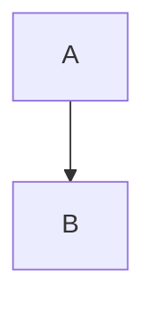

# {{title}}

Part of [[Holding ERP]]. Company context is in [[Company Roles and Modules]].

## Overview and scope
- **In the ERP:**
- **Handed to other modules:**
- **Which companies use it:**

## Comparison
Ours, general and the colleague's, refreshed at the start of the phase: [[ERP Best Practices]] (this module's section). Gap and Decide rows from it are in Open questions below.

## Key terms
| Term | Meaning | Who makes it |
|---|---|---|
| | | |

## Records the module owns
| Record | Main fields | Statuses | Links to |
|---|---|---|---|
| | | | |

## Main flow

## Business rules
| Rule | How the system enforces it |
|---|---|
| | |

## Handoffs to other modules
| Module | What it does for this module | Where in the flow |
|---|---|---|
| | | |

## Pandu baseline
- What Pandu does here today:
- What Wening changes (batches, expiry, formulas):
- Records that cross into Anggoan:
- What the holding view excludes:

## Open questions
- [ ] 

## Acceptance checks
Written before the build. Each one is something Jingga can click through.
- [ ] 

## Build plan
Filled in by Claude and approved before any code.
- Data model:
- Screens:
- API:
- Slices (small, one record end to end):
  - [ ] 
